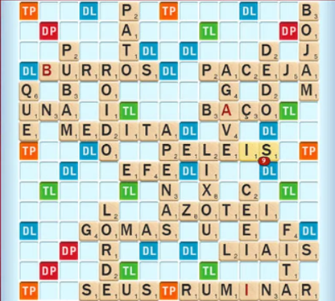

##  

O conteúdo dessa aula é baseado em **partes dos capítulos 2 e 3** do livro abaixo.

{fig-align="center" fig-alt="Capa do livro de Potter e Zingaro." style="max-height: 50vh; width: auto;"}

# Características de boas funções (cont.) {background-color="#40666e"}

##

Na aula anterior, vimos um [guia para criarmos boas funções]{.alert}:

1. Uma tarefa clara a realizar
2. Comportamento claramente definido
3. Poucas linhas de código
4. Uso geral em vez de uso específico
5. Entrada e saída claras

## Exemplos de **boas** funções folha

- _Calcular o volume de uma esfera_ 
  - Dado o raio da esfera calcula seu volume.
- _Encontrar o maior número em uma lista_
  - Dada uma lista, retorna seu maior valor.
- _Verificar se a lista contém um valor específico_ 
  - Dada uma lista e um valor, retornar True se ela tem o valor e False em caso contrário.

## Exemplos de **boas** funções folha

- _Exibir o estado de um jogo de Xadrez_
  - Dada uma lista 2D representando o tabuleiro do jogo, exibir o tabuleiro na tela em formato texto.
- _Inserir um valor em uma lista_
  - Dada uma lista, um novo valor e uma posição na lista, retornar uma nova lista que é a lista original com o novo valor inserido na posição especificada.

## Funções folha **ruins**

Vamos agora ver alguns exemplos de funções folha ruins e porque elas são ruins.

. . .

_Pedir informações fiscais de um usuário e calcular seu imposto de renda_

- Calcular imposto de renda envolve vários cálculos que deveriam ser implementados em funções separadas.

## Funções folha **ruins**

_Remover o maior valor de uma lista_

- Pode não parecer ruim a princípio, mas veja que estamos fazendo duas coisas.
  - Precisamos encontrar o maior valor na lista.
  - E precisamos remover um valor da lista.
- Assim, seria mais reutilizável ter uma função folha para cada subtarefa.
  - Obs.: pode ser útil criar uma função não folha que chama as outras duas se isso for usado várias vezes em um sistema.

## Funções folha **ruins**

_Dado um conjunto de dados estatísticos de partidas de futebol, retornar os nomes dos zagueiros que correram mais de 8 km_

- Há muita informação específica nesse caso.
- Claramente a distância percorrida poderia ser um parâmetro.
- Mas, se pensarmos bem, inclusive a posição dos jogadores poderia ser um parâmetro.
- Melhor ainda seria se a própria estatística fosse um parâmetro.
  - Poderíamos querer consultar, por exemplo, o nome dos goleiro que fizeram mais que 10 gols.

## Funções folha **ruins**

_Determinar o melhor filme de todos os tempos_

- O problema dessa função é que ela é muito vaga.
  - O que define o que é um bom filme?
  - Quais filmes deveriam ser considerados?
- Seria mais claro se a função recebesse uma lista de filmes com suas respectivas avaliações e um número limite de avaliações.
  - E retornasse os filmes melhor avaliados que tivessem, no mínimo, o número de avaliações passado como limite.

## Funções folha **ruins**

_Jogar Call of Duty_

- Precisa explicar? 🤓
 
# Dica: escolhendo sugestão do Copilot  {background-color="#40666e"}

##

Quando pedimos ao Copilot para gerar um código, podemos avaliar outras possíveis sugestões dele.

. . .

Para exemplificar isso, suponha que vamos criar um programa para jogar `Scrabble`.

{fig-align="center" fig-alt="Jogo de tabuleiro Scrabble em português."}

##

{fig-align="center" fig-alt="Jogo de tabuleiro Scrabble em português."}

É um jogo de tabuleiro baseado em palavras-cruzadas.

##

{fig-align="center" fig-alt="Jogo de tabuleiro Scrabble em português."}

Dois jogadores devem ir completando palavras em um tabuleiro com peças de letras.

- E, cada vez que um jogador consegue incluir uma palavra, ele ganha pontos de acordo com as letras da palavra.

##

Vamos trabalhar aqui apenas com a função que calcula os pontos de uma palavra.

- O cabeçalho e docstring abaixo mostram como é o cálculo na versão do jogo em português.

. . .

```python 
def numero_de_pontos(palavra):
    """
    Cada letra na palavra vale os seguintes pontos:
    a, e, i, o, u, m, s, r, t: 1 ponto
    d, l, c, p: 2 pontos
    n, b, ç: 3 pontos
    f, g, h, v: 4 pontos
    j: 5 pontos
    q: 6 pontos
    x, z: 8 pontos

    palavra é uma palavra formada por letras (caracteres minúsculos)
    Retorna a soma dos pontos de cada letra da palavra
    """
```

## 

Uma possível resposta do Copilot para o corpo da função é:

```python 
    pontos = 0
    for letra in palavra:
        if letra in "aeioumsrt":
            pontos += 1
        elif letra in "dlcp":
            pontos += 2
        elif letra in "nbç":
            pontos += 3
        elif letra in "fghv":
            pontos += 4
        elif letra == "j":
            pontos += 5
        elif letra == "q":
            pontos += 6
        elif letra in "xz":
            pontos += 8
    return pontos
```

## 

O código parece razoável, e nosso próximo passo seria testar a função.

- Mas o ponto que quero mostrar aqui é como escolher as sugestões do Copilot.

## 

Quando o Copilot sugere o código, ele aparece esmaecido e em itálico.

- Antes de apertarmos <kbd>TAB</kbd> para aceitar o código, 
- podemos avaliar outras sugestões que o Copilot oferece.
  - Isso pode ser feito passando o mouse sobre o código e escolhendo no painel que aparece acima do código.
  - Ou pelo atalho <kbd>ALT</kbd> + <kbd>]</kbd> para ver a próxima sugestão ou <kbd>ALT</kbd> + <kbd>[</kbd> para ver a anterior.

##

Uma segunda sugestão feita pelo código para o corpo da função foi:

```python 
    pontos = {
        'a': 1, 'e': 1, 'i': 1, 'o': 1, 'u': 1, 'm': 1, 's': 1, 'r': 1, 't': 1,
        'd': 2, 'l': 2, 'c': 2, 'p': 2,
        'n': 3, 'b': 3, 'ç': 3,
        'f': 4, 'g': 4, 'h': 4, 'v': 4,
        'j': 5,
        'q': 6,
        'x': 8, 'z': 8
    }
    total = 0
    for letra in palavra:
        total += pontos.get(letra, 0)  # Adiciona o valor da letra ou 0 se não estiver no dicionário
    return total
```

. . .

Repare que ela é bem diferente da anterior.

##

Essa segunda sugestão usa um [dicionário]{.alert} para guardar o valor de cada letra.

- Um dicionário do Python é uma estrutura similar a um `HashMap` do Java.

. . .

No código, o dicionário `pontos` usa as letras como chaves e os pontos correspondentes como valores.

- Assim, ao percorrer a palavra uma letra de cada vez.
  - podemos consultar o dicionário para buscar quanto vale a letra.

## 

::: {.nonincremental}
Em uma terceira sugestão, o Copilot fez a soma dos pontos em uma única linha, trocando o trecho

::: {.fontsize125}
```python 
    total = 0
    for letra in palavra:
        total += pontos.get(letra, 0)  # Adiciona o valor da letra ou 0 se não estiver no dicionário
    return total
```
:::

por

::: {.fontsize125}
```python 
    return sum(pontos.get(letra, 0) for letra in palavra)
```
:::

:::

- Esse tipo de construção usando [list comprehension]{.alert} é muito comum em Python.

##

::: {.callout-tip}
Você pode fazer com o que o painel de escolha das sugestões do Copilot fique sempre visível, 
para não precisar passar o mouse sobre o código para acessá-lo.

Para isso, quando ele aparecer uma vez, acesse os botão de três pontos ao final do painel e 
escolha a opção _Always show toolbar_.
:::

##

Para fechar o exemplo, suponha que o Tião está jogando Scrabble

- e tem três palavras que poderiam ser encaixadas agora: _zape_, _pazes_ e _pizza_.
- ele gostaria de saber qual palavra dá mais pontos.

. . .

O que acha do cabeçalho abaixo para uma função que retorne a melhor dessas três palavras?

::: {.fontsize125}
```python
def melhor_palavra(palavra1, palavra2, palavra3):
```
:::

##

::: {.fontsize125}
```python
def melhor_palavra(palavra1, palavra2, palavra3):
```
:::

De acordo com o **guia para criarmos boas funções** essa não é uma boa função, por que?

- Ela poderia ser mais geral, funcionando para qualquer quantidade de palavras.
- Poderíamos, por exemplo, receber uma lista de palavras como parâmetro.

. . .

Vamos então melhorar a definição da função.

##

::: {.fontsize125}
```python
def melhor_palavra(palavras):
    """
    palavras é uma lista de palavras.

    Retorna a palavra com a maior pontuação.
    """
```
```python {.fragment start=7}
    if not palavras:
        return None  # Retorna None se a lista estiver vazia

    melhor = palavras[0]
    max_pontos = numero_de_pontos(melhor)

    for palavra in palavras[1:]:
        pontos = numero_de_pontos(palavra)
        if pontos > max_pontos:
            melhor = palavra
            max_pontos = pontos

    return melhor
```
:::

##

Escolhendo entre as sugestões do Copilot, essa foi outra opção:

::: {.fontsize125}
```python
def melhor_palavra(palavras):
    """
    palavras é uma lista de palavras.

    Retorna a palavra com a maior pontuação.
    """
    return max(palavras, key=numero_de_pontos)
```
:::

. . .

Qual das duas opções você prefere?

##

Talvez seja prematuro escolher sem fazer testes.

. . .

Veja esse teste feito com a segunda opção:

::: {.fontsize125}
```python {.fragment code-line-numbers="false"}
>>> melhor_palavra([])
Traceback (most recent call last):
  File "<stdin>", line 1, in <module>
  File "<stdin>", line 6, in melhor_palavra
ValueError: max() iterable argument is empty
```
:::

. . .

Esse erro não ocorreria na primeira opção.

##

A dica portanto é:

- Para qualquer que seja a sugestão escolhida: é necessário **sempre testar**!

. . .

A segunda opção poderia ser alterada para a acrescentar o mesmo `if` da primeira opção.

- Nesse caso, qual você escolheria?
- Sugestão: depende do seu objetivo.
  - A primeira opção é mais legível.
  - A segunda é mais compacta.

# Demonstrando o uso do Copilot para Processamento de Dados {background-color="#40666e"}

## 

Vamos agora fazer algo mais interessante.

- E que já dê uma ideia de como podemos usar o Copilot em tarefas de processamento de dados.

. . .

Nós vamos utilizar um conjunto de dados (_dataset_) da plataforma Kaggle.

- Uma plataforma de competição de ciência de dados e aprendizado de máquina.
- Que tem milhares de conjuntos de dados dos mais variados assuntos.

## 

Vamos trabalhar com dados sobre futebol.

- Acesse a página do _dataset_ [All footeball player stats in top 5 leagues 23/24](https://www.kaggle.com/datasets/orkunaktas/all-football-players-stats-in-top-5-leagues-2324).
- São dados estatísticos dos jogadores das 5 principais ligas de futebol europeias.
- Veja na página quais são os dados disponíveis e uma amostra dos dados.

##

Vamos baixar os dados para usar em nosso programa. Para isso:

- Clique em `Download` &rarr; `Download dataset as zip`.
  - Logue no Kaggle ou crie uma conta se não tiver (pode ser logando com a conta do Google).
- Descompacte o arquivo zip baixado.
- Crie uma pasta para o projeto da aula de hoje e copie para ela o arquivo `top5-players.csv`.

## 

Vamos agora escrever um prompt para carregar os dados do arquivo em nosso programa.

- Abra a pasta criada no VS Code.
- Crie um novo arquivo python chamado `futebol.py`.
- Em seguida, vamos definir uma função para carregar os dados
  com do arquivo `top5-players.csv`.

. . .

::: {.halfincfontsize}
```python
def carregar_dados_futebol(nome_arquivo_csv):
    """
    A função abre o arquivo CSV passado por parâmetro
    e retorna os dados carregados
    """
```
:::

##

Teste seu programa usando <kbd>Shift</kbd> + <kbd>Enter</kbd> para excecutá-lo em um terminal Python.

- Chame a função passando como parâmetro o nome do arquivo `top5-players.csv`.
- Se tudo der certo, os dados do arquivo vão aparecer na tela.

## 

Nessa parte cada aluno pode estar vendo um código diferente:

- pois há várias bibliotecas no Python para lidar com arquivos CSV.
- E, como já sabemos, os assistentes de IA são não determinísticos.


## 

::: {.nonincremental}

É possível que o Copilot tenha sugerido uma biblioteca mas não a tenha importado.

- Para corrigir isso, ou algum outro tipo de erro, você pode selecionar o código gerado, 
  - clicar na lâmpada que aparece e acessar a opção `fix` (consertar).

- Se ele sugeriu usar uma biblioteca que precisaria ser instalada você pode alterar o prompt
  - pedindo para usar apenas as bibliotecas padrões do python.
 
:::

## 

Vamos agora trabalhar com os dados que foram carregados.

- A ideia é analisar as estatísticas dos jogadores brasileiros nas principais ligas de futebol.

. . .

Para isso vamos usar duas funções:

- Uma para calcular os dados que queremos: quantidade de gols feitos por brasileiros em cada liga.
- E outra para exibir os resultados.

## 

Gere então o código da primeira função com o prompt abaixo.

::: {.fontsize125}
```python
def calcular_quantidade_gols(dados, pais):
    """
    dados contém dados estatísticos de futebol:
    - a terceira coluna traz o nome do país do jogador
    - a sexta coluna o nome da liga
    - a décima terceira coluna o número de gols feitos pelo jogador
    país é a identificação do país de interesse (ex.: "br BRA")

    A função calcula e retorna a quantidade de gols feitos 
    por jogadores do país passado em cada liga
    """
```
:::

. . .

E teste sua função.

- Lembre-se que você precisa chamar a primeira função.

##

Nós já vimos os resultados no terminal mas em um formato
que não é muito adequado para o usuário final.

- Vamos agora criar uma função para mostrar o resultado.
- E pedir o resultado com as quantidades de gols em ordem decrescente.

. . .

::: {.fontsize125}
```python
def exibir_gols_por_liga(quantidade_gols):
    """
    A função exibe a quantidade de gols feitos por 
    jogadores de um país em cada liga em ordem decrescente.
    """
```
:::

## 

Em seguida, vamos pedir ao Copilot para chamar as funções
no próprio script Python que estamos criando.

. . .

::: {.fontsize125}
```python
# Chame as funções anteriores para exibir ao usuário
# as quantidades de gols feitos por brasileiros
# a partir do arquivo top5-players.csv
```
:::

. . .

Agora nós vamos testar o script propriamente dito.

- Clicando no botão `Run` no canto superior direito do VS Code.

##


Repare que fizemos o nosso programa com apenas três funções.

- Uma para lidar com a entrada de dados.
- Outra para processá-los.
- E a última para exibir os dados.

. . .

Esse ciclo de entrada, processamento e saída é extremamente comum em programação.

## 

Vamos agora usar o Copilot para alterar o código que havíamos gerado.

- Suponha que estamos interessados apenas nos gols dos jogadores jovens (que têm até 23 anos)

. . .

Para isso, nós vamos apagar o código gerado para a segunda função que criamos

- e vamos redefinir a função.
- Você alteraria algo na assinatura da função?
- E o que você alteraria na docstring da função?
- Mãos à Obra e ao Teste!

## 

Seguindo os critérios de criação de boas funções provavelmente você:

- Acrescentou um parâmetro de idade máxima à função
- Acrescentou na docstring 
  - a informação da coluna que tem a idade do jogador (a sétima).
  - o significado do parâmetro idade
- Além, é claro de ter passado 23 como idade máxima na chamada da função.

. . .

Se não foi isso que fez, bora fazer :)

## 

Você deve ter notado que os nomes das ligas começam com um identificador do país

- `eng`, `es`, `it`, `fr` ou `de`.

. . . 

Vamos pedir ao Copilot para substituir esse identificador pelo nome do país.

- Acrescentando o texto do slide a seguir à docstring da função de exibição dos resultados

##

::: {.fontsize125}
```python
O nome da liga tem primeiro duas ou três letras para 
identificar o país, seguido de um espaço e depois o 
nome da liga propriamente dito. Substitua essas duas 
letras pelo nome do país. Os países são: 
eng: Inglaterra, es: Espanha, it: Itália, fr: França 
e de: Alemanha
```
:::

Dica: se o copilot não gerar o código selecione o comentário, clique na lâmpada, 
 acesse `Modify` e digite `complete o código`.

## 

Repare que, se não estivéssemos preocupados em separar o código em funções,
quem nunca programou também conseguiria fazer o que fizemos usando o Copilot.

- Essa pessoa poderia ter mais dificuldade nas situações que geram erro.
- Mas ainda assim conseguiria, ao final, obter o resultado que precisa.
- Imagine como seria difícil para ela fazer isso sem uma ferramenta como o Copilot?


# Copilot via chat {background-color="#40666e"}

## 

Vamos agora interagir com o Copilot via chat para gerar um gráfico a partir dos dados processados.

. . . 

Para isso, selecione toda a terceira função e

- Abra o chat do Copilot (clicando no ícone de chat na barra de título do VS Code ou digitando <kbd>Ctrl</kbd> + <kbd>Alt</kbd> + <kbd>I</kbd>).
- Mude do modo `Agent` para `Ask` (primeira opção na parte inferior do chat).
- E digite o prompt do slide a seguir.

##

::: {.fontsize125}
```text
A função selecionada exibe informações no terminal. 
Altere o código para que essas informações sejam 
exibidas em um gráfico. Caso seja necessário 
instalar alguma biblioteca, me explique como eu 
poderia fazer isso.
```
:::


Siga então as instruções e faça interações com o Copilot, se necessário, até obter o gráfico.

# Mais experimentos com o Copilot {background-color="#40666e"}

## 

Os exercícios a seguir podem ser feitos usando o Copilot 

- selecionando o código e acessando a opção `Modify` 
- ou via chat.

1. Aumente o tamanho das fontes do gráfico.
2. Exiba o número de gols nas barras do gráfico.
3. Salve o gráfico em um arquivo PNG.

##

É importante termos em mente que não estamos validando os resultados gerados

- Assim, é possível que alguns resultados estejam incorretos.

. . .

Como foi mencionado nas aulas anteriores, precisamos aprender a testar o código gerado pelo Copilot

- Para termos segurança de que ele faz o que precisamos.
- Veremos mais sobre isso mais adiante na disciplina.

## 

Obtendo mais informações do _dataset_:

- Crie funções com ajuda do Copilot para cada situação abaixo.
- Obs.: as informações podem ser exibidas apenas no terminal.

4. Exiba os nomes e quantidade de gols dos cinco jogadores que mais fizeram gols em cada liga, ordenados pela quantidade de gols.
5. Encontre o jogador mais jovem que marcou gol em cada liga e exiba seu nome, idade, equipe e número de gols.
6. Encontre a equipe que menos tomou cartões (amarelos e vermelhos em cada liga).
Exiba o nome da equipe e a quantidade de cartões recebidos de cada tipo.