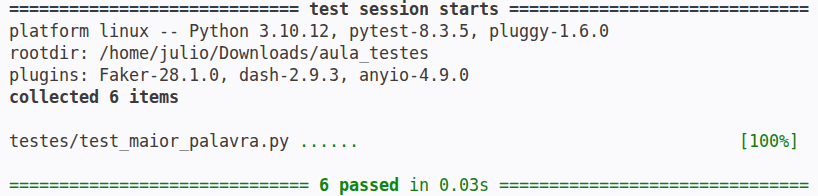
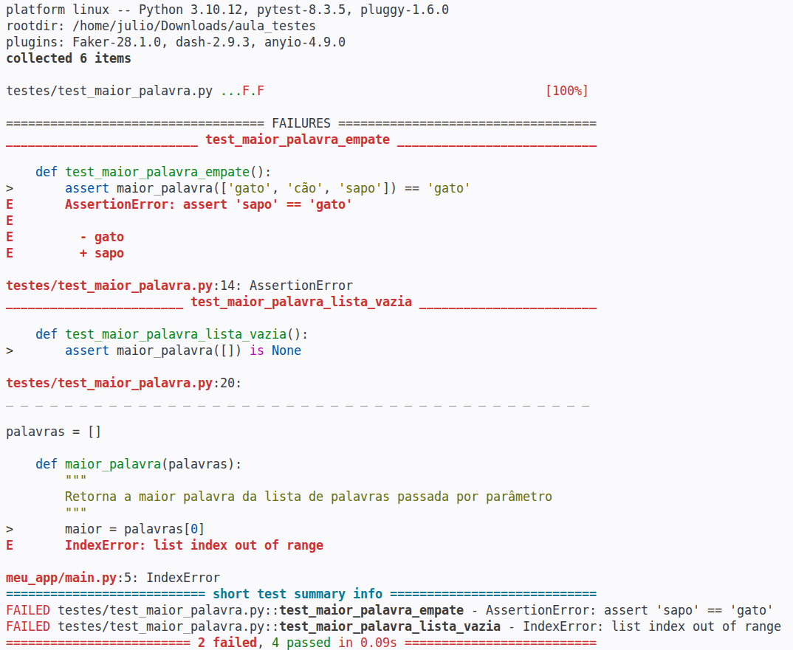
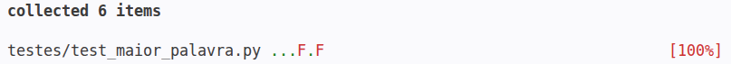

##  

O conteúdo dessa aula é baseado no **capítulo 6** do livro abaixo.

{fig-align="center" fig-alt="Capa do livro de Potter e Zingaro." style="max-height: 50vh; width: auto;"}

# Por que é essencial testar código? {background-color="#40666e"}

##

Já mencionamos nas aulas anteriores sobre testes de código.

- [Testar código]{.alert} é uma **habilidade essencial** porque nos dá confiança de que o código funciona apropriadamente.

. . .

É importante que você adquira essa habilitade e consiga conferir por você mesmo se o seu código funciona.

- Mesmo que o Copilot possa ser usado para gerar testes (e ele está ficando cada vez melhor nisso),
- entendemos que você deve ser capaz de escrever testes por conta própria, para verificar se um código gerado pelo Copilot está correto.

##

**Programadores iniciantes** geralmente têm aversão a testes (e mesmo nem tão novatos assim).

- Eles têm dificuldade de perceber que, mesmo que um código pareça fazer sentido, ele pode conter erros sutis.
- Há também um sentimento de que _"se eu testar vou descobrir que tem problema, então melhor deixar quieto"_.

##

**Engenheiros de Software profissionais** seguem uma abordagem completamente oposta.

- Eles levam testes extremamente a sério, porque sabem o quanto isso pode trazer de consequências para suas empresas.
- Ninguém quer ser a pessoa que 
  - causou um prejuízo enorme para sua empresa ou para algum de seus clientes;
  - deixou hacker obter acesso a dados confidenciais de usuários;
  - ou causou um acidente de um carro autônomo.

##

Dado o potencial **custo** de um erro, faz muito mais sentido **assumir que o código está errado** até que se prove o contrário.

. . .

Apenas com testes rigorosos podemos ter confiança de que o código funciona apropriadamente.

- Empresas geralmente não testam uma única vez.
- Possuem toda uma metodologia e infraestrutura de testes contínuos para garantir que tudo funciona a cada alteração no código.

## TDD

Algumas empresas levam isso tão a sério que seguem uma abordagem chamada [TDD - Test Driven Development]{.alert}.

- A ideia central é escrever primeiro os testes e depois a função/módulo a ser testado.

. . .

Não vamos seguir essa abordagem aqui,

- mas precisamos nos lembrar que assistentes de IA erram e precisamos verificar nossos códigos.

# Testes de Caixa-Preta e de Caixa-Branca {background-color="#40666e"}

## Testes de Caixa-Preta

. . .

[Testes de Caixa-Preta]{.alert} assumem que não sabemos nada sobre como o código funciona.

- Apenas sabemos o que ele deve fazer.
- O teste envolve então experimentar diferentes entradas e verificar se as saídas estão corretas.

. . .

Podemos aplicar testes de caixa-preta a cada função ou a um programa inteiro.

- Uma vantagem desse tipo de teste é que não precisamos olhar o código para escrevê-lo.
- Focamos apenas no comportamento desejado do código.

##

Como exemplo, suponha que precisamos testar uma função que 
**pega uma lista de palavras (strings) e retorna a maior delas**.

. . .

::: {.fontsize125}
```python
def maior_palavra(palavras):
```
:::

Mais precisamente, dada a assinatura acima, o comportamento esperando é que a função retorne a
palavra que tenha mais caracteres.

- Se existirem várias palavras com o mesmo número máximo de caracteres, a função deve retornar a 
  primeira delas presente na lista.

##

Há duas categorias principais que costumamos pensar ao escrever testes.

- [Casos de uso comuns]{.alert}: incluem as entradas que imaginamos que serão utilizadas na prática.
- [Casos de borda _(edge cases)_]{.alert}: são casos incomuns, mas possíveis, que podem quebrar o código.
  - Há entradas que podem testar algumas regras da função em maior profundidade ou que contenham entradas inesperadas
   (ex. uma lista contendo só strings vazias).

## Casos de uso comuns

Pensando na função `maior_palavra`, vamos pensar nos casos de testes que deveríamos usar.

- Para especificar os casos de testes vamos escrever como se estivéssemos usando um terminal Python.

. . .

Começando com **casos de uso comuns**:

. . .

Podemos pensar em um teste com poucas palavras nas quais apenas uma é maior que todas as outras.

::: {.fontsize125}
```python
>>> maior_palavra(['gato', 'pássaro', 'cachorro'])
'cachorro'
```
:::

## Casos de uso comuns

Podemos agora testar uma lista com mais palavras e com a maior palavra aparecendo em outra posição da lista.

::: {.fontsize125}
```python
>>> maior_palavra(['feliz', 'aniversário', 'para', 'meu', 'cachorro'])
'aniversário'
```
:::

. . .

Por fim, podemos pensar em uma lista contendo uma única palavra.

::: {.fontsize125}
```python
>>> maior_palavra(['feliz'])
'feliz'
```
:::

## Casos de borda

Se o programa estiver funcionando para esses casos de testes comuns, é hora de pensarmos nos **casos de borda**.

- Podemos começar testando o caso de termos empate na maior palavra, 
- que, pela especificação da função, deve ser retornadada a primeira delas.
- Obs.: algumas pessoas podem considerar esse um caso comum e outras um caso de borda.

. . .

::: {.fontsize125}
```python
>>> maior_palavra(['gato', 'cão', 'sapo'])
'gato'
```
:::

## Casos de borda

E se nenhuma palavra tiver caracteres? 

- A maior palavra é uma string vazia.

. . .

::: {.fontsize125}
```python
>>> maior_palavra(['', '', ''])
''
```
:::

. . .

::: {.callout-tip}
Em códigos que usam loops é muito comum que erros ocorram em verificações do primeiro 
ou do último elementos, por falhas na construção da lógica do loop.

Assim, se presumimos que uma função pode ter que percorrer uma lista, ou algo similar,
é interessante pensarmos em casos de borda sobre isso.
:::

## Casos de borda

E como deveríamos testar o caso do método ser chamado com uma lista vazia?

- Veja que, neste caso, a especificação do comportamento da função não é clara.
- A função poderia retornar `None` ou poderia gerar uma exceção, por exemplo.

. . .

Assumindo que a função retorne `None` para esse caso, o teste seria:

::: {.fontsize125}
```python
>>> maior_palavra([])
None
```
:::

## Testes de entrada incorreta

Há ainda um outro tipo de teste que poderíamos pensar, que é o caso da 
função ser chamada com parâmetros errados.

- Como Python é fracamente tipado, nada impede que a função `maior_palavra` seja chamada com 
  tipos de dados inesperados, como números, lista de números, `None`, etc.

. . .

Nessa aula vamos ignorar esse tipo de situação.

- Mas em sistemas em produção isso é algo importante.
- E, para esse caso, _type hints_ podem ser mais interessantes do que testes exaustivos.


## Como saber quais casos de testes usar

Podemos começar considerando os tipos de dados dos parâmetros e variando seus valores.

- Se o parâmetro for uma lista (ou string), podemos verificar testar vazia, com um ou com vários elementos.
- Na maioria das vezes, "vários" podem ser 4 elementos.
  - Já que é improvável que uma função funcione para 4 elementos mas não para 5, 6 ou mais.
- Já para uma função que recebe dois números, podemos pensar em testes considerando quando
  - um deles é zero, os dois são zero, um é negativo, ambos são negativos ou ambos são positivos.

## Como saber quais casos de testes usar

Outro tipo de caso de teste é levar em conta o comportamento específico da função.

- Como no caso do empate da função `maior_palavra`.

. . .

No final das contas, como já mencionamos, testar é uma mistura de ciência e arte.

- A prática é o melhor caminho para que descubra os melhores testes para suas necessidades.


## Testes de Caixa-Branca

. . .

A ideia do [teste de caixa-branca]{.alert} é examinar o código para pensarmos em casos de testes
adicionais que podemos escrever.

- Ao ler o código de uma função se vermos que ela usa um loop, devemos pensar nos casos comuns de erros com loops.
- Se houver uma estrutura condicional com verificação com `>` ou `>=`, por exemplo, é outro caso a se avaliar.

. . .

A ideia, portanto, é usar o conhecimento do código a ser testado para completar os testes necessários.

# Como testar seu código? {background-color="#40666e"}

##

Qual é a estratégia de testes mais simples que podemos pensar?

- Podemos testar nossa função no terminal Python como fizemos nas aulas anteriores.

. . .

Fazemos a chamada como especificamos no caso de testes e comparamos o resultado exibido com o esperado.

::: {.fontsize125}
```python
>>> maior_palavra(['gato', 'cão', 'sapo'])
'gato'
```
:::

##

Quais são as **vantagens** de testes usando o terminal?

- É rápido de rodar.
- É fácil acrescentar novos testes de acordo com o resultado dos testes anterioress.

##

Mas e as **desvantagens** de testar usando o terminal?

. . .

Os problemas começam quando fazemos uma correção no código após detecarmos um problema em um teste.

- É muito comum que, ao corrigir um erro, lembremos de repetir apenas o teste que tinha falhado.
- Mas pode ser que a correção tenha provocado um efeito colateral em outros casos de teste que tínhamos verificado antes.
- E, portanto, o correto seria reexecutar todos os testes.
  - E aí começa a ficar muito improdutivo seguir essa estratégia.

##

E qual seria a segunda abordagem mais simples para testar o código?

- Seria inserir os casos de teste no próprio código.
- Por exemplo, poderíamos inserir testes no mesmo arquivo da função `maior_palavra` logo após a definição dela.
- Mas isso seria muito ruim quando o código fosse usado em produção.
  - Precisaríamos comentar esse código de teste, ou ter uma maneira de desabilitá-lo.

## 

A melhor abordagem, na verdade, é usar um [framework de testes]{.alert}.

- A biblioteca mais popular para testes em Python é a [pytest](https://docs.pytest.org).
- Ela permite escrever testes de forma simples e organizada.
  - E, ao mesmo tempo, oferece recursos avançados.

. . .

Obs.: o livro de Potter e Zingaro usa o módulo `doctest`, que é parte da biblioteca padrão do Python.

- Ele é útil para testes bem simples, mas não é tão poderoso quanto o `pytest`.

## Instalando `pytest`

Nesta aula nós veremos apenas o básico do `pytest`.

- Mas que será suficiente para os testes que precisaremos fazer.

. . .

A primeira coisa que precisamos fazer é instalar o `pytest`, já que não é um módulo padrão do Python.

::: {.fontsize125}
```bash
pip install pytest
```
:::

## Implementando um teste com `pytest`

O módulo `pytest` fornece uma maneira simples de implementar testes.

- Nós, basicamente, escrevemos uma função para cada teste que queremos realizar.
- E, na implementação da função, usamos o comando `assert` para realizar o teste.

. . . 

```python
def test_maior_palavra_unica():
    assert maior_palavra(['gato', 'pássaro', 'cachorro']) == 'cachorro'
```

## O comando `assert`

O comando `assert` serve para verificar se uma condição é verdadeira.

- Se for, o código continua sendo executado normalmente.
- Se não for, é lançada uma exceção `AssertionError`.
- É como se ele significasse: _"Eu espero que isso seja verdade"_. 

. . .

Nós podemos ainda definir uma mensagem de erro personalizada.

- O formato é: 

. . .

::: {.fontsize125}
```python
assert <condição>, <mensagem_opcional_de_erro>
```
:::

## `pytest` e comando `assert`

O módulo `pytest` utiliza o comando `assert` para verificar se as condições dos testes são atendidas.

- Se todas as condições forem verdadeiras, significa que nosso código passou nos testes.
- Já se um `assert` falha, o Pytest automaticamente fornece informações detalhadas
  sobre os valores das variáveis envolvidas na comparação, o que simplifica muito a depuração.

## Convenção de nomenclatura do `pytest`

O módulo `pytest` procura de forma automática os testes escritos em nosso projeto.

- Ele procura por arquivos que começam com `test_`.
- Dentro deles, procura por funções que começam com `test_`.
- Podemos ainda organizar os testes em classes, que devem começar com `Test` e não podem ter construtor.

##

Vamos então implementar todos os testes que levantamos para a função `maior_palavra`.

- Vamos primeiro deixar clara a estrutura de pastas e arquivos que vamos usar.

. . .

Suponha que nossa função `maior_palavra` esteja implementada em um arquivo `meu_app/main.py`.

- Vamos então criar uma subpasta chamada `testes` e, dentro dela, criar um arquivo
  `test_maior_palavra.py`, onde escreveremos nossos testes.

##

A estrutura fica então assim.

::: {.fontsize125}
```
meu_projeto/
│
├── meu_app/
│   ├── __init__.py
│   └── main.py
│
└── testes/
    ├── __init__.py
    └── test_utilitarios.py
```
:::

. . .

Obs.: os arquivos `__init__.py` são arquivos vazios que servem para que suas pastas (`meu_app` e `testes`) 
  sejam reconhecidas como módulos Python.

- É similar ao conceito de pacotes em Java.

##

No nosso arquivo `meu_app/main.py`, devemos implementar a função `maior_palavra`.

```python
def maior_palavra(palavras):
    if not palavras:
        return None
    maior = palavras[0]
    for p in palavras[1:]:
        if len(p) > len(maior):
            maior = p
    return maior
```

##

Já nosso arquivo `test_maior_palavra.py` ficaria então assim:

```python
from meu_app.main import maior_palavra

def test_maior_palavra_unica():
    assert maior_palavra(['gato', 'pássaro', 'cachorro']) == 'cachorro'

def test_maior_palavra_unica_lista_maior():
    assert maior_palavra(['feliz', 'aniversário', 'para', 'meu', 'cachorro']) == 'aniversário'

def test_maior_palavra_lista_1_elemento():
    assert maior_palavra(['feliz']) == 'feliz'

def test_maior_palavra_empate():
    assert maior_palavra(['gato', 'cão', 'sapo']) == 'gato'

def test_maior_palavra_strings_vazias():
    assert maior_palavra(['', '', '']) == ''

def test_maior_palavra_lista_vazia():
    assert maior_palavra([]) is None
```

## 

Repare em um detalhe importante do último teste.

- Para verificar se o retorno é `None`, usamos `is None` em vez de `== None`.

. . .

É que o operador `==` compara o conteúdo de dois objetos.

- De forma similar ao `equals` no Java.
- Já o operador `is` verifica se duas variáveis apontam para o mesmo objeto.
  - Que é similar ao `==` do Java 😁

##

Como `None` é um objeto único no Python, é mais eficiente e seguro usar `is None` para verificar se uma variável é `None`.

## Execução do `pytest`

Agora, para executar os testes, basta executar o comando `pytest` na pasta principal do projeto.

::: {.fontsize125}
```bash
pytest
```
:::

. . .

Se nossa função passar em todos os testes, esse seria um exemplo de saída esperada.

{fig-align="center" fig-alt="Saída do pytest mostrando os 6 casos passando." style="max-height: 50vh; width: auto;"}

## 

Vamos agora forçar dois erros em nossa função `maior_palavra`

- para ver como o `pytest` vai reportar esses erros.

::: {.fontsize125}
```python
def maior_palavra(palavras):
    # removemos a verificação de lista vazia
    maior = palavras[0]
    for p in palavras[1:]:
        # trocamos > por >=
        if len(p) >= len(maior):
            maior = p
    return maior
```
:::

. . .

Obtemos então a seguinte saída com `pytest`.

##

{fig-align="center" fig-alt="Saída do pytest mostrando dois casos com erro."}

## 

Na saída anterior vemos que foram encontrados 6 testes dos quais dois não passaram

{fig-align="center" fig-alt="Saída do pytest mostrando resumo dos dois casos com erro."}

. . .

Em seguida são apresentados detalhes dos testes que falharam.

- Que nos ajudam a identificar o problema para corrigi-lo.

# Atualizando o ciclo de projeto de funções {background-color="#40666e"}

##

Nas aulas anteriores vimos o **ciclo de projeto de funções**.

- Vamos agora atualizá-lo para incluir a etapa de testes.

##

- **A**. Defina o comportamento desejado da função
- **B**. Escreva um prompt que descreve a função
- **C**. Use o Copilot para gerar o código
- **D**. O código parece razoável? Sim: **E**, não: **I**.
- **E**. Escreva casos de teste usando pytest
- **F**. Rode os testes. Passou nos testes? Sim: **G**, não: **J**
- **G**. Escreveu todos os casos de testes? Sim: **H**, não: **E**
- **H**. Pronto!
- **I**. Explore alternativas do Copilot. Alguma parece razoável?  Sim: **E**, não: **J**
- **J**. Revise o prompt para melhorar a descrição da função e vá para **C** .

##

```{mermaid}
flowchart TD
  A(Defina o comportamento desejado da função) --> B(Escreva um prompt que descreve a função)
  B --> C(Use o Copilot para gerar o código)
  C --> D(O código parece razoável?)
  D --Sim--> E(Escreva casos de teste usando pytest)
  E --> F(Rode os testes. Passou nos testes?)
  F -- Sim --> G(Escreveu todos os casos de testes?)
  G -- Sim --> H(Pronto!)
  G -- Não --> E
  D -- Não --> I(Explore alternativas do Copilot. Alguma parece razoável?)
  I -- Sim --> E
  I -- Não --> J(Revise o prompt para melhorar a descrição da função)
  J --> C
  F -- Não --> J
```

# Praticando escrita de testes {background-color="#40666e"}

## 

Vamos agora **praticar a escrita de testes**.

- Para isso, você deve tratar as situações a seguir, **seguindo todo o ciclo atualizado de projeto de funções**.

. . .

Trataremos duas situações.

- A primeira com o objetivo de experimentarmos o uso da biblioteca `pytest`.
- Já a segunda com o objetivo de pensarmos em como testar funções que processam arquivos.

## Situação 1

Suponha que esteja indo em grupo a uma sala de cinema

- e que vocês queriam escolher uma fileira de cadeiras que caiba todo o grupo sentado um ao lado do outro.
- Caso exista mais de uma fileira que caiba todo o grupo, vocês querem escolher a fileira que tenha o maior número consecutivo de assentos livres
  - de forma que todos do grupo possam se sentar juntos de maneira mais confortável possível.
- Obs.: em caso de empate o grupo prefere a última fileira (mais ao fundo da sala).

## Situação 1

Com o apoio da IA, crie então uma função que atenda à necessidade do grupo.

- Ela deve receber uma matriz de booleanos (lista de listas) na qual cada lista representa uma fileira com os assentos ocupados (`True`) ou livres (`False`).
- E deve retornar o número da fileira com a maior quantidade de assentos consecutivos livres.
  - Considerando que a primeira fileira é a de número 0.
- Caso não exista nenhuma fileira que caiba todo o grupo, a função deve retornar `-1`.

##

Ao chegar na etapa **E**, de escrita de testes, faça você mesmo (**sem apoio da IA**).  

- Pense em todos os casos de uso comuns e de borda que julgar necessários.
- A ideia é que você só prossiga depois de achar que já terminou todos os testes.
  - Ou seja depois de já ter chegado no passo **H** do ciclo de projeto de funções.

. . .

Acabou mesmo? Tem certeza?

##

Já que terminou confira se tratou pelo menos os casos abaixo:

```
1. Uma fileira com mais assentos livres consecutivos que todas as outras e com mais assentos que o tamanho do grupo.
2. Uma fileira como do caso 1, mas com dois espaços não consecutivos suficientes para todo o grupo.
3. Uma fileira como do caso 1, mas com assentos livres do mesmo tamanho do grupo.
4. Mais de uma fileira com mais assentos livres consecutivos que o tamanho do grupo, sem empates.
5. Mesmo caso anterior, mas com empates.
6. Mais de uma fileira com assentos consecutivos livres, mas nenhuma suficiente para todo o grupo.
7. Uma fileira com todos os assentos livres e suficientes para o tamanho do grupo.
8. Uma sala de cinema cheia, com todos os assentos ocupados.
9. Uma sala de cinema vazia, com todos os assentos livres (suficientes para o tamanho do grupo).
10. Uma sala de cinema cujas fileiras são menores que o tamanho do grupo.
```

Complemente os testes que porventura tenham faltado.

## Situação 2 - Testes com arquivos

Imagine agora que queiramos testar funções com processem arquivos.

- Como a que fizemos em outra aula, com dados de ligas europeias de futebol.

. . .

```python
def calcular_quantidade_gols(dados, pais):
    """
    dados contém dados estatísticos de futebol:
    - a terceira coluna traz o nome do país do jogador
    - a sexta coluna o nome da liga
    - a décima terceira coluna o número de gols feitos pelo jogador
    pais é a identificação do país de interesse (ex.: "br BRA")

    A função calcula e retorna a quantidade de gols feitos 
    por jogadores do país passado em cada liga
    """
```

##

Nesse caso, como podemos fazer o teste?

- Usar o arquivo que queremos processar, o próprio arquivo do Kaggle, não é uma boa ideia.
- Por que? 

. . .

_(pense antes de prosseguir...)_

##

1. Como validar se a resposta está correta?

- Repare que se precisarmos abrir o arquivo Kaggle para conferir manualmente se a resposta está correta,
  a função perde o sentido pois nem precisaríamos mais dela.

2. E se o arquivo for muito grande?

- Além de ser improditivo conferir manualmente, o teste poderia ser lento para executar.
- Testes precisam ser [rápidos]{.alert}.

##

3. E se o arquivo for alterado?

- Um outro problema de depender de um arquivo externo é que você não tem controle sobre o conteúdo dele.
- Assim mesmo que você verifique manualmente a resposta esperada para escrever o teste,
  se o arquivo for alterado, o teste vai parar de funcionar.
- Prejudicando a [reprodutibilidade]{.alert} dos testes.

## 

4. E se o arquivo não estiver disponível?

- Precisamos garantir que os testes não dependam de fontes externas que podem não estar disponíveis.
- Testes precisam ser [isolados]{.alert}.

5. E se o arquivo não tiver casos de borda?

- Precisamos garantir que os testes sejam abrangentes e incluam casos de borda relevantes.
- Um arquivo real pode não conter esses casos.


## 

O que podemos fazer então para testar a função garantindo que os testes são **rápidos**, **isolados** e **reprodutíveis**?

- Podemos criar um conjunto de dados artificial para o qual sabemos a saída esperada para várias consultas possíveis.
- Como o conjunto é artificial, podemos adicionar a ele situações de casos de borda.

. . .

No caso da função que queremos testar, criaríamos um arquivo CSV fictício

- contendo situações dos casos de testes que queiramos testar.
- E usaríamos esse arquivo para testar a função.

##

Vamos começar então pensando nos casos de testes.

- Considere que a função pode ser usada para consultar vários países diferentes.

. . .

Lista no seu caderno os casos de testes antes de continuar.

##

Verifique se considerou os casos de testes comuns a seguir.

- Um país aparece várias vezes em linhas não consecutivas, incluindo a última linha.
- Um país aparece em linhas consecutivas.
- Um país aparece apenas uma vez.
- Um país aparece em todas as ligas.
- Um país aparece em apenas uma liga.
- Um país aparece várias vezes mas nenhum jogador do país fez gols.
- Um país não aparece no arquivo.

##

Precisamos agora criar nosso conjunto de dados artificial

- Para isso podemos criar vários arquivos, ou apenas um para todos os testes.
- Se conseguirmos criar apenas um arquivo, será mais fácil gerenciar os testes.
-  Repare que o arquivo original tem várias colunas, mas para os nossos testes seria suficiente considerar as primeiras treze (que são as que precisamos).

##

Vamos então criar um arquivo CSV que cubra os casos de testes. Para isso seguem algumas dicas:

- Crie um arquivo CSV contendo as 13 primeiras colunas e 11 primeiras linhas do arquivo original.
- Salve o arquivo com o nome `futebol.csv` na pasta `testes/dados/`.
- Altere os dados do arquivo para atender aos casos de testes levantados.
  - Parece suficiente considerar a existência de apenas duas ligas.
  - E você pode usar países diferentes para cobrir todos os casos de testes.

##

Para ler o arquivo criado no seu arquivo com as funções de teste você pode começar com o seguinte código:

```python
import csv
from pathlib import Path

CAMINHO_ARQUIVO_FUTEBOL = Path(__file__).parent / 'dados' / 'futebol.csv'
```

. . .

Mãos à obra!
