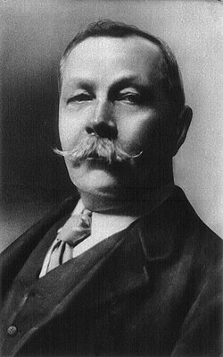
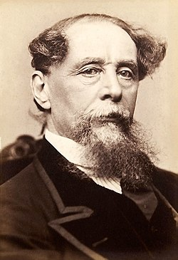
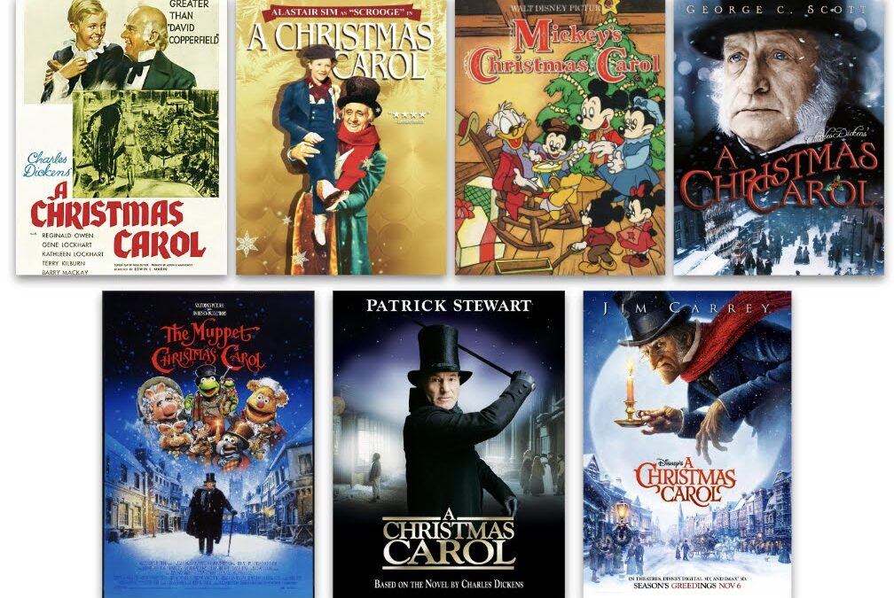
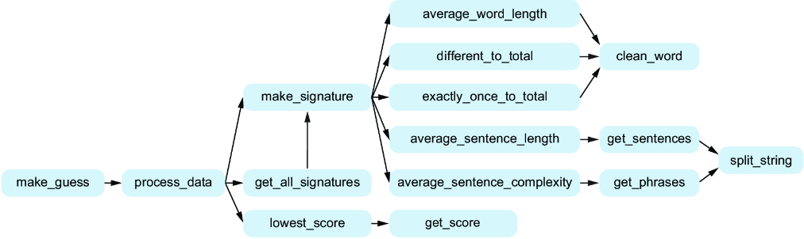

O conteúdo dessa aula é baseado no **capítulo 11** do livro abaixo (e um pouquinho do **capítulo 8**).

{fig-align="center" fig-alt="Capa do livro de Potter e Zingaro." style="max-height: 50vh; width: auto;"}

# Depuração {background-color="#40666e"}

##

[Encontrar e resolver bugs]{.alert} são algumas das principais atividades realizadas por um Engenheiro de Software.

- Os testes de código são essenciais para encontrarmos bugs em nossos sistemas.
- Mas, uma vez que eles são encontrados, como podemos resolvê-los?

##

Claro que podemos usar o Copilot para nos ajudar a resolver bugs.

- Mas **é importante conseguirmos depurar nosso próprio código**.
- Seja porque às vezes o Copilot não consegue nos ajudar.
- Seja porque às vezes é mais rápido e eficiente resolvermos o problema sozinhos, do que ficar
  gerando prompts e analisando as respostas do Copilot.

##

Existem diversas **formas de depurar nosso código**.

- Lendo o código.
- Explicando para alguém.
- Incluindo comandos `print()` (que depois precisam ser removidos).
- Ou usando um [depurador (_debugger_)]{.alert}.
  - Que é a forma mais recomendada!
  - Alunos geralmente têm preguiça de usar, mas, quando entram em um estágio ou emprego, 
    costumam perceber que depuradores são ferramentas essenciais para o dia-a-dia de um desenvolvedor.

##

Vamos fazer um Quiz para verificar como (e se) vocês costumam usar depuradores.

- [Quiz](https://www.polleverywhere.com/activities?folder=20270545) (obs.: apenas o professor consegue acessar esse link).

##

Como vocês não são alunos de início de curso, provavelmente já sabem usar um depurador.

- Para quem nunca usou o depurador do VS Code, é [altamente recomendável]{.alert} **que comece a usar**.
  - Você pode começar com esse [tutorial](https://scribehow.com/viewer/Usando_Debugger_do_VS_Code__8ggh8wtURoivTHc4W6pGDg) bem simples que uso em PPOO.
  - E há bastante material disponível na internet.
- Não vamos trabalhar isso nessa aula.
  - E vou considerar que, aqueles que ainda não usam, vão tratar isso como tarefa de casa.

# Programa de Identificação de Autoria {background-color="#40666e"}

##

Na aula passada, sobre [Decomposição de Problemas]{.alert}, fizemos o **_Design Top-Down_**
de um programa para sugestões de correção.

- Vamos agora levar o _design top-down_ para outro nível,
- **praticando** essa habilidade em um **problema muito maior**.

##

O processo, a princípio, será o mesmo:

- Vamos dividir o problema em subproblemas.
- E dividir novamente os subproblemas, se necessário.
- Vamos criar funções bem definidas, que recebam poucos parâmetros e retornem o resultado útil.

. . .

Mas, você verá que teremos **uma novidade** nesse caso:

- Criaremos funções que serão chamadas por mais de uma função.
- Evitando a [replicação de código]{.alert}.

## Programa de Identificação de Autoria

A ideia nessa aula é desenvolvermos um programa que **tenta identificar o** 
**autor desconhecido de um texto misterioso**.

- Vamos usar IA para fazer essa predição.
- Não vamos perder a oportunidade de  usar IA em uma disciplina de Programação com Suporte de IA. 😁

## 

Suponha que temos dois trechos de texto.

::: {.callout-note}
## Trecho 1
I have not yet described to you the most singular part. About six years
ago — to be exact, upon the 4th of May 1882 — an advertisement appeared in the
Times asking for the address of Miss Mary Morstan and stating that it would be
to her advantage to come forward. There was no name or address appended. I
had at that time just entered the family of Mrs. Cecil Forrester in the capacity of
governess. By her advice I published my address in the advertisement column.
The same day there arrived through the post a small card-board box addressed
to me, which I found to contain a very large and lustrous pearl. No word of writing 
was enclosed. Since then, every year upon the same date there has always
appeared a similar box, containing a similar pearl, without any clue as to the
sender. They have been pronounced by an expert to be of a rare variety and of
considerable value. You can see for yourselves that they are very handsome.
:::

## 

::: {.callout-note}
## Trecho 2
It was the Dover Road that lay on a Friday night late in November,
before the first of the persons with whom this history has business. The Dover
Road lay, as to him, beyond the Dover mail, as it lumbered up Shooter’s Hill.
He walked up hill in the mire by the side of the mail, as the rest of the passengers 
did; not because they had the least relish for walking exercise, under the
circumstances, but because the hill, and the harness, and the mud, and the
mail, were all so heavy, that the horses had three times already come to a stop,
besides once drawing the coach across the road, with the mutinous intent of
taking it back to Blackheath. Reins and whip and coachman and guard, however, 
in combination, had read that article of war which forbade a purpose otherwise 
strongly in favour of the argument, that some brute animals are endued
with Reason; and the team had capitulated and returned to their duty.
:::

## 

Suponha que alguém te pergunte se é provável que esses dois trechos tenham sido
escritos pelo mesmo autor.

- Como você poderia responder a essa pergunta?
- Apenas com base nos textos - não vale jogar no Google 😜

. . .

Podemos assumir uma **premissa** razoável de que **autores diferentes têm estilo de escrita diferentes**.

- E que essas diferenças aparecem em **métricas** que podemos calcular a partir dos textos.

## 

Como assim?

- Podemos notar, por exemplo, que o primeiro trecho tem frases mais curtas.
- E o segundo texto parece mais complexo se repararmos a quantidade de vírgulas e ponto-e-vírgulas.

. . .

Com base nessa avaliação poderíamos concluir que os textos, provavelmente, foram escritos por autores diferentes.

- O que é verdade nesse caso.

## 

::: {.columns}

:::: {.column width="50%"}
O autor do primeiro texto é [Sir Arthur Conan Doyle](https://pt.wikipedia.org/wiki/Arthur_Conan_Doyle).

::: {.row}
{fig-align="center" fig-alt="Foto de Sir Arthur Conan Doyle." style="max-width: 48%; display: inline-block;"}
{fig-align="center" fig-alt="Imagem do filme Sherlock Holmes." style="max-width: 48%; display: inline-block;"}
:::
::::

:::: {.column width="50%"}
E o autor do segundo texto é [Charles Dickens](https://pt.wikipedia.org/wiki/Charles_Dickens).

::: {.row}
{fig-align="center" fig-alt="Foto de Charles Dickens." style="max-width: 48%; display: inline-block;"}
{fig-align="center" fig-alt="Imagem de adaptações de obras de Charles Dickens." style="max-width: 48%; display: inline-block;"}
:::
::::

:::

## 

Nesse caso acertamos que são autores diferentes, mas o exemplo foi escolhido a dedo 🤭

- Pode ser, por exemplo, que um mesmo autor escreva diferente em trechos ou livros diferentes.
- Mas, como não vamos fazer um programa perfeito, tudo bem.

## Ideia Geral

Baseado no princípio desse exemplo, suponha que tenhamos:

- **um conjunto de textos de autores conhecidos**.
- e **o texto de um autor desconhecido**
  - Poderia ser uma obra nunca publicada, que foi encontrada por acaso com um colecionador, por exemplo.
  - Ou uma obra publicada com um pseudônimo, que pareça ter sido escrita por um autor conhecido.

. . .

Precisamos de uma forma que nos permita **comparar o estilo de escrita** dos autores conhecidos com o do autor desconhecido.

## Ideia Geral

Nossa estratégia será construir uma **_"impressão digital"_** (ou **_"assinatura"_**) do estilo de escrita de cada autor.

- Com base em um livro que ele tenha escrito.
- Essa _impressão digital_ seria **baseada em métricas que conseguimos calcular a partir do texto**.
  - Como o número médio de palavras por frase e a complexidade média das frases.

## Ideia Geral

Usaríamos o mesmo processo para construir a _impressão digital_ do texto de autor desconhecido.

- E compararíamos a _impressão digital_ do autor desconhecido com a dos autores conhecidos.
- Aquele que tiver a _impressão digital_ mais próxima, seria o autor mais provável do texto desconhecido.

## Limitações

Claro que o texto de autor desconhecido pode ser de um autor completamente novo.

- Ou pode ser que nossas métricas não capturem bem o estilo de escrita de cada autor.
- Ou ainda que um mesmo autor escreva livros diferentes com estilos diferentes.

. . .

Portanto, nosso programa não estará pronto para ser lançado no mercado 🙃

- De todo modo, dada a dificuldade da tarefa, você ficará surpreso com o resultado que conseguiremos alcançar.

##

A ideia nessa aula é que **você mesmo faça o _design top-down_ do programa**.

- E use o Copilot para ajudar a implementar as funções que você definir.

. . .

O livro da disciplina vai construindo o _design_ e, à medida que avança, vai acrescentando mais detalhes sobre como
o programa deve funcionar.

- Como quais métricas usar, por exemplo.
- Mas como aqui é você quem fará o _design_, é necessário que você conheça
esses detalhes antes de começar a fazer o _design_.

# Definições para o Programa de Identificação de Autoria {background-color="#40666e"}

## Textos disponíveis

O projeto inicial disponibilizado tem uma pasta `dados`.

- Dentro da pasta há uma pasta chamada `autores_conhecidos` com 5 arquivos de texto.
  - Cada arquivo é um livro diferente, escrito por um autor diferente.
  - O título do arquivo é o nome do autor.
- Há também 4 arquivos de autores desconhecidos.
  - Cada arquivo é um trecho de texto, que pode ter sido escrito por qualquer um dos autores conhecidos.
  - O nome do arquivo não indica o autor.

## Métricas

A ideia é utilizar as seguintes métricas para construir a _impressão digital_ de cada autor:

::: {.nonincremental}
1. tamanho médio das palavras
2. número de palavras diferentes dividido pelo número total de palavras
3. número de palavras usadas exatamente uma vez dividido pelo número total de palavras
4. número médio de palavras por frase
5. complexidade média das frases

A seguir vamos detalhar como calcular cada uma delas.
:::

## Tamanho médio das palavras

A ideia aqui é diferenciar autores que usam, em média, palavras mais curtas ou mais longas.

- Calculamos o número total de letras das palavras e o número total de palavras do texto.
- E dividimos o primeiro pelo segundo.

. . .

::: {.fontsize80}
Exemplo: _"A chuva caía. O guarda-chuva tinha ficado em casa."_

- São 40 letras e 9 palavras no total.
- Tamanho médio das palavras: 40 / 9 = 4.44
- Obs.: para simplificar estamos considerando que o hífen conta como letra.
:::

## Número de palavras diferentes dividido pelo número total de palavras

A ideia dessa métrica é identificar autores que costumam ser repetitivos ou não.

- Calculamos o número de palavras diferentes que aparecem.
- E dividimos pelo número total de palavras do texto.

. . .

::: {.fontsize80}

Ex.: _Uma pérola! Uma pérola! Uma pérola brilhante! Rara. Que belo achado._

- Total de palavras: 10
- Palavras diferentes: 7 (_uma, pérola, brilhante, rara, que, belo, achado_)
- Resultado da métrica: 7 / 10 = 0.7
:::

## Número de palavras usadas exatamente uma vez dividido pelo número total de palavras

Pode ser que alguns autores usem muitas palavras apenas uma vez, enquanto outros 
tendem a repetir mais as palavras.

- Vamos calcular o número de palavras que aparecem exatamente uma vez no texto.
- E dividir pelo número total de palavras do texto.

. . .

::: {.fontsize80}
Exemplo: _Uma pérola! Uma pérola! Uma pérola brilhante! Rara. Que belo achado._

- Número total de palavras: 10
- Palavras usadas exatamente uma vez: 5 (_brilhante, rara, que, belo, achado_)
- Resultado da métrica: 5 / 10 = 0.5
:::

## Número médio de palavras por frase

A ideia dessa métrica é identificar se o autor costuma escrever frases mais longas ou mais curtas.

- Calculamos o número total de palavras e o número total de frases do texto.
- E dividimos o primeiro pelo segundo.

. . .

::: {.fontsize80}
Exemplo: _"A chuva caía. O guarda-chuva tinha ficado em casa."_

- Número total de palavras: 9
- Número total de frases: 2
- Número médio de palavras por frase: 9 / 2 = 4.5
:::

## Complexidade média das frases

Comentamos no exemplo inicial que um trecho de texto tinha frases mais curtas e outro mais longas.

- Uma maneira que temos de medir a complexidade é verificar se as frases têm mais de uma oração.

. . .

Exemplo: _"No mesmo dia chegou uma carta endereçada a mim, que parecia conter algo importante. Mas não tive coragem de abri-la."_

- Veja que a primeira frase tem duas orações, separadas pela vírgula.
- Já a segunda frase tem apenas uma oração.

## Complexidade média das frases

Como seria muito complicado realmente tentar identificar orações, vamos usar uma aproximação simples:

- Vamos considerar que toda vírgula, ponto-e-vírgula ou dois-pontos indicam a separação de orações de uma frase.
- E vamos calcular o total de orações dividido pelo total de frases do texto.
  - No exemplo citado, o resultado da métrica seria: 3 / 2 = 1.5

## 

A **_impressão digital_** de cada autor será então dada pelo **conjunto de métricas** calculada a partir de um livro que ele tenha escrito.

- Ela será uma lista de 5 números, com os valores de cada métrica na ordem que definimos.

. . . 

::: {.fontsize70 .nonincremental}
- Exemplo: `[4.44, 0.7, 0.5, 4.5, 1.5]`
  1. tamanho médio das palavras
  2. número de palavras diferentes dividido pelo número total de palavras
  3. número de palavras usadas exatamente uma vez dividido pelo número total de palavras
  4. número médio de palavras por frase
  5. complexidade média das frases
:::
. . .

Em Aprendizado de Máquina, nós chamaríamos esse conjunto de **vetor de características (_features_)**.

## Identificando o autor desconhecido

Para identificar o autor desconhecido de um texto, faremos o seguinte:

- Calcularemos a _impressão digital_ de cada autor conhecido.
- Calcularemos a _impressão digital_ do texto de autor desconhecido.
  - E a compararemos com a _impressão digital_ de cada autor conhecido.
- O autor conhecido cuja _impressão digital_ for mais próxima, será o autor mais provável do texto desconhecido.

. . .

Mas como será feita a comparação entre as impressões digitais?

## Identificando o autor desconhecido

Suponha que estamos comparando:

- a _impressão digital_ `[4.44, 0.7, 0.5, 4.5, 1.5]` de um autor conhecido.
- com a _impressão digital_ `[4.0, 0.5, 0.7, 4.0, 1.9]` de um autor desconhecido.

. . .

Vamos começar calculando a diferença, em módulo, entre cada métrica.

- O resultado seria `[0.44, 0.2, 0.2, 0.5, 0.4]`.

##

E, em seguida, vamos calcular a soma ponderada dessas diferenças.

- Os pesos da soma seria: `[11, 33, 50, 0.4, 4]`.
- O resultado seria então `(0.44*11 + 0.2*33 + 0.2*50 + 0.5*0.4 + 0.4*4) = 23.24`.

## Identificando o autor desconhecido

Mas de onde veio essa lista de pesos?

- Os autores do livro aplicaram esse exercício ao longo do tempo.
- E, empiricamente, descobriram que esses pesos funcionam bem para esse problema.

. . .

Obs.: em uma aplicação profissional de Aprendizado de Máquina, esses pesos seriam aprendidos a partir de um conjunto
de dados de treinamento.

## Identificando o autor desconhecido

Voltando à identificação do autor desconhecido:

- Vimos que a comparação entre duas _impressões digitais_ resulta em um número (_score_).
- E quanto menor esse número, menor a diferença entre as _impressões digitais_, certo?
- Portanto, o autor conhecido cuja comparação resulte no menor _score_ será o autor mais provável do texto desconhecido.

## Dica para a fase de _design_

::: {.fontsize80}
Uma das operações necessárias é a contagem de palavras.

- Para isso, podemos usar a função `split()` da classe `str`.
- Exemplo: 
  - Usando função `split()` no trecho _"A chuva caía. O guarda-chuva tinha ficado em casa."_
  - Obteríamos as palavras: `["A", "chuva", "caía.", "O", "guarda-chuva", "tinha", "ficado", "em", "casa."]`
- Mas veja que as palavras _"caía."_ e _"caía"_ seriam consideradas diferentes.
  - Precisamos então tratar isso, removendo as pontuações das palavras.
  - Mas devemos tomar cuidado para não remover o hífen, que faz parte da palavra (como na palavra _"guarda-chuva"_).
  - Bastaria remover as pontuações apenas do início e do fim das palavras.
:::

# _Design top-down_ do Programa de Identificação de Autoria {background-color="#40666e"}

## 

É **hora** então **de construir o _design top-down_ do programa**.

- Recomendo que façam em duplas, mas podem fazer individualmente se preferirem.
- Lembre-se que o [objetivo é praticar a habilidade de decomposição de problemas]{.alert}.
- **Dica**: provavelmente você encontrará uma ou mais funções que são chamadas por mais de uma função.

##

No próximo slide vou apresentar o _design_ feito pelos autores do livro.

- Mas [atenção]{.alert}: é **muito importante** que você mesmo faça o design.
  - Não adianta copiar o design de alguém ou usar o _design_ mostrado a seguir.
- Somente depois que terminar o _design_, antes de implementar, você pode comparar com o _design_ mostrado a seguir.
  - E ver se há algo que você não tinha pensado.
- Lembre-se que o _design_ não precisa ser igual ao do livro.
  - A ideia é apenas ajudar a identificar se você esqueceu de algo importante.

## Design dos autores do livro

Você já terminou mesmo seu design? Tem certeza?

. . .

{fig-align="center" fig-alt="Design do programa de identificação de autoria feito pelos autores do livro." style="max-height: 50vh; width: auto;"}

# Implementação do Programa de Identificação de Autoria {background-color="#40666e"}

## 

Agora é **hora de implementar o programa**.

- A ideia é usar o Copilot para ajudar na implementação.
- Você precisará **também escrever testes** para suas funções.
  - Pelo menos um caso de teste para cada função.
  - O Copilot pode ajudar nisso também. Mas você precisa verificar se os testes estão corretos.
- Dica: ao escrever o prompt/docstring de cada função, pense que ela poderia ser reutilizada 
  futuramente em outros programas

. . .

Como saber se o programa funciona corretamente?

##

Você verá que os arquivos de autores desconhecidos têm o nome do autor dentro do arquivo.

- Portanto, você poderá verificar se o programa está funcionando corretamente. 😉
- E, claro, seu programa não pode usar essa informação para fazer a predição. 😏

. . .

O exercício deve ser entregue no Campus Virtual até a data indicada.