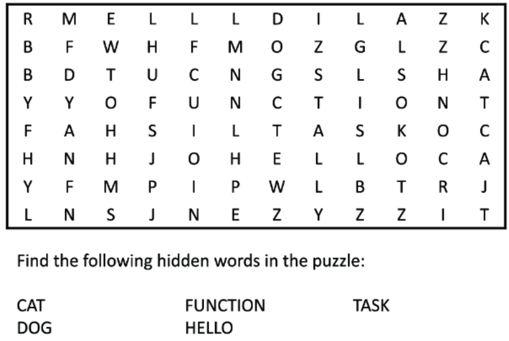
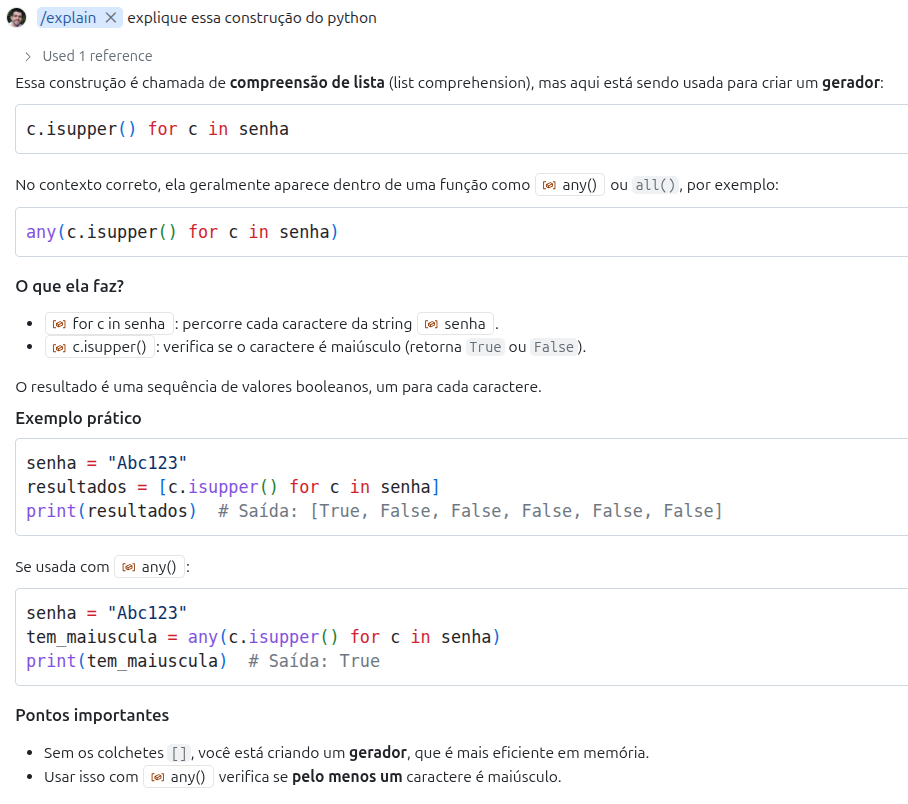
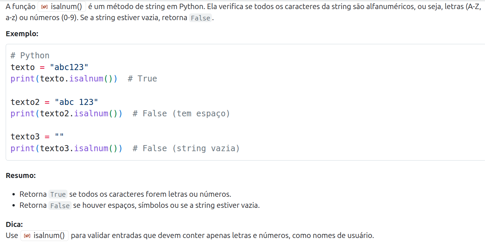

##  

O conteúdo dessa aula é baseado no **capítulo 3** do livro abaixo.

{fig-align="center" fig-alt="Capa do livro de Potter e Zingaro." style="max-height: 50vh; width: auto;"}

##

Pela pesquisa de perfil da turma vi que o conhecimento de Python da turma é bem variado.

- É importante então apresentar a linguagem nas primeiras aulas.
- Mas, junto com a apresentação da linguagem, vou apresentar também boas práticas e dicas de uso do Copilot.
  - que podem ser interessantes também para que tem mais experiência com Python.
- Espero então que a aula seja útil para todos :)

##

::: {.callout-caution}
## Lembrete

Lembre-se que **Assistentes de IA são não determinísticos**. 
Portanto, ao experimentar os exemplos dessa aula, você pode obter resultados diferentes.
:::

# Introdução {background-color="#40666e"}

##  

Um dos desafios para programadores iniciantes usarem o Copilot

- é saber o que é uma tarefa razoável para que ele consiga gerar uma boa solução.

. . .

Como já mencionamos antes, passar uma tarefa muito grande para o Assistente de IA

- pode fazer com que ele falhe
- e falhe de uma forma que seja muito difícil de corrigir.


##

Na verdade essa questão de **complexidade não é um problema só para o Copilot**, mas para nós mesmos.

- **Engenheiros de Software** que tentam resolver problemas muito complexos sem quebrá-los em partes menores **também falham**.

. . .

Existem diversas formas de tratar, no código, a decomposição de um problema em partes.

- A mais simples delas é a através de funções.

##

Uma [função]{.alert} é um trecho de código que resolve uma tarefa específica

- e que não é tão complexo a ponto de ficar difícil de implementar e testar.

##

Claro que vocês já sabem o que são funções e como elas podem ser implementadas.

- Mas será que vocês sabem (ou se lembram) quais são os **critérios** para projetar **boas funções**?
- Será que pensam nisso na hora de programar, ou simplesmente saem programando?
- Além disso, no **contexto do uso de IA**, quais seriam as **melhores práticas** para projetar funções?

# Funções {background-color="#40666e"}

## 

Uma função é uma pequena tarefa que pode ser usada para resolver tarefas maiores.

- Essas tarefas menores, por sua vez, podem ser usadas para resolver tarefas maiores.

##

Para exemplificar, encontre as palavras abaixo no quebra-cabeça.

{fig-align="center" fig-alt="Capa do livro de Potter e Zingaro." style="max-height: 50vh; width: auto;"}

## 

Qual foi o raciocínio que você usou para encontrar as palavras?

- Procurar todas as palavras de uma vez é uma tarefa muito grande e complicada.

. . .

Você poderia, por exemplo, escolher uma palavra para encontrar primeiro.

- E, para encontrar essa palavra, você poderia procurar a primeira letra.
  - E então procurar o restante da palavra buscando para a direita, esquerda, para cima ou para baixo.

##

Repare que estamos decompondo o problema de resolver o caça-palavras

- em tarefas menores, que, se resolvidas, nos ajudam a resolver o problema como um todo.

. . .

É essa a estratégia que precisamos seguir na hora de programar.

##

Uma função pode ser vista como um [contrato]{.alert} 📝.

- Se existir uma função `maior` e for dito que ela recebe dois números e retorna o maior deles,
- nós podemos acreditar que se a função for chamada com os números 2 e 5, ela retornará 5.
  - Nós não precisamos saber como a função funciona para utilizá-la.
- Da mesma forma que não precisamos entender de mecânica de carros para frear um carro 🚗.
  - Nós acionamos o pedal e sabemos que a velocidade do carro vai diminuir 🙌.

##

Na aula passada usamos o Copilot para gerar código a partir de um comentário.

- Podemos fazer o mesmo para criar funções.

. . .

Vamos fazer um exemplo:

::: {.halfincfontsize}
```python
# escreva uma função que retorna o  
# maior de dois números
# a entrada são dois números
# e a saída é o maior entre eles
```
:::

##

::: {.halfincfontsize}
```python
# escreva uma função que retorna o  
# maior de dois números
# a entrada são dois números
# e a saída é o maior entre eles
def maior_numero(a, b):
    if a > b:
        return a
    else:
        return b
```
:::

Esse é um possível resultado gerado pelo Copilot.

##

```python
# escreva uma função que retorna o  
# maior de dois números
# a entrada são dois números
# e a saída é o maior entre eles
def maior_numero(a, b):
    if a > b:
        return a
    else:
        return b
```
- Note que [assinatura]{.alert} **de uma função em Python** começa com a palavra-chave `def`.
  - É isso que diz para o Python que o que vem a seguir é uma função.
- Depois vem o [nome]{.alert} **da função** (`maior_numero`, nesse caso).
  - Dica: se parecer difícil escolher um nome para a função, pode ser um sinal de que ela está fazendo muitas coisas.

##

```python
# escreva uma função que retorna o  
# maior de dois números
# a entrada são dois números
# e a saída é o maior entre eles
def maior_numero(a, b):
    if a > b:
        return a
    else:
        return b
```

- Em seguida, temos os [parâmetros]{.alert} **da função**, que são as entradas que ela recebe.
- Por fim, temos o [corpo]{.alert} **da função**, que é onde a lógica é implementada.
  - Uma função pode [retornar]{.alert} **valores ou não**. 
  - Quando ela retorna usamos a palavra-chave `return`.

##

```python
# escreva uma função que retorna o  
# maior de dois números
# a entrada são dois números
# e a saída é o maior entre eles
def maior_numero(a, b):
    if a > b:
        return a
    else:
        return b
```

Veja que, diferente de linguagens fortemente tipadas, em Python não precisamos especificar os tipos

  - nem dos parâmetros e nem do retorno da função.

# Funções (dicas avançadas) {background-color="#40666e"}

##

Dica para programadores avançados:

- Apesar de Python não ser fortemente tipado
  - é uma boa prática usar [anotações de tipo]{.alert} (**_type hints_**) para melhorar a legibilidade do código.
- Isso ajuda muito na implementação de sistemas maiores.
- Mas afinal, o que é isso?


## 

Vamos gerar novamente a função `maior_numero`, mas agora com _type hints_ (acrescentando uma linha na docstring).

::: {.halfincfontsize}
```python
# escreva uma função que retorna o  
# maior de dois números
# a entrada são dois números
# e a saída é o maior entre eles
# use anotação de tipos
```
:::

::: {.halfincfontsize}
```python {.fragment start=6}
def maior_numero(a: int, b: int) -> int:
  if a > b:
    return a
  else:
    return b    
```
:::

## 

As anotações de tipo servem como **documentação** e podem ser utilizadas por **ferramentas de análise sintática**.

- Ou seja, são úteis para dizer para outros programadores o que exatamente a função espera e o que retorna.
- E, principalmente, para que as **IDEs**, como o VS Code, **apontem possíveis erros** antes mesmo de rodar o código.
  - Isso melhora a qualidade do código e facilita a manutenção.

. . .

Experimente, por exemplo, chamar a função no VS Code passando uma string.

## 

Mas é importante deixar claro que os **_type hints_ não alteram o comportamento do código**.

- Como Python não é uma linguagem compilada, o código vai ser executado
  - e os _type hints_ são ignorados em tempo de execução.
- Ou seja, se a função for chamada passando um parâmetro de tipo errado
  - isso não causará um erro imediatamente, mas pode levar a comportamentos inesperados.
  - Na verdade quando dá erro é até melhor, o problema maior é quando passa batido.

## 

Nos materiais da disciplina vou evitar anotações de tipo para manter os exemplos mais simples.

- Mas para quem tem mais experiência com Python, recomendo muito que se acostumem a usar.


# Criando funções com Copilot {background-color="#40666e"}

## 

Nós havíamos passado para o Copilot a tarefa de criar a função completa.

- Mas outra forma de usar o Copilot é nós mesmos definirmos a assinatura da função
  - e pedirmos ao Copilot apenas para implementar o corpo da função.
- Isso pode levar a resultados melhores.

##

Nós podemos fazer isso usando [docstrings]{.alert}.

- **Docstrings** são strings de documentação que podem ser usadas para descrever o que uma função faz.
- Elas são definidas logo abaixo da assinatura da função e são delimitadas por três aspas duplas.

. . .

::: {.callout-tip}
É uma boa prática escrever **docstrings** para suas funções.
:::


##

Nós poderíamos então gerar a função `maior_numero` de forma diferente

- Escrevendo nós mesmos o cabeçalho e a docstring da função.
- E deixando o Copilot gerar o corpo da função.
  - O que torna a geração do código mais fácil para o Copilot.

##

Vamos então refazer a função, mas agora nós definimos o cabeçalho e docstring da função.

::: {.halfincfontsize}
```python
def maior_numero(num1, num2):
  """
  num1 e num2 são dois números.

  Retorna o maior dos dois números.
  """
```
:::

##

O Copilot pode então gerar o corpo da função.

::: {.halfincfontsize}
```python
def maior_numero(num1, num2):
  """
  num1 e num2 são dois números.

  Retorna o maior dos dois números.
  """
  if num1 > num2:
    return num1
  else:
    return num2
```
:::

##

Para terminar, vamos pedir ao Copilot para chamar a função que criamos.

::: {.halfincfontsize}
```python
# chame a funcao maior_numero com os valores 3 e 5
# armazene o resultado em uma variável chamada 
# resultado e então exiba o resultado
```
:::

::: {.halfincfontsize}
```python {.fragment start=4}
resultado = maior_numero(3, 5)
print(resultado)
```
:::

##

Segue uma sugestão de [ciclo de criação de funções com Copilot]{.alert}.

 1. Defina o comportamento desejado para a função
 2. Escreva um prompt que descreva a função da forma mais clara possível
 3. Deixe o Copilot gerar o código
 4. Leia o código para avaliar se ele parece razoável
 5. Teste o código para conferir se ele está correto
  - Se estiver correto, a função está pronta.
  - Se não estiver, volte ao passo 2.

# Exemplos de boas funções com Copilot {background-color="#40666e"}

## Investimentos em Bolsa do Tião

. . .

Tião é um investidor em uma ação chamada PASIA.

- Ele comprou 10 ações por R$ 15.
- Agora cada ação vale R$ 17.
- Ele quer saber quanto lucro 💰 teria se vendesse as ações agora.

##

Essa seria uma boa função para calcular o lucro do Tião?

. . .

::: {.halfincfontsize}
```python
def calcular_lucro():
  return (17 - 15) * 10
```
:::

. . .

Não, essa função não é boa. 

- Por que?

##

Quando criamos uma função devemos criá-la da forma [mais geral possível]{.alert}.

- Com isso, **a função pode ser reutilizada** em diferentes contextos.
- Repare que, no caso do Tião, ele não quer saber o lucro apenas de uma compra específica
  - mas sim de qualquer compra que ele faça.

. . .

Mesmo que você ache que isso parece muito simples.

- É muito comum que programadores experientes repitam esse erro em contextos mais complexos.

##

Como deveria ser a assinatura da função, de forma que ela seja mais útil?

- Quais parâmetros deveria receber?
  - a quantidade de ações compradas  
  - o valor que as ações foram compradas  
  - e o preço de atual das ações.

. . .

Poderíamos então definir a assinatura assim:

::: {.fontsize125}
```python
def calcular_lucro(qtd_acoes, valor_compra, valor_venda)
```
:::

##

:::{.nonincremental}
Seguindo a estratégia que vimos antes, 

- vamos criar uma docstring para explicar ao Copilot o que a função precisa fazer.
:::

. . .

::: {.callout-tip}
Claro que essa função é muito simples e você poderia pedir ao Copilot para criar
inclusive a assinatura e a docstring.

Mas a ideia aqui é que você entenda o processo com uma função simples, para que
depois possa aplicar para funções mais complexas.
:::

##

::: {.fontsize125}
```python
def calcular_lucro(qtd_acoes, valor_compra, valor_atual):
  """
  qtd_acoes é a quantidade de ações compradas
  valor_compra é o valor de cada uma dessas ações
  valor_atual é o valor atual dessas ações

  Retorne o lucro total obtido com a venda das ações.
  """
```
:::

. . .

Podemos agora pedir ao Copilot para gerar o corpo da função.

##

::: {.fontsize125}
```python
def calcular_lucro(qtd_acoes, valor_compra, valor_atual):
  """
  qtd_acoes é a quantidade de ações compradas
  valor_compra é o valor de cada uma dessas ações
  valor_atual é o valor atual dessas ações

  Retorne o lucro total obtido com a venda das ações.
  """
  return (valor_atual - valor_compra) * qtd_acoes
```
:::

## 

::: {.nonincremental}

Nós já fizemos os três passos iniciais do ciclo de design de funções.

1. Defina o comportamento desejado para a função
2. Escreva um prompt que descreva a função
3. Deixe o Copilot gerar o código
4. Avalie o código para conferir se ele parece razoável
5. Teste o código para conferir se ele está correto

:::

##

O próximo passo é [avaliar se o código parece razoável]{.alert}.

::: {.fontsize125}
```python
  return (valor_atual - valor_compra) * qtd_acoes
```
:::

. . .

O exemplo é simples para avaliar 😊

## 

O passo seguinte é [testar o código]{.alert}.

- E aqui vai uma dica interessante de uso do VS Code para testar códigos Python.

. . .

Você pode selecionar o código da função no VS Code e apertar <kbd>Shift</kbd> + <kbd>Enter</kbd>

- Ao fazer isso, o trecho de código selecionado será executado em um terminal Python.
- E você poderá então fazer chamadas de teste a essa função no terminal Python.

## 

::: {.nonincremental}
Um primeiro teste óbvio que poderíamos fazer 

- é calcular o lucro da compra específica de ações do Tião.
:::

. . .

::: {.fontsize125}
```python {code-line-numbers="false"}
>>>  calcular_lucro(10, 15, 17)
```
:::

::: {.fontsize125}
```python {.fragment code-line-numbers="false"}
20
```
:::

. . .

Está certo?

- Sim, como ele teve 2 reais de lucro em cada ação e são 10 ações, o total é 20.

. . .

Precisamos agora pensar em mais [casos de testes]{.alert}.

##

Testar se as ações tivessem subido para R$ 18 em vez de R$ 17 seria um bom teste?

- Não, porque seria um teste de um caso na **mesma categoria** do teste anterior.
- Precisamos pensar em situações diferentes.

. . .

Por exemplo:

- Uma situação que desse prejuízo.
- Ou que as ações permanecessem no mesmo preço.

##

Podemos inverter o preço de compra e o atual para testar o prejuízo.

::: {.fontsize125}

```python {code-line-numbers="false"}
>>>  calcular_lucro(10, 17, 15)
```
```python {.fragment code-line-numbers="false"}
-20
```
:::

. . .

E testar o caso do preço da ação ser mantido

::: {.fontsize125}
```python {code-line-numbers="false"}
>>>  calcular_lucro(10, 15, 15)
```
```python {.fragment code-line-numbers="false"}
0
```
:::

##

Mas como saber quantas categorias testar?

- Como ter certeza se dois testes não são da mesma categoria?
- Ou se eles cobrem todas categorias possíveis?

. . .

Testes são uma combinação de **ciência 🧪** e **arte 🎨**

- É necessário prática e experiência para definir bem casos de testes.
- E vamos ter aula específica sobre isso mais adiante na disciplina.

## A senha do Tião

. . .

Tião está se inscrevendo em uma nova rede social chamada _ProgrammersKingdom_.

- Ele quer ter certeza que a senha que ele vai usar é forte o suficiente.

. . .

Vamos começar com uma definição bem simples do que é uma senha forte.

- E depois vamos melhorar a função.
- No meio do caminho vamos nos acostumando com a sintaxe do Python.

##

A princípio, vamos considerar que uma senha é forte se ela não for `'1234'` ou `'senha'`.

- Vamos então definir o cabeçalho e a docstring de uma função que recebe uma
  possível senha e retorna se ela é forte ou não.

. . .

::: {.fontsize125}
```python
def eh_senha_forte(senha):
    """
    Uma senha é forte se não for '1234' ou 'senha'

    Retorna True se a senha for forte e False em caso contrário
    """    
```
:::

##

Suponha que seja esse o código gerado.

::: {.fontsize125}
```python
def eh_senha_forte(senha):
    """
    Uma senha é forte se não for '1234' ou 'senha'

    Retorna True se a senha for forte e False em caso contrário
    """    
    if senha == "1234" or senha == "senha":
        return False
    return True
```
:::

. . .

Seguindo próximo passo do **ciclo de design de funções**, avaliamos se o código parece razoável.

- O que acha?

##

Vamos agora testar a função usando <kbd>Shift</kbd> + <kbd>Enter</kbd> no VS Code.

::: {.fontsize125}

```python {.fragment code-line-numbers="false"}
>>> eh_senha_forte("1234")
```
```python {.fragment code-line-numbers="false"}
False
```

```python {.fragment code-line-numbers="false"}
>>> eh_senha_forte("senha")
```
```python {.fragment code-line-numbers="false"}
False
```

```python {.fragment code-line-numbers="false"}
>>> eh_senha_forte("admin")
```
```python {.fragment code-line-numbers="false"}
True
```

:::

. . . 

`'admin'` claramente não é uma senha forte 🙂

##

Vamos melhorar a definição da nossa função.

::: {.fontsize125}
```python
def eh_senha_forte(senha):
    """
    Uma senha é forte se não for '1234' ou 'senha' ou 'admin'

    Retorna True se a senha for forte e False em caso contrário
    """    
```
```python {.fragment}  
    if senha in ['1234', 'senha', 'admin']:
        return False
    return True

```
:::

##

```python
def eh_senha_forte(senha):
    """
    Uma senha é forte se não for '1234' ou 'senha' ou 'admin'

    Retorna True se a senha for forte e False em caso contrário
    """
    if senha in ['1234', 'senha', 'admin']:
        return False
    return True

```

Repare que, nesse caso, o Copilot gerou um código que usa uma [lista]{.alert}.

- Podemos declarar listas em Python entre colchetes e com valores separados por vírgulas.
- E o operador `in` indica se um elemento pertence à lista.

##

O código parece razoável? Hora de testar!

. . .

Mas nossa função ainda aceita `'Tião'` como senha, o que é claramente ruim.

- Vamos então deixar a definição de senha forte, mais forte 💪.

##

```python
def eh_senha_forte(senha):
    """
    Uma senha forte tem pelo menos uma letra maiúscula,
    uma letra minúscula, um número e um caractere especial.

    Retorna True se a senha for forte e False em caso contrário
    """  
```
```python {.fragment start=8}
    tem_maiuscula = any(c.isupper() for c in senha)
    tem_minuscula = any(c.islower() for c in senha)
    tem_numero = any(c.isdigit() for c in senha)
    tem_especial = any(not c.isalnum() for c in senha)
    return tem_maiuscula and tem_minuscula and tem_numero and tem_especial
```

. . .

O código gerado pelo Copilot parece claro sobre o que está fazendo no geral.

- Mas há construções de Python nos detalhes que podem ser melhor exploradas.

## 

Vamos pedir ao Copilot para explicar o trecho

::: {.halfincfontsize}
```python {code-line-numbers="false"}
c.isupper() for c in senha
```
:::

. . . 

Para isso, aperte <kbd>Ctrl</kbd> + <kbd>I</kbd> e digite `explique essa construção do python`.

##

Essa é uma possível resposta do Copilot.

<div style="overflow:auto; max-height:400px; text-align:center;">
  
</div>

. . .

Esse é um bom exemplo de como o Copilot pode nos ajudar a entender um código já implementado.

## 

Agora que o código parece razoável, vamos passar para a fase de testes.

::: {.fontsize125}

```python {.fragment code-line-numbers="false"}
>>> eh_senha_forte("Tião")
```
```python {.fragment code-line-numbers="false"}
False
```

```python {.fragment code-line-numbers="false"}
>>> eh_senha_forte("Tião4*")
```
```python {.fragment code-line-numbers="false"}
True
```

:::

. . .

Parece tudo certo, né? Mas vamos testar mais um caso.

::: {.fontsize125}
```python {.fragment code-line-numbers="false"}
>>> eh_senha_forte("Tião da Silva")
```
```python {.fragment code-line-numbers="false"}
True
```
:::

. . . 

Essa não era uma senha forte, pois não parece conter caracteres especiais.

## 

O que será que aconteceu?

- Vamos analisar a linha que trata caracteres especiais.

. . .

::: {.fontsize125}
```python {.fragment start=8}
    tem_especial = any(not c.isalnum() for c in senha)
```
:::

. . .

Podemos pedir ao copilot para explicar o funcionamento da função `isalnum`.

##

Essa é uma possível resposta do Copilot.

<div style="overflow:auto; max-height:400px; text-align:center;">
  
</div>

. . .

Veja que o caractere espaço não é alfanumérico, ou seja, não é uma letra ou um número.

##

Podemos pedir ao Copilot para corrigir.

- Ou fazer uma [engenharia de prompt]{.alert}.
  - O que no caso, significa mudar a maneira como documentamos a função.

. . .

Vamos experimentar substituir `caractere especial` por `caractere de pontuação` na docstring da função.

##

::: {.fontsize125}
```python
def eh_senha_forte(senha):
    """
    Uma senha forte tem pelo menos uma letra maiúscula,
    uma letra minúscula, um número e um caractere de pontuação.

    Retorna True se a senha for forte e False em caso contrário
    """  
```
:::

##

```python
def eh_senha_forte(senha):
    """
    Uma senha forte tem pelo menos uma letra maiúscula,
    uma letra minúscula, um número e um caractere de pontuação.

    Retorna True se a senha for forte e False em caso contrário
    """  
    import string

    if len(senha) < 8:
        return False

    tem_maiuscula = any(c.isupper() for c in senha)
    tem_minuscula = any(c.islower() for c in senha)
    tem_numero = any(c.isdigit() for c in senha)
    tem_pontuacao = any(c in string.punctuation for c in senha)

    return tem_maiuscula and tem_minuscula and tem_numero and tem_pontuacao
```

. . .

Esse foi o código gerado pelo Copilot.

##

Ao analisar se o código parece razoável há dois pontos que vale a pena destacar.

- O primeiro é que o código usa a função `string.punctuation` que parece que vai fazer o que precisamos.

- Mas para ela funcionar, foi necessário importar um [módulo do Python]{.alert}: `import string`.

. . .

Python possui diversos módulos que podem ser importados para ajudar a realizar tarefas específicas.

- A linguagem já vem com muitos deles.
- Mas o grande potencial da linguagem é a quantidade de bibliotecas de terceiros que podem ser instaladas e utilizadas.

##

Repare que o código foi gerado fazendo a importação do módulo dentro da própria função.

- O que não é uma boa prática de programação.
- Porque deixa as dependências de código menos legíveis para outros programadores.

. . .

O ideal é levar o import para o início do arquivo.

- E, portanto, de fora da função.

##

```python
import string

def eh_senha_forte(senha):
    """
    Uma senha forte tem pelo menos uma letra maiúscula,
    uma letra minúscula, um número e um caractere de pontuação.

    Retorna True se a senha for forte e False em caso contrário
    """  

    if len(senha) < 8:
        return False

    tem_maiuscula = any(c.isupper() for c in senha)
    tem_minuscula = any(c.islower() for c in senha)
    tem_numero = any(c.isdigit() for c in senha)
    tem_pontuacao = any(c in string.punctuation for c in senha)

    return tem_maiuscula and tem_minuscula and tem_numero and tem_pontuacao
```

##

Apenas tome cuidado na hora de testar a função usando <kbd>Shift</kbd> + <kbd>Enter</kbd> para executar a célula.

- Pois, se não selecionar também a linha que contém o import, o código não vai funcionar.

. . .

::: {.fontsize125}
```python {code-line-numbers="false"}
>>> eh_senha_forte("Tião3da!Silva")
Traceback (most recent call last):
  File "<stdin>", line 1, in <module>
  File "<stdin>", line 12, in eh_senha_forte
  File "<stdin>", line 12, in <genexpr>
NameError: name 'string' is not defined. Did you forget to import 'string'?
```
:::

##

::: {.smaller}

Obs.: no teste feito pelos autores do livro, o import não foi gerado.

- Se isso acontecer com você, você pode inserir manualmente ou pedir o Copilot para corrigir.
:::

##

Outra obsevação sobre o código gerado pelo Copilot é que ele criou uma regra que não havíamos solicitado.

. . .

::: {.fontsize125}
```python {code-line-numbers="false"}
    if len(senha) < 8:
        return False
```
:::

. . .

Ele acrescentou uma verificação que obriga que a senha tenha pelo menos 8 caracteres.

- A função `len` retorna o tamanho de uma string (ou de uma lista, por exemplo).

##

Mesmo que consideremos que pode ter sido uma boa sugestão para esse caso.

- É importante que estejamos atentos para esse fato:
  - assistentes de IA podem **inventar regras de negócio** que não foram solicitadas.
- O que reforça a **importância da avaliação e teste de código**.

. . .

Para o nosso exemplo, vamos remover essas linhas.

- É hora então de testar o código.

##

::: {.fontsize125}

```python {.fragment code-line-numbers="false"}
>>> eh_senha_forte("Tião da Silva")
```
```python {.fragment code-line-numbers="false"}
False
```

```python {.fragment code-line-numbers="false"}
>>> eh_senha_forte("Tião3da Silva")
```
```python {.fragment code-line-numbers="false"}
False
```

```python {.fragment code-line-numbers="false"}
>>> eh_senha_forte("Tião3da!Silva")
```
```python {.fragment code-line-numbers="false"}
True
```

:::

. . .

Parece tudo OK agora ✅

## 

Espero que esses exemplos tenham mostrado a importância de testes de código.

- Programadores iniciantes muitas vezes não testam seu código.
- Eles confiam que o código está correto pois, analisando o código, ele parece fazer sentido.

##

Uma diferença bem comum entre juninhos e progamadores experientes é:

- juninhos sempre assumem que seu código está correto;
- enquanto desenvolvedores experientes sempre assumem que está errado,
  - até que tenham testado e provado o contrário.

. . .

Um dos motivos que iniciantes falham em testar código

- é porque parece meio desanimador descobrir que seu código está errado.

##

Mas, na verdade, quanto antes descobrirmos que uma função está errada melhor.

- Por que dá muito mais trabalho quando já desenvolvemos muitas funções.
- E temos que descobrir porque o sistema como um todo não funciona.

. . .

Me chamou a atenção que, na Pesquisa de Perfil da Turma, vários de vocês não usam IA para gerar testes (ou usam pouco)! ⚠️ 

##

Para finalizar o trabalho com senhas fortes

- vamos criar uma função que pede ao usuário uma senha
- e, se ela não for forte, continua pedindo uma senha até que seja digitada uma senha forte.
- Que é mais ou menos o que os sites fazem quando criamos uma senha.

. . .

Qual poderia ser a assinatura dessa função?

##

A função não precisa de parâmetros, pois não depende de nenhuma informação externa.

::: {.fontsize125}
```python 
def obter_senha_forte():
  """
  Fica pedindo uma senha para o usuário até
  que ele digite uma senha forte.

  Se a senha não for forte, avisa que ela não é.
  Se for, retorna a senha forte
  """
```
:::

##

::: {.fontsize125}
```python 
def obter_senha_forte():
  """
  Fica pedindo uma senha para o usuário até
  que ele digite uma senha forte.

  Se a senha não for forte, avisa que ela não é.
  Se for, retorna a senha forte
  """
  while True:
      senha = input("Digite uma senha forte: ")
      if eh_senha_forte(senha):
          return senha
      print("A senha não é forte. Tente novamente.")
```
:::

. . .

Veja que o código gerado pelo Copilot usa a função `eh_senha_forte` que havíamos criado anteriormente.

- O código parece razoável?

##

Para testar no VS Code, temos agora que lembrar de selecionar as duas funções.

. . .

::: {.fontsize125}
```python  {code-line-numbers="false"} 
>>> obter_senha_forte()
Digite uma senha forte: tião !!@*#@
A senha não é forte. Tente novamente.
Digite uma senha forte: tião!!@*#@
A senha não é forte. Tente novamente.
Digite uma senha forte: Tião1!@*#@
'Tião1!@*#@'
```
:::

- Repare que a última linha é o retorno da função `obter_senha_forte()`.


# Benefícios das funções {background-color="#40666e"}

##

Além das funções serem essenciais na **decomposição de problemas**,

- elas também trazem outros [benefícios]{.alert}.


## [Esforço cognitivo]{.alert}

. . .

::: {.callout-tip}
**Esforço cognitivo** tem relação com a quantidade de informação que seu cérebro consegue processar ao mesmo tempo e ainda ser efetivo.
:::

. . .

Se alguém te disser 4 palavras aleatórias e pedir para você repetir, provavelmente você conseguirá.

- Mas se a pessoa disser 20 palavras, provavelmente você terá dificuldades.
- A mesma dificuldade acontece quando temos que pensar em detalhes de uma situação muito complexa.

## [Esforço cognitivo]{.alert}

Programadores têm o mesmo problema.

- Se tentarem resolver um problema complexo tudo de uma vez, têm dificuldade de criar um código correto.

. . .

Funções ajudam os programadores a evitarem fazer tudo de uma vez.

## [Evitar repetição]{.alert}

. . .

Programadores, e pessoas em geral, não gostam muito de resolver o mesmo problema repetidamente.

- Se você criar uma função que calcula a área de um círculo, por exemplo,
  - e precisar desse cálculo em lugares diferentes de um sistema,
  - você pode chamar a mesma função nos dois lugares.

. . . 

::: {.callout-tip}
**Reutilização de código**, que é o contrário da replicação, é uma característica de um código bem projetado.
:::

## [Melhoria dos testes]{.alert}

. . .

É muito mais complicado testar um código que faz muitas coisas ao mesmo tempo.

. . .

Quando criamos funções para tarefas específicas, podemos testá-las individualmente.

- Essa é uma técnica chamada [teste unitário]{.alert}.
- Utilizamos diferentes casos de teste com diferentes parâmetros de entrada.
- Se todos eles produzirem uma saída correta, provavelmente nossa função não causará problema no sistema como um todo.

## [Melhoria dos testes]{.alert}

::: {.callout-tip}
**Testes unitários** são altamente recomendados em softwares bem projetados.
:::

## [Melhoria da confiabilidade]{.alert}

. . .

Engenheiros de software experientes cometem erros, e sabemos que o Copilot também.

. . .

Se você for um programador incrível, e cada linha de código que você escreve tiver 95% de chances de estar certa,

- quantas linhas de código você acha que conseguiria escrever antes que pelo menos uma linha de código fosse provavelmente incorreta?
  - A resposta são 14 linhas de código!

. . .

Obs.: veja a explicação estatística do ChatGPT sobre as 14 linhas [aqui](https://chatgpt.com/share/68a0d06e-a1e4-800e-8aaa-8644f1edf204). 😃


## [Melhoria da confiabilidade]{.alert}

Note que 95% é um nível bem alto, mas, mesmo assim, é possível que erros aconteçam em poucas linhas.

- Por isso, dividir um problema em funções com até 12 (ou, no máximo, 20 linhas)
  - diminui a probabilidade de que exista um erro no código.

. . .

Sem contar que quando um código tem muitos erros que interagem entre si,

- a probabilidade se gerem gerados novos erros ainda maiores só aumenta.

## [Melhoria da confiabilidade]{.alert}

Todo programador experiente já passou horas 😫 depurando um código que tinha múltiplos erros.

- Que poderiam ter sido evitadas com testes mais frequentes em trechos menores e código.

## [Melhoria da legibilidade de código]{.alert}

. . .

Mesmo usando Copilot, quando pensamos em software desenvolvido por várias pessoas

- é importante que seja fácil para a equipe entender o código existente,
- independente se ele foi criado pelo Copilot ou por outros programadores.

## [Melhoria da legibilidade de código]{.alert}

Isso torna mais fácil tarefas como:

- encontrar bugs;
- determinar onde começar a alterar o código para acrescentar uma nova funcionalidade;
- entender, em alto nível, se seria fácil ou não fazer alguma alteração no sistema que estejamos prospectando.

## [Melhoria da legibilidade de código]{.alert}

::: {.nonincremental}
Ter as tarefas do sistema divididas em funções

- nos ajuda a entender o que cada parte do código faz
- e a ter uma melhor percepção sobre como as coisas funcionam no todo.
:::

. . .

Também nos ajuda a dividir o trabalho e as responsabilidades de forma a garantir que o código está correto.

# Características de boas funções {background-color="#40666e"}

##

Não há uma regra absoluta para definir o que é uma boa função.

- Mas há recomendações e intuições que podemos compartilhar.
- Mesmo com elas, saiba que identificar boas funções é uma habilidade que requer tempo e prática.

. . .

Antes de entrar nas recomendações, você verá que usaremos aqui o termo "funções folha" (_leaf functions_).

- Esse termo se refere a funções que não chamam nenhuma outra função do nosso próprio sistema.
- A ideia vem de que em uma árvore, a partir da raiz, as folhas são as "pontas".

## [Uma tarefa clara a realizar]{.alert}

. . .

Uma função folha pode ser algo como:

- Calcular o volume de uma esfera.
- Encontrar o maior número em uma lista.
- Verificar se uma lista tem um valor específico.

. . .

Funções que não são folha podem ter objetivos mais amplos, como:

- Atualizar os gráficos do jogo.
- Mas ainda assim devem ter um objetivo específico,
  e devem chamar outras funções para atingir esse objetivo.

## [Comportamento claramente definido]{.alert}

. . .

A tarefa _"encontrar o maior número em uma lista"_ é claramente definida.

- Se alguém te der uma lista de números e te pedir o maior número, você sabe exatamente o que fazer.

. . .

Já a tarefa _"encontre a melhor palavra em uma lista"_ é mal definida.

- Falta informação: o que significa palavra "melhor"?
- É a palavra mais longa? 
  - A que tem menos vogais? 
  - A que tem `J` de Julio 😁?

## [Comportamento claramente definido]{.alert}

A questão é que tarefas **subjetivas** não são boas para computadores.

. . .

É comum conseguimos deixar claro o comportamento da função só pelo seu nomes.

- Mas muitas vezes isso não é possível, e usamos a docstring para dar mais detalhes sobre a tarefa.

. . . 


::: {.callout-tip}
Se precisar escrever mais do que algumas linhas em uma docstring de uma função folha, pode ser um sinal
de que a tarefa é muito grande para uma única função.
:::

## [Poucas linhas de código]{.alert}

. . .

Muitas empresas de software tem guias de estilo de programação que sugerem um limite no número de linhas das funções.

- Esse limite geralmente varia de 12 a 20 linhas.

. . .

Na verdade o número de linhas é um _proxy_ para a complexidade do código.

- E acaba sendo um _proxy_ bem razoável.

. . .

::: {.callout-tip}
Se o Copilot gerar uma função para você com 50 linhas de código, é recomendável pedir que ele quebre a tarefa em funções menores.
:::

## [Uso geral em vez de uso específico]{.alert}

. . .

Criar uma função que retorna todos os números de uma lista maiores que cinco

- pode ser útil para uma necessidade específica.

. . .

Mas a função seria muito mais útil se o limite fosse um parâmetro.

. . .

Seguimos a mesma ideia ao calcular o lucro das ações do Tião.

. . .

::: {.callout-tip}
Vale a pena reescrever uma função se percebermos que ela pode ter um uso mais geral.
:::

## [Entrada e saída claras]{.alert}

. . .

É importante que uma função tenha parâmetros e valores de retorno bem definidos.

- Pode ser que precisemos de uma função que receba muitos parâmetros,
  - ou que retorne vários valores.
- Mas é importante sempre questionar se eles são realmente necessários ou se não teria outro jeito de resolver a tarefa.

. . .

::: {.callout-tip}
Se você está criando uma função que às vezes retorna uma lista, às vezes um valor único e 
às vezes não retorna nada, é um sinal de que ela provavelmente não é uma boa função.
:::

## 

::: {.nonincremental}
Em resumo, esse então é o [guia para criarmos boas funções]{.alert}:

1. Uma tarefa clara a realizar
2. Comportamento claramente definido
3. Poucas linhas de código
4. Uso geral em vez de uso específico
5. Entrada e saída claras
:::

