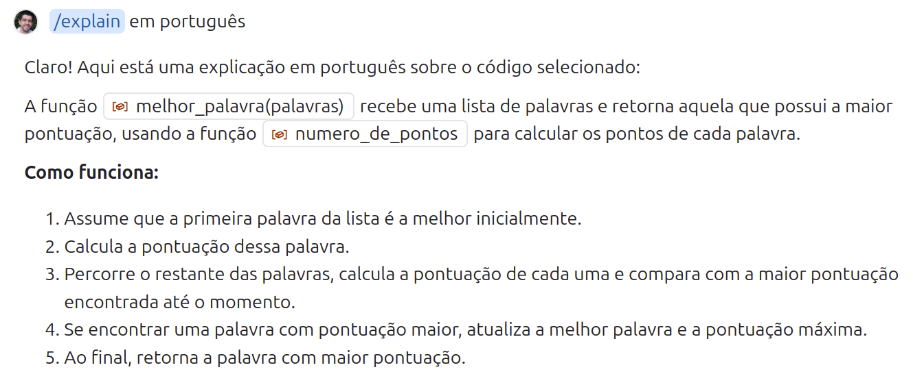
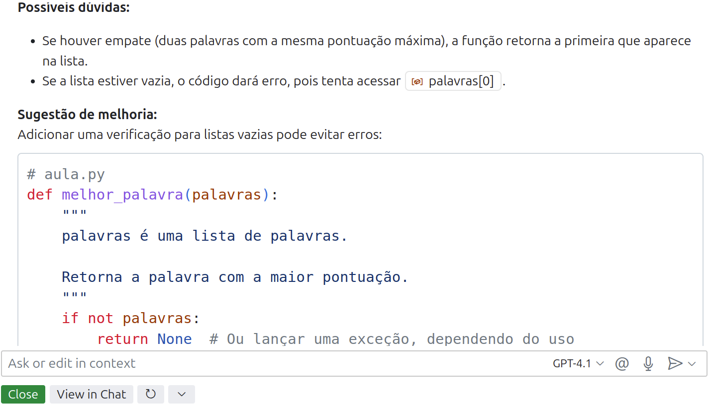
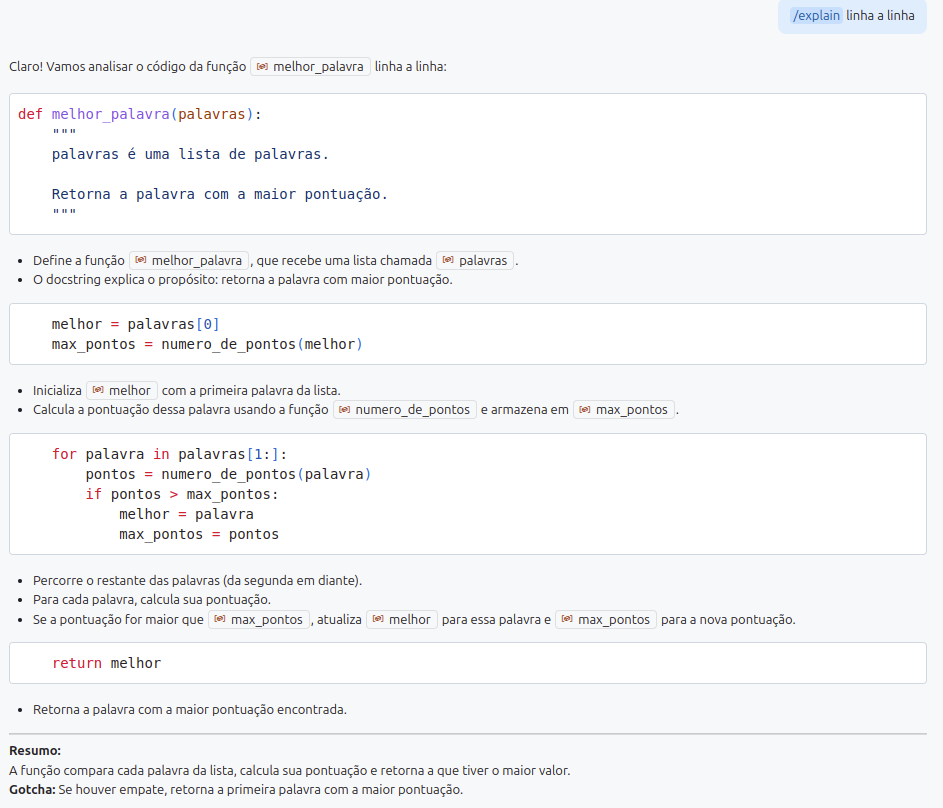
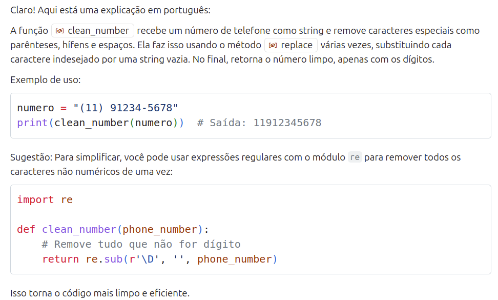
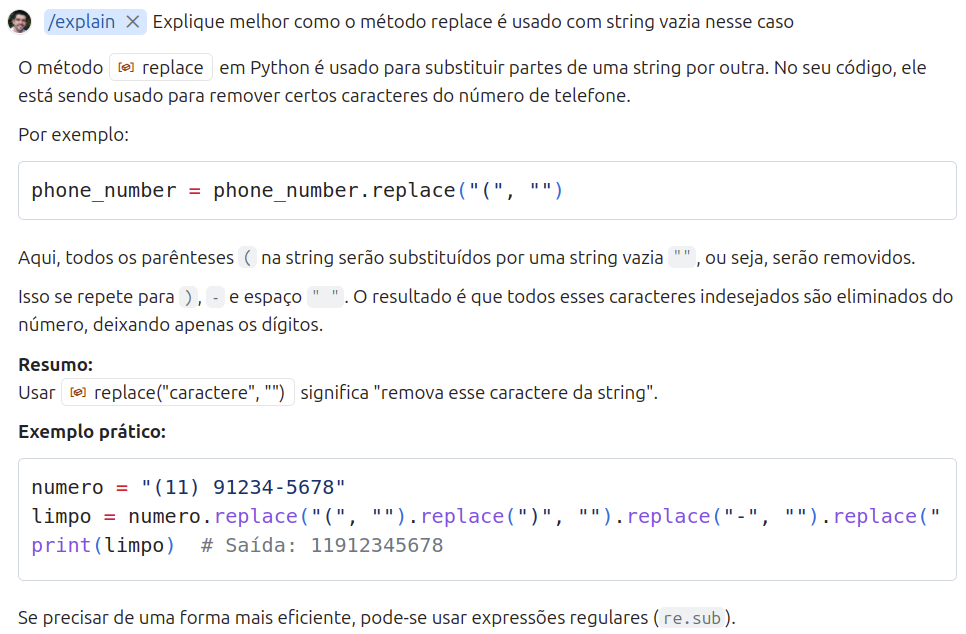

##  

O conteúdo dessa aula é inspirado nos **capítulos 4 e 5** do livro abaixo.

{fig-align="center" fig-alt="Capa do livro de Potter e Zingaro." style="max-height: 50vh; width: auto;"}

# Introdução {background-color="#40666e"}

## Ler Código

[Ler código]{.alert} significa [entender]{.alert} o que o código faz ao examiná-lo.

. . . 

Existem **dois níveis de entendimento**:

- Entender o que **cada linha de código faz** (_tracing description_).
- Entender o **objetivo geral** de um código (função, classe, etc.).

## Ler Código

O **1º nível, _tracing description_,** depende do conhecimento de estruturas e linguagem de programação.

. . .

Já o **2º nível, _objetivo geral_,** é geralmente o que esperamos encontrar na docstring de uma função.

- E depende do entendimento de 1º nível.

## Por que é importante a habilidade de ler código?

. . .

**Ajuda a determinar se o código está correto**:

- Nós usaremos testes para validar código.
- Mas podemos ganhar tempo se conseguirmos identificar erros mais óbvios no código, antes de gastar tempo escrevendo código de teste.

. . .

**Para ter mais informações para os testes**:

- Entender o código nos ajuda a identificar melhor os casos de testes que precisamos criar para validar a implementação.

## Por que é importante a habilidade de ler código?

**Para ajudar a escrever código**:

- Por que escrever código se vamos usar o Copilot?
- Às vezes é mais rápido alterarmos nós mesmos o código, do que ficar mudando prompt até obter o código correto.
- E, por fim, há evidência científica de que conseguir explicar código linha a linha é pré-requisito para conseguir escrever código.

##

A ideia aqui não é entender cada detalhe de cada linha do código.

. . .

E sim aprender a como usar o Copilot para chegar num meio termo entre:

::: {.columns}

:::: {.column width="50%"}
- _“Esse código faz mágica”_ 🧙‍♂️
::::

:::: {.column width="50%"}
- _“Eu sei exatamente como cada linha de código funciona”_ 🤓
::::

:::

##

Na aula passada tratamos o processamento de um _dataset_ de futebol
sem nos preocuparmos em entender realmente o código.

- Mas isso foi apenas para demonstrar o uso do Copilot.
- Em nossos projetos precisamos buscar o meio termo citado no slide anterior.


# Usando Copilot para Entender Código {background-color="#40666e"}

##

Nas aulas anteriores escrevemos prompts para que o Copilot explicasse trechos de código pra gente.
 
- Mas o Copilot também tem **comandos específicos** além de texto livre.

. . .

Podemos selecionar a função (ou trecho de código) que queremos entender,

- e acessamos com o **botão direito do mouse a opção** [Explain]{.alert},
- ou **digitamos `/explain` na janela de chat** lateral.

##

::: {.callout-tip}
Podemos complementar o comando `/explain` com mais detalhes.

Isso pode ser útil, por exemplo, para fazermos com que o Copilot entenda que queremos as explicações em português.
:::


##

Vamos usar como exemplo a função `melhor_palavra`.

```python
def melhor_palavra(palavras):
    """
    palavras é uma lista de palavras.

    Retorna a palavra com a maior pontuação.
    """
    melhor = palavras[0]
    max_pontos = numero_de_pontos(melhor)

    for palavra in palavras[1:]:
        pontos = numero_de_pontos(palavra)
        if pontos > max_pontos:
            melhor = palavra
            max_pontos = pontos

    return melhor
```

##

Primeira parte da explicação:

<div style="overflow:auto; text-align:center;">
  
</div>

##

<div style="overflow:auto; text-align:center;">
  
</div>

##

Veja que, na explicação, o Copilot já destacou pontos de dúvidas e sugeriu melhoria.

- Nem sempre ele faz isso. Demos sorte nessa vez. 😃

. . .

Se uma função tiver um código com o qual não temos familiaridade,
podemos pedir uma **explicação linha a linha**.

- Usando `\explain linha a linha`, por exemplo.

##

<div style="overflow-y:auto; max-height:60vh; width:100%; text-align:center;">
  
</div>

##

Como professor, considero incrível que agora os alunos tenham com quem **tirar dúvidas** quantas vezes for necessário.

. . .

Apenas lembre-se que a explicação do Copilot pode estar errada. 

- Aí você pode pensar: então pra que ela serve?

. . .

Realmente pode ser frustrante.

- Mas na maioria dos códigos, especialmente mais simples, as explicações são corretas.
- E, sem o Copilot, se você tivesse dúvidas e procurasse um amigo ou no Google, poderia obter respostas erradas também.
    
##


::: {.callout-tip}
Uma maneira de diminuir a possibilidade de erro é pedir a explicação mais de uma vez.

É incomum que o Copilot explique errado mais de uma vez.
:::


##

Vamos usar outro exemplo de explicação do Copilot.

- Suponha que você precise entender uma função já existente em um projeto.

. . .

::: {.halfincfontsize}
```python
def clean_number(phone_number):
    phone_number = phone_number.replace("(", "")
    phone_number = phone_number.replace(")", "")
    phone_number = phone_number.replace("-", "")
    phone_number = phone_number.replace(" ", "")
    return phone_number
```
:::

. . .

Vamos ver a explicação do Copilot em português.

##

<div style="overflow:auto; text-align:center;">
  
</div>

##

Veja que neste caso o Copilot fez uma explicação e sugeriu uma melhoria.

- Antes de avaliar a sugestão de melhoria é importante que você avalie
  se realmente entendeu a explicação dada para o código atual.

. . .

Por exemplo, se não tiver ficado claro como o método `replace` funciona, você pode pedir uma explicação mais detalhada sobre isso.

##

<div style="overflow:auto; text-align:center;">
  
</div>

##

Você pode continuar pedindo mais informações do Copilot até julgar que tem um nível de entendimento adequado para a tarefa que precisa.

- Lembre-se do que falamos no início da aula: não é necessário entender cada detalhe do código.
  - Mas temos que sair do estágio _“Esse código faz mágica”_.
  - Para conseguirmos depois validar o nosso código.
  - E assim resolver a tarefa que precisamos.

##

Voltando na explicação inicial dada pelo Copilot

- você alteraria seu código para usar a solução _"mais limpa e eficiente"_, segundo ele, que usa o módulo `re`?

. . .

Que **critérios** adotar para decidir aceitar ou não a sugestão?

##

::: {.callout-tip}
Minha sugestão é: use a opção que você entenda melhor.

Você pode já ficar satisfeito com o código original, ou pode pedir ao Copilot explicações sobre a sugestão de melhoria.
E depois de ter entendido as duas opções, escolher a que te parece melhor.
:::

. . .

::: {.nonincremental}
::: {.callout-tip}
É melhor ter mais rapidamente uma versão do sistema que funciona corretamente e depois otimizá-la, se necessário,
do que tentar já otimizar código antes mesmo de saber se ele vai atender o que precisa.

- Pode ser, por exemplo, que uma função que você está otimizando agora acabe nem sendo usada mais adiante.
:::
:::


# Os 10 Principais Tópicos em Python {background-color="#40666e"}

##

O livro que estamos usando como referência, lista os **10 principais tópicos em Python** que precisamos entender

- para conseguir acompanhar tudo que é apresentado no livro.

. . .

Como você já fez disciplinas de programação, você pode ter um bom entendimento dessas estruturas em outras linguagens. 

- Mas é importante que consiga entendê-las na sintaxe do Python.
- Se você já programa em Python é bom revisar seu conhecimento.
- Se está começando na linguagem agora é uma boa hora de conhecê-los.

## Os 10 Principais Tópicos em Python

::: {.columns}
:::: {.column width="50%"}
1. Funções  
2. Variáveis  
3. Condicionais  
4. Strings  
5. Listas  
::::
:::: {.column width="50%"}
6. Loops  
7. Indentação  
8. Dicionários  
9. Arquivos  
10. Módulos  
::::
:::

## 

Fiquei pensando na melhor forma de passar esse conteúdo nessa disciplina.

- Poderia ser interessante para alguns alunos fazer uma revisão tradicional completa desses conceitos na aula.
- Mas poderia ser tedioso para outros uma aula em formato expositivo.

##

Creio que é muito mais interessante estudar as estruturas de maneira mais prática e interativa.

- Especialmente para quem já fez outras disciplinas de programação.

. . .

::: {.nonincremental}
E, como temos Assistentes de IA à nossa disposição

- por que não utilizá-los para apoiar essa tarefa.
:::

. . .

Vamos então trabalhar com esses 10 tópicos de três formas distintas.

##

Vamos primeiro usar o Copilot para nos ajudar a entender esses conceitos.

- Mas em vez de sair simplesmente perguntando para ele o que são esses conceitos,
- podemos usar um pouco de [Engenharia de Prompt]{.alert} para tornar esse processo mais interessante.

. . .

Ainda vamos ter aula específica sobre Engenharia de Prompt.

- E pode ser que ao chegar nela a gente conclua que a abordagem que vou sugerir poderia ser melhor.
- Mas o que preparei aqui já pode ser um bom começo.

# Um pouco de Engenharia de Prompt {background-color="#40666e"}

##

Algumas das [recomendações]{.alert} **mais comuns de Engenharia de Prompt** são:

- **Dar contexto**.
- **Definir o papel (_persona_) do modelo**.
- **Ser claro e específico**.
- **Definir o formato da resposta esperada**.
- **Iterar e refinar o prompt**.

. . .

Seguindo essas ideias pensei em uma sugestão de formato de estudo,
que você pode (e deve) adaptar para a sua realidade.

## 


. . .

::: {.halfincfontsize}
::: {.callout-note}
#### Dar contexto
Considere que sou estudante de um curso de TI. Já fiz disciplinas introdutórias de programação, mas tenho certa dificuldade dificuldade com conceitos de programação. Conheço razoavelmente a linguagem Java e agora gostaria de aprender Python.
:::
:::

. . .


::: {.halfincfontsize}
::: {.callout-note}
#### Definir o papel (_persona_) do modelo
Atue como um professor de programação paciente, criativo e com ótima didática.
:::
:::

##

::: {.halfincfontsize}
::: {.callout-note}
#### Ser claro e específico
Poderia me guiar por uma sessão de conversa que apresente de forma didática a linguagem Python comparando as construções com Java? Gostaria de abordar essas 10 construções em Python: Funções, Variáveis, Condicionais, Strings, Listas, Loops, Indentação, Dicionários, Arquivos e Módulos.
:::
:::

##  

::: {.halfincfontsize}
::: {.callout-note}
#### Definir o formato da resposta esperada
Gostaria que a sessão fosse interativa, apresentando um conceito de cada vez, com exemplos práticos, comparações com Java e perguntas de múltipla escolha para fixação do conteúdo.
:::
:::


##

::: {.halfincfontsize}
::: {.callout-note}
#### Iterar e refinar o prompt
É comum que um prompt não funcione como gostaríamos.
Podemos então alterá-lo para conseguir o que queremos.

Nesse caso como estou pedindo uma sessão interativa, podemos experimentá-la e,
se ao longo do processo não estivermos satisfeitos, interrompemos a
sessão e fazemos um novo prompt.
:::
:::

##

Podemos montar um **texto corrido** com tudo que escrevemos **ou** você pode ser mais específico 
usando um [prompt estruturado]{.alert}:

. . .

::: {.halfincfontsize}
```
  Contexto: Considere que sou estudante ...
  Persona: Atue como um professor ...
  Tarefa: Poderia me guiar ...
  Formato: Gostaria que a sessão fosse ...
```
:::


# Conhecendo/revisando os 10 tópicos principais em Python {background-color="#40666e"}

## Sessão interativa com Copilot

Vamos então testar!

```
Contexto: Considere que sou estudante de um curso de TI. Já fiz disciplinas introdutórias de programação, mas tenho certa dificuldade dificuldade com conceitos de programação. Conheço razoavelmente a linguagem Java e agora gostaria de aprender Python.
Persona: Atue como um professor de programação paciente, criativo e com ótima didática.
Tarefa: Poderia me guiar por uma sessão de conversa que apresente de forma didática a linguagem Python comparando as construções com Java? Gostaria de abordar essas 10 construções em Python: Funções, Variáveis, Condicionais, Strings, Listas,Loops, Indentação, Dicionários, Arquivos e Módulos.
Formato: Gostaria que a sessão fosse interativa, apresentando um conceito de cada vez, com exemplos práticos, comparações com Java e perguntas de múltipla escolha para fixação do conteúdo.
```

##

::: {.callout-tip}
Durante a sessão interativa o Copilot pode te pedir para escrever trechos de código
em Python e, para isso, você precisará pular linha. Mas se usar <kbd>ENTER</kbd> você
envia o prompt incompleto. Use <kbd>Shift</kbd> + <kbd>ENTER</kbd> para pular linha.
:::

::: {.nonincremental}

Vamos fazer uma sessão interativa dessas aqui na sala para revisar os conceitos.

- E é **altamente recomendável** que você faça depois em casa, adaptando o prompt à sua realidade.
- Para tornar o processo ainda mais interativo, vamos usar o 
  [PollEverywhere](https://www.polleverywhere.com/multiple_choice_polls/9WFVxxh6jUTT96ViR822m) 
  para responder às perguntas durante a sessão.

:::

##

::: {.callout-tip}
Além de experimentar prompts diferentes, você pode também usar Assistentes de IA diferentes.

Eu testei com Copilot, ChatGPT e Gemini e a interação de cada um deles foi diferente.
Gemini pediu para escrever código Python, ChatGPT esqueceu de tratar funções :)

Mas, lembre-se, usar o mesmo prompt de novo no mesmo assistente de IA pode levar a uma interação diferente.
:::

## Dinâmica em duplas

Vamos passar agora para uma segunda parte de fixação das 10 principais estruturas em Python.

. . .

Quando preparei a aula, logo após a sessão interativa, pedi ao Copilot para gerar 
20 exercícios sobre as 10 estruturas do Python, usando o prompt abaixo.

```
Agora gostaria que gerasse 20 perguntas de múltipla escolha, 
sendo 2 de cada uma das estruturas de Python que citei anteriormente. 
Gostaria que as perguntas fossem listadas em Markdown para que eu possa 
passar para o outro arquivo. E o gabarito deve ser fornecido somente ao final.
```

##

Vamos formar duplas e cada dupla vai responder os exercícios.

- Não é necessário identificar os nomes, basta dar um nome para a dupla.
- Anote o gabarito de vocês no caderno para facilitar a próxima etapa da dinâmica.

##

Depois de respondidos os exercícios, cada dupla receberá as respostas de outra dupla.

- E vai preencher a folha de conferência.
- Justificando as respostas incorretas.

##

Para fechar a dinâmica vamos comparar as respostas com o gabarito oficial.

## Funções

::: {.nonincremental}
1. Qual é a forma correta de definir uma função que retorna o quadrado de um número em Python?

a) `def quadrado(n): return n * n`
b) `function quadrado(n) { return n * n }`
c) `def quadrado(n) { return n * n }`
d) `int quadrado(int n) { return n * n }`
:::

. . .

**Resposta: a**

## Funções

::: {.nonincremental}
2. O que acontece se uma função Python não possui a instrução `return`?

a) Retorna `0`
b) Retorna `None`
c) Retorna `False`
d) Retorna vazio
:::

. . .

**Resposta: b**

## Variáveis

::: {.nonincremental}
3. Qual destas opções declara corretamente uma variável chamada `idade` com valor 25 em Python?

a) `int idade = 25`
b) `idade = 25`
c) `idade := 25`
d) `var idade = 25`

:::

. . .

**Resposta: b**

## Variáveis

::: {.nonincremental}
4. O que acontece se você atribuir um valor string a uma variável que antes era um inteiro?

a) Erro de tipo
b) Python converte automaticamente para inteiro
c) Python aceita a mudança de tipo
d) O valor anterior é mantido
:::

. . .

**Resposta: c**

## Condicionais

::: {.nonincremental}
5. Qual é a sintaxe correta para um if em Python?

a) `if (x > 10) { print("maior") }`
b) `if x > 10: print("maior")`
c) `if x > 10 then print("maior")`
d) `if x > 10 { print("maior") }`
:::

. . .

**Resposta: b**

## Condicionais

::: {.nonincremental}
6. Qual palavra-chave é usada para múltiplas condições em Python?

a) `elseif`
b) `else if`
c) `elif`
d) `otherwise`
:::

. . .

**Resposta: c**

## Strings

::: {.nonincremental}
7. Qual comando imprime o tamanho da string `"Python"`?

a) `print(size("Python"))`
b) `print(length("Python"))`
c) `print(len("Python"))`
d) `print(count("Python"))`
:::

. . .

**Resposta: c**

## Strings

::: {.nonincremental}
8. Qual método transforma todos os caracteres de uma string para maiúsculas?

a) `upper()`
b) `capitalize()`
c) `toUpper()`
d) `uppercase()`
:::

. . .

**Resposta: a**

## Listas

::: {.nonincremental}
9. Como criar uma lista com os elementos 1, 2 e 3?

a) `lista = [1, 2, 3]`
b) `lista = (1, 2, 3)`
c) `lista = {1, 2, 3}`
d) `lista = <1, 2, 3>`
:::

. . .

**Resposta: a**

## Listas

::: {.nonincremental}
10. Qual método adiciona um elemento ao final de uma lista?

a) `add()`
b) `append()`
c) `insert()`
d) `push()`
:::

. . .

**Resposta: b**

## Loops

::: {.nonincremental}
11. Qual é a forma correta de percorrer uma lista chamada nomes e imprimir cada elemento?

a) `for nome in nomes: print(nome)`
b) `for nome of nomes: print(nome)`
c) `for (nome in nomes) { print(nome) }`
d) `foreach nome in nomes: print(nome)`
:::

. . .

**Resposta: a**

## Loops

::: {.nonincremental}
12. O que faz o comando `range(5)` em um loop for?

a) Cria uma lista de 1 a 5
b) Cria uma lista de 0 a 5
c) Cria uma lista de 0 a 4
d) Cria uma lista de 1 a 4
:::

. . .

**Resposta: c**

## Indentação

::: {.nonincremental}
13. O que acontece se você esquecer de indentar o corpo de uma função em Python?

a) O código funciona normalmente
b) O Python ignora o bloco
c) O Python gera erro de indentação
d) O Python executa sem problemas
:::

. . .

**Resposta: c**

## Indentação

::: {.nonincremental}
14. Qual é o padrão de indentação recomendado em Python?

a) 2 espaços
b) 4 espaços
c) 1 tabulação
d) Não é necessário indentar
:::

. . .

**Resposta: b**

## Dicionários

::: {.nonincremental}
15. Como criar um dicionário com as chaves `"a"` e `"b"` e valores `1` e `2`?

a) `d = {"a": 1, "b": 2}`
b) `d = ["a": 1, "b": 2]`
c) `d = ("a": 1, "b": 2)`
d) `d = <"a": 1, "b": 2>`
:::

. . .

**Resposta: a**

## Dicionários

::: {.nonincremental}
16. Como acessar o valor da chave `"nome"` em um dicionário chamado aluno?

a) `aluno["nome"]`
b) `aluno.nome`
c) `aluno->nome`
d) `aluno.get("nome")`
:::

. . .

**Resposta: a**

## Arquivos

::: {.nonincremental}
17. Qual comando abre um arquivo para leitura em Python?

a) `open("arquivo.txt", "r")`
b) `open("arquivo.txt", "w")`
c) `open("arquivo.txt", "a")`
d) `open("arquivo.txt", "rw")`
:::

. . .

**Resposta: a**

## Arquivos

::: {.nonincremental}
18. Qual método lê todo o conteúdo de um arquivo aberto?

a) `read()`
b) `readline()`
c) `readall()`
d) `get()`
:::

. . .

**Resposta: a**

## Módulos

::: {.nonincremental}
19. Como importar o módulo `math` em Python? ______

a. `import math`
b. `include math`
c. `using math`
d. `require math`
:::


. . .

**Resposta: a**

## Módulos

::: {.nonincremental}
20. Como importar apenas a função `sqrt` do módulo math?

a) `from math import sqrt`
b) `import sqrt from math`
c) `math.sqrt()`
d) `include sqrt from math`
:::

. . .

**Resposta: a**

##

::: {.callout-tip}
Em casa você pode gerar outro questionário para estudar podendo direcionar melhor.
Você pode pedir mais exercícios de algum tópico, ou se basear em comparações
com outra linguagem por exemplo.
:::

## Videoaula

Para quem prefere um material em vídeo mais tradicional, há vários disponíveis na internet.

. . .


Uma sugestão são esses vídeos iniciais de um curso de Ciência de Dados do ICMC.

::: {.columns}
:::: {.column width="50%"}
<iframe width="100%" height="315" src="https://www.youtube.com/embed/LxP-r00E2fo" title="Aula 1 - Introdução ao Python" frameborder="0" allowfullscreen></iframe>
::::
:::: {.column width="50%"}
<iframe width="100%" height="315" src="https://www.youtube.com/embed/1TEVHMv3vcs" title="Aula 2 - Funções e POO" frameborder="0" allowfullscreen></iframe>
::::
:::

# Quiz mais avançado {background-color="#40666e"}

##

::: {.nonincremental}
Se ainda tivermos tempo, nossa última parte será um [Quiz](https://www.polleverywhere.com/activities?folder=20148464) no Poll Everywhere,
mas agora com perguntas um pouco mais avançadas.


Não se preocupe se precisar chutar respostas, afinal podem ser perguntas de coisas que não revisamos.

- Mas vou aproveitar o gancho para comentar sobre elas.

:::

. . .

::: {.callout-tip}
Na primeira vez que gerei esse Quiz o Copilot gerou respostas estranhas em alguns casos. 
Lembre-se que Assistentes de IA podem gerar respostas erradas.

Uma dica quando estiver estudando sozinho é experimentar o código você mesmo para conferir.
:::

