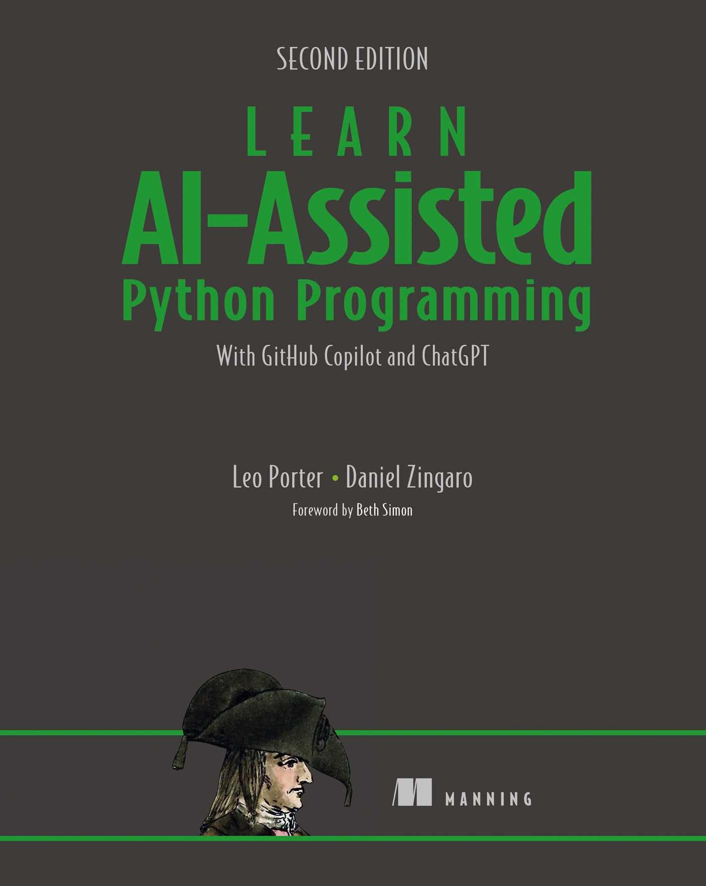

##  

O conteúdo dessa aula é inspirado no **capítulos 7** do livro abaixo.

{fig-align="center" fig-alt="Capa do livro de Potter e Zingaro." style="max-height: 50vh; width: auto;"}

# Introdução {background-color="#40666e"}

##

Já comentamos em aulas anteriores que não devemos pedir ao Copilot para resolver 
um problema muito grande de uma vez só.

- Como: _Crie um jogo de estratégia multiplayer desafiador e divertido_.

. . .

No pior caso, o Copilot não vai gerar nada útil.

- Há casos em que ele só fica gerando comentários em sequência.

##

E, na melhor das hipóteses, você teria um jogo _"enlatado"_ que não é muito divertido ou desafiador.

- Parte do poder de ser um programador é conseguir customizar o que você cria.

. . .

Além disso, imagina a dificuldade que seria corrigir todos os erros de um jogo inteiro gerado de uma vez.

. . .

Nós precisamos pedir ao Copilot para resolver pequenos problemas pra gente.

- E nós mesmos vamos juntando esses pedaços em nossos programas.

##

O objetivo dessa aula é aprender a quebrar um problema grande em subproblemas menores.

- De forma que consigamos resolver grandes problemas usando programação.

# Decomposição de Problemas {background-color="#40666e"}

##

[Decomposição de problemas]{.alert} envolve começar com um problema grande e que não 
está bem especificado

- e **quebrá-lo em subproblemas**, os quais são **bem definidos** e **úteis** para resolver o problema original.

. . .

Na aula vamos trabalhar com decomposição de funções.

- O que faremos portanto é escrever funções para cada um dos subproblemas que identificamos.

##

Ao identificarmos um subproblema, pode ser que consigamos resolvê-lo escrevendo uma função.

- Ou pode se que ele ainda seja muito grande para ser implementado em uma única função.
- E então precisaremos quebrá-lo em sub-subproblemas.
  - Esperamos então que cada sub-suproblema seja pequeno o suficiente.
  - Mas se não for, continuamos quebrando em subproblemas sucessivamente.

##

A principal **razão** para decompormos problemas é a **complexidade**.

. . .

Cada função deve ser simples o suficiente de forma que:

- consigamos entender o seu propósito;
- consigamos pedir ao Copilot para implementá-la;
- e, se tiver algum erro, não tenhamos muitas dificuldades em resolvê-lo.

## 

Quando escrevemos um código que é muito complexo, é muito mais provável que cometamos erros.

- O mesmo vale para o Copilot.

. . .

E quando temos erros em códigos grandes e complexos não é fácil encontrá-los e corrigi-los.

. . .

_"É difícil exagerar a importância da decomposição de problemas para a qualidade de código"_

##

No contexto da **Engenharia de Software** nós chamamos a decomposição de problemas de
[design top-down]{.alert} (abordagem de cima pra baixo).

- Tem esse nome porque começamos com uma tarefa grande que precisamos completar e a
  dividimos em tarefas menores.
- Durante o _design top-down_, nós criamos a "casca" das funções que precisamos implementar.
- Depois que terminamos o _design_, podemos implementar o código das funções definidas.

##

Nós geralmente acabamos tendo:

- uma função para o problema completo
- que chama as funções que implementam os subproblemas.
- E cada função de subproblema pode chamar funções de subsubproblemas.
- E assim sucessivamente.

. . .

Nesse processo, procuramos definir funções que recebem poucos parâmetros e que
retornam poucas informações, mas úteis.

- O que ajuda muito a melhorar a facilidade de entendimento do código.

# Pequenos exemplos de _design top-down_ {background-color="#40666e"}

##

Nas aulas anteriores já utilizamos alguns exemplos, ainda que simples, que poderiam ter sido tratados com _design top-down_.

. . .

Nós criamos, por exemplo, a função `obter_senha_forte`

- que fica pedindo um usuário para digitar uma senha até que ele digite uma senha forte.

. . .

Seguindo o _design top-down_ poderíamos identificar uma subtarefa dessa tarefa.

- Que é verificar se uma senha é forte.
- O que é justamente o que a função `eh_senha_forte` faz.

##

Podemos representar o _design top down_ como mostrado abaixo.

```{mermaid fontSize:25}
flowchart TD
  A(obter_senha_forte) --> B(eh_senha_forte)
```

## 

Nós também trabalhamos com uma função `melhor_palavra` que recebe uma
lista de palavras e retorna aquela que faz mais pontos no jogo _Scrabble_.

- Se tivéssemos criando a função usando _design top-down_, poderíamos 
identificar uma subtarefa que é calcular a pontuação de uma palavra.

. . .

Teríamos então o seguinte _design top-down_:

```{mermaid fontSize:25}
flowchart TD
  A(melhor_palavra) --> B(numero_de_pontos)
```

##

Quando nós criamos essas funções na aula passada, nós não usamos _design top-down_.

- Nós começamos da subtarefa (função folha) e depois criamos a função que resolve o problema maior.

. . .

Agora, para implementar o código das funções, nós continuaremos a fazer dessa forma.

- Mas antes disso, vamos projetar quais são as funções necessárias usando _design top-down_.

##

É importante ressaltar que, para esses exemplos pequenos, pode parecer que não faria
muita diferença usar ou não _design top-down_.

- Ou até mesmo pode parecer desnecessário implementar mais de uma função.

. . .

Mas, para problemas maiores, a decomposição de problemas é a única forma de manter
a complexidade sob controle.

- O nosso objetivo aqui é adquirir a [habilidade]{.alert} de quebrar um problema em problemas menores.

# Sugestões de Correção Ortográfica {background-color="#40666e"}

##

Vamos agora resolver um problema usando _design top-down_ desde o início.

- Ao longo da disciplina, nós vamos continuar abordando essa estratégia.
- De forma que você consiga aplicá-la com susesso por conta própria.

. . .

Ops.. tem um erro na frase anterior.

- O correto é _sucesso_ e não _susesso_.

##

É comum que erros de digitação ocorram ou que tenhamos dúvidas sobre a ortografia de uma palavra.

- Ex.: exceção ou excesão ou excessão?

. . .

O que nós vamos fazer é pegar uma palavra que pode estar escrita errada

- e oferecer sugestões de possíveis correções para ela.

. . .

Será um corretor ortográfico básico para palavras individuais.

##

Nós vamos tratar três tipos de erro de ortografia:

- letra faltando: como _suceso_ ao invés de _sucesso_.
- letra sobrando: como _menssagem_ ao invés de _mensagem_.
- letra trocada: como _viajem_ ao invés de _viagem_.

##

Existem diversos outros erros de ortografia que não cobriremos:

- Como o caso de _excessão_ ao invés de _exceção_ que tem uma letra trocada e uma letra sobrando.
- Ou de _metereologia_ em vez de _meteorologia_ que tem uma letra trocada e em posição errada.

. . .

Mas a ideia aqui é aprendermos o _design top-down_ e não criar um corretor ortográfico perfeito.

- Os casos que trataremos serão suficientes para o que precisamos.

# _Design top-down_ das Sugestões de Correção Ortográfica {background-color="#40666e"}

##

A nossa tarefa é:

- _Escrever um programa que pega uma palavra que pode estar escrita errada_
  _e oferece sugestões de possíveis correções para ela._
- Essa tarefa é certamente muito grande para ser tratada de uma vez só.


##

Para dividi-la em subtarefas, a primeira sugestão é tratar os três passos que são
muito comuns em diversos programas:

1. Ler a entrada do usuário.
2. Processar os dados.
3. Exibir a saída.

. . .

Obs.: nós já tínhamos usado isso no exemplo do processamento dos dados de futebol.

## 

<div style="font-size:0.8em">

| Fase | Papel  | Exemplo de uso com o Corretor |
|------|--------|-------------------------------|
| Entrada | Pegar, como entrada, a informação necessária para a função | Pegar a palavra errada _suceso_ e uma coleção de palavras reais (com ortografia correta) |
| Processamento | Realizar as operações especificadas sobre os dados | Considerar alterações na palavra que possam levar a uma palavra escrita corretamente (deve ser tentadas todas as combinações dos 3 tipos de erros que estamos tratando; ex.: _sucesso_, mas também _ssuceso_) |
| Saída | Exibir o resultado do processamento dos dados | Mostrar a sugestão _sucesso_ |

</div>

##

Seguindo essas etapas, começamos nosso _design top-down_, divindo a tarefa do corretor em três subtarefas:

1. Entrada: pedimos ao usuário uma palavra para a qual ele quer obter sugestões de correção.
2. Processamento: precisaremos descobrir todas as possíveis sugestões para a palavra do usuário.
3. Saída: exibimos para o usuário todas as sugestões que encontramos.

. . .

E agora criaremos uma função para cada subtarefa dessa, certo?

- Ou não?

##

Apesar de muitas vezes criarmos uma função para cada subtarefa, isso nem sempre é necessário.

- Veja que, para o tratamento da entrada do nosso problema, nós precisamos apenas pedir uma palavra ao usuário.
  - Acontece que Python já tem uma função _input_ que faz exatamente isso.
  - Portanto uma função para tratar a entrada teria apenas uma linha, o que parece uma divisão exagerada.
- A mesma coisa pode ser dita sobre o passo de saída.
  - Já que Python já possui uma função _print_ para isso.

##

Não é que esteja errado se resolvermos criar funções para esses passos.

- Mas devemos refletir se vale realmente a pena criar funções com uma única linha.
  - Um caso onde isso é útil é se ela fizer algo que precisa ser repetido várias vezes.

## Dividindo o subproblema de Processamento

Vamos focar então na etapa de processamento.

- Vamos chamar a função de processamento de `_obter_sugestoes_correcao`.

- Quais parâmetros a função precisa receber?

. . .

Com certeza precisa receber a palavra que o usuário digitou.

##

Ela poderia receber também as palavras reais em português, para que consiga fazer as sugestões.

- Isso pode ser feito de diferentes formas:
  - Ela pode receber a lista de palavras reais como um parâmetro.
  - Ou o nome de um arquivo que contém essas palavras.

## 

Esse tipo de decisão é muito comum quando estamos fazendo decomposição de subproblemas.

- Para nosso exemplo, vamos usar como parâmetro o nome de um arquivo.
- Isso porque temos um arquivo contendo quase 150 mil palavras reais em português.
- Que foram obtidas através de uma busca no Google (do repositório [fserb/pt-br](https://github.com/fserb/pt-br)).

##

Esse é o nosso _design top-down_ para o corretor até o momento:

- Considerando que a função mais geral, do problema como um todo, se chama `corretor_ortografico`.

```{mermaid fontSize:40 height=500}
flowchart TD
  A(corretor_ortografico) --> B(obter_sugestoes_correcao)
```

##


E o que precisamos fazer na função de processamento?

- Se pensarmos bem, podemos dividir a função em 4 subproblemas.

  1. Obter uma lista de palavras a partir do arquivo.
  2. Gerar uma lista de todas as palavras possíveis a partir da palavra digitada.
  3. A partir das palavras possíveis, gerar uma lista contendo apenas palavras reais.
  4. Retornar uma lista contendo as palavras reais (as sugestões) sem repetições. 

##


Vamos acrescentar alguns detalhes a esses passos.

. . .

1. Obter uma lista de palavras a partir do arquivo.
  - Função `carregar_lista_palavras` que carrega as palavras do arquivo em uma lista.
  - O arquivo tem uma palavra real do português em cada linha.

##

2. Gerar uma lista de todas as palavras possíveis a partir da palavra digitada.
  - Função `gerar_palavras_possiveis` que recebe a palavra digitada e gera todas as combinações possíveis com os erros que estamos tratando.
  - Ou seja, ela gera uma lista enorme de strings: acrescentado uma letra, removendo uma letra ou trocando uma letra.
  - Vamos fazer isso sem nos preocuparmos aqui se essas strings formam uma palavra válida ou não.

##

3. A partir das palavras possíveis, gerar uma lista contendo apenas palavras reais.
  - Função `filtrar_palavras_reais` que recebe a lista de palavras possíveis e a lista de palavras reais.
  - E retorna uma lista contendo apenas as palavras que estão nas duas listas.

##

4. Retornar uma lista contendo as palavras reais (as sugestões) sem repetições.
  - Função `filtrar_palavras_repetidas`. Mas por que ela seria necessária?
  - Porque, dependendo da forma como geramos as palavras possíveis, podemos acabar com sugestões duplicadas.
  - Ex.: se a palavra digitada for _suceso_, podemos gerar _sucesso_ duas vezes.
    - Uma ao tentar acrescentar um _s_ depois do _e_,
    - e outra ao tentar trocar um _s_ após o _s_ já existente na palavra.

##

Até o momento no _design top-down_ pode ser demonstrado no diagrama abaixo.

```{mermaid}
flowchart TD
  A(corretor_ortografico) --> B(obter_sugestoes_correcao)
  B --> C1(carregar_lista_palavras)
  B --> C2(gerar_palavras_possiveis)
  B --> C3(filtrar_palavras_reais)
  B --> C4(filtrar_palavras_repetidas)
```

##

::: {.callout-tip}
## Múltiplas formas de decompor um problema

Não há uma única forma correta de fazer um `design top-down`.

Você poderia ter pensado, por exemplo, em só gerar palavras que fossem reais,
filtrando as palavras já no momento em que foram geradas.

- Com isso a divisão de subproblemas seria diferente.
- E é recomendável que você tente outras alternativas de decomposição para esse mesmo problema.
:::

##

::: {.callout-tip}
## Decomposição é um processo de tentativa e erro

É muito comum que comecemos com uma ideia de `design top-down` e, no meio do processo,
percebamos que precisamos mudar nossa estratégia.

- Talvez porque em algum ponto ficou difícil dividir em subproblemas.
- Ou porque chegamos a muitas funções que parecem muito específicas (e não seriam úteis para problemas mais gerais).
- Ou ainda porque estamos passando muitos parâmetros para as funções ou passando um parâmetro de função em função repetidamente.
- Ou, por fim, porque apenas queremos experimentar outra abordagem.

A recomendação é: prática! Quanto mais praticar, mais habilidoso será no processo de decomposição.
:::

## Carregar lista de palavras

Vamos agora pensar em cada subproblema gerado no último passo da decomposição.

- Nós precisamos quebrar a função `carregar_lista_palavras` em subtarefas?

. . .

Poderíamos pensar em fases como: abrir o arquivo, carregar os dados em uma lista e fechar o arquivo.

- Mas pelo que vimos sobre arquivos do Python na aula passada, sabemos que abrir e fechar o arquivo é algo muito simples.
- Então vamos manter essa tarefa em uma única função.

## Gerar a lista de todas as palavras possíveis

E a função `gerar_palavras_possiveis` precisaria ser quebrada?

- Vamos pensar em como exatamente essas palavras candidatas seriam geradas.
- A ideia é gerar todas as combinações de adicionar uma letra, remover uma letra e trocar uma letra.
  - Só de descrever essa ideia já percebemos que existem três operações distintas.
  - Que poderiam então ser tratadas como subproblemas.

## Gerar a lista de todas as palavras possíveis

Poderíamos então quebrar a tarefa `gerar_palavras_possiveis` em três subtarefas:

1. `adicionar_letra`: que gera uma palavra candidata para cada letra do alfabeto em cada posição possível.
  - Ex.: `suceso` -> `asuceso`, `bsuceso`, ..., `sauceso`, `sbuceso`, ..., `sucesoa`, `sucesob`.
2. `remover_letra`: que gera uma palavra candidata removendo cada letra da palavra original.
  - Ex.: `suceso` -> `uceso`, `sceso`, `sueso`, `sucso`, `suceo` e `suces`.

## Gerar a lista de todas as palavras possíveis

3. `trocar_letra`: que gera uma palavra candidata para cada letra do alfabeto substituindo cada letra da palavra original.
  - Ex.: `suceso` -> `auceso`, `buceso`, ..., `saceso`, `sbceso`, ..., `sucesy`, ..., `sucesz`.

## Gerar a lista de todas as palavras possíveis

Precisamos quebrar ainda mais as tarefas anteriores?

- Para cada tarefa, parece que precisaremos fazer um loop nas letras da palavra e/ou no alfabeto
- E gerar uma palavra para cada combinação.

. . .

Por ora, vamos manter as tarefas como estão.

- Se, durante a fase de implementação percebermos que as tarefas são mais complicadas que parecem nós quebramos novamente.

##

::: {.callout-tip}
## Como saber quando parar de dividir em subtarefas?

Em geral, saber quando para de decompor um subproblema é mais arte do que ciência.

É necessária muita prática para adquirir a intuição de quando parar.
Desenvolvedores experientes costumam já imaginar em sua cabeça como uma tarefa poderia 
ser resolvida para decidir se deve dividi-la ou não.

Mas tudo bem se não soubermos bem como fazer isso por agora. Podemos ter uma uma 
primeira versão do _design_ e, durante a implementação, se uma função se torna mais
complexa que o esperado, nós a dividimos em subtarefas. Por outro lado, se uma
função ficou muito pequena e específica podemos reavaliar e não ter receio de
juntá-la a outras funções.
:::

## Gerar a lista de todas as palavras reais

A função `filtrar_palavras_reais` receberá duas listas, uma de palavras candidatas e
outra de palavras reais 

- E precisará retornar as palavras candidatas que existem também na lista de palavras reais.

. . .

Se pensarmos um pouco em como resolver esse problema, não parece algo tão complicado.

## Gerar a lista de todas as palavras reais

Podemos pensar em um loop que percorre a lista de palavras candidatas.

- E, para cada uma delas, verifica se ela existe também na lista de palavras reais.
- Se existir é adicionada na lista de resposta.

. . .

Parece um problema simples o suficiente para ser tratado por uma única função.

## Filtrar palavras repetidas

E a função `filtrar_palavras_repetidas`?

- Esse é um exemplo de como seu conhecimento prévio da linguagem pode mudar sua decisão.

. . . 

A princípio podemos manter a função, pois podemos pensar em um loop que percorre a lista de palavras

- E, para cada palavra, a adicionamos na lista de resposta apenas se ela ainda não estiver lá.

## Filtrar palavras repetidas

Acontece que Python tem uma função que remove duplicações de uma lista com uma linha de código.

- Então se souber disso, você pode concluir que a função `filtrar_palavras_repetidas` é desnecessária.

## Resumo do _design top-down_ do corretor ortográfico

Nosso _design top-down_ final é o seguinte:

```{mermaid}
flowchart TD
  A(corretor_ortografico) --> B(obter_sugestoes_correcao)
  B --> C1(carregar_lista_palavras)
  B --> C2(gerar_palavras_possiveis)
  C2 --> D1(adicionar_letra)
  C2 --> D2(remover_letra)
  C2 --> D3(trocar_letra)
  B --> C3(filtrar_palavras_reais)
  B --> C4(filtrar_palavras_repetidas)
```

# Implementação das Sugestões de Correção Ortográfica {background-color="#40666e"}

##

Ao fazer o design, nós definimos as funções de cima para baixo (_top-down_).

- Mas na hora de implementar é melhor escrever os códigos das funções de baixo para cima (_bottom-up_).
- Por que?

. . .

Isso porque se gerarmos primeiro as funções de subproblemas finais usando Copilot,

- se torna mais provável que ele as utilize quando pedirmos para gerar o código das funções de subproblemas maiores.

##

A estratégia do livro é focar na **Decomposição de Problemas** e, por isso, não segue
cada passo do **Ciclo de projeto de funções** para cada função.

- Mais especificamente, ele já apresenta a solução que preferiram, sem detalhar a **Engenharia de Prompt** utilizada.
- e não acrescentam os **testes** das funções.

. . .

Eu planejei aqui incluir pelo menos os testes de funções.

- Que é algo importante e geralmente subestimado pelos alunos, e até por professores 😜
- Mas vamos ver se o tempo da aula vai permitir passar por tudo.

## `carregar_lista_palavras`

Repare que começar de baixo para cima não significa necessariamente começar pelo nível mais baixo do
design.

- O importante é começar por funções folha.
- E só implementar uma função se todas as suas subfunções estiverem implementadas.

. . .

Por isso, vamos começar com a função `carregar_lista_palavras`.

## `carregar_lista_palavras`

Como já fizemos anteriormente, vamos definir a assinatura e a docstring e deixar o Copilot gerar o código.


```python
def carregar_lista_palavras(caminho_arquivo):
    """
    caminho_arquivo  é o nome de um arquivo que tem uma palavra 
    em português por linha.
    
    Retorna uma lista com as palavras do arquivo.
    """
```

## `carregar_lista_palavras`

Esse foi o código gerado pelo Copilot no meu caso.

```python
def carregar_lista_palavras(caminho_arquivo):
    """
    caminho_arquivo  é o nome de um arquivo que tem uma palavra 
    em português por linha.
    
    Retorna uma lista com as palavras do arquivo.
    """
    with open(caminho_arquivo, 'r', encoding='utf-8') as f:
        palavras = f.read().splitlines()
    return palavras
```

## Testes da função `carregar_lista_palavras`

Quais testes poderíamos pensar para a função?

- Podemos criar três arquivos de teste: um vazio, um com uma palavra e um com várias palavras.
- E criar uma função de teste para cada caso.

. . .

::: {.columns}
:::: {.column width="50%"}
No arquivo com uma palavra colocaremos:

```
exuberante
```
::::

:::: {.column width="50%"}
E no arquivo com várias palavras

```
dinossauro
exuberante
melancia
tucano
```
::::

:::

## Testes da função `carregar_lista_palavras`

Nossas funções de teste poderiam ser então:

```python
from pathlib import Path
from corretor.main import carregar_lista_palavras

PASTA_ARQUIVOS = Path(__file__).parent / 'dados'

def test_carregar_lista_palavras_vazia():
    palavras = carregar_lista_palavras(PASTA_ARQUIVOS / 'arquivo_vazio.txt')
    assert palavras == []

def test_carregar_lista_palavras_uma_palavra():
    palavras = carregar_lista_palavras(PASTA_ARQUIVOS / 'uma_palavra.txt')
    assert palavras == ['exuberante']

def test_carregar_lista_palavras_varias_palavras():
    palavras = carregar_lista_palavras(PASTA_ARQUIVOS / 'varias_palavras.txt')
    assert palavras == ['dinossauro', 'exuberante', 'melancia', 'tucano']
```

## Observação sobre os slides

Daqui por diante, na aula, nós vamos criar todas as funções e suas respectivas funções
de teste em um projeto no VS Code.

- Esse projeto estará disponível no repositório [ufla-pasia/corretor-ortografico](https://github.com/ufla-pasia/corretor-ortografico).

. . .

Já aqui nos slides vou manter apenas o prompt das funções (assinatura e docstring) e a
descrição em alto nível dos testeas.

##

Já implementamos então a função que carrega as palavras. 

- Vamos agora para a próxima função folha: `adicionar_letra`.


```{mermaid}
flowchart TD
  A(corretor_ortografico) --> B(obter_sugestoes_correcao)
  B --> C1(carregar_lista_palavras fa:fa-check)
  B --> C2(gerar_palavras_possiveis)
  C2 --> D1(adicionar_letra)
  C2 --> D2(remover_letra)
  C2 --> D3(trocar_letra)
  B --> C3(filtrar_palavras_reais)
  B --> C4(filtrar_palavras_repetidas)
```

## `adicionar_letra`

```python
def adicionar_letra(palavra):
    """
    palavra é uma string com pelo menos uma letra.

    Retorna uma lista com todas as strings que podem ser obtidas
    adicionando uma letra em qualquer posição da palavra.
    """
```

Obs.: para simplificar, vamos ignorar o acréscimo de letras com acentos.

. . .

Testes: 

- palavra comum (_boi_), palavra de uma letra (_a_), palavra com letra repetida (_passar_)

##

A próxima função agora será `remover_letra`.

```{mermaid}
flowchart TD
  A(corretor_ortografico) --> B(obter_sugestoes_correcao)
  B --> C1(carregar_lista_palavras fa:fa-check)
  B --> C2(gerar_palavras_possiveis)
  C2 --> D1(adicionar_letra fa:fa-check)
  C2 --> D2(remover_letra)
  C2 --> D3(trocar_letra)
  B --> C3(filtrar_palavras_reais)
  B --> C4(filtrar_palavras_repetidas)
```

## `remover_letra`

```python
def remover_letra(palavra):
    """
    palavra é uma string com pelo menos uma letra.

    Retorna uma lista com todas as strings que podem ser obtidas
    removendo uma letra de qualquer posição da palavra.
    """
```

. . .

Testes: 

- palavra comum (_boi_), palavra de uma letra (_a_), palavra com letra repetida (_passar_)


## `trocar_letra`

```python
def trocar_letra(palavra):
    """
    palavra é uma string com pelo menos uma letra.

    Retorna uma lista com todas as strings que podem ser obtidas
    trocando uma letra de qualquer posição da palavra por outra letra.
    """
```

. . .

Testes: 

- palavra comum (_boi_), palavra de uma letra (_a_), palavra com letra repetida (_passar_)

##

Agora nós já temos todos os subproblemas da função `gerar_palavras_possiveis` resolvidos e, 
portanto, podemos implementá-la.

```{mermaid}
flowchart TD
  A(corretor_ortografico) --> B(obter_sugestoes_correcao)
  B --> C1(carregar_lista_palavras fa:fa-check)
  B --> C2(gerar_palavras_possiveis)
  C2 --> D1(adicionar_letra fa:fa-check)
  C2 --> D2(remover_letra fa:fa-check)
  C2 --> D3(trocar_letra fa:fa-check)
  B --> C3(filtrar_palavras_reais)
  B --> C4(filtrar_palavras_repetidas)
```


## `gerar_palavras_possiveis`

```python
def gerar_palavras_possiveis(palavra):
    """
    palavra é uma string com pelo menos uma letra.

    Retorna uma lista com todas as palavras possíveis que podem ser geradas
    a partir da palavra original, através das operações de adicionar, remover
    ou trocar uma letra.
    """
```

. . .

Testes: 

- palavra comum (_boi_), palavra de uma letra (_a_), palavra com letra repetida (_passar_)

##

Nosso sistema está evoluindo bem. Próximo passo: `filtrar_palavras_reais` e depois 
`filtrar_palavras_repetidas`.

```{mermaid}
flowchart TD
  A(corretor_ortografico) --> B(obter_sugestoes_correcao)
  B --> C1(carregar_lista_palavras fa:fa-check)
  B --> C2(gerar_palavras_possiveis fa:fa-check)
  C2 --> D1(adicionar_letra fa:fa-check)
  C2 --> D2(remover_letra fa:fa-check)
  C2 --> D3(trocar_letra fa:fa-check)
  B --> C3(filtrar_palavras_reais)
  B --> C4(filtrar_palavras_repetidas)
```


## `filtrar_palavras_reais`

```python
def filtrar_palavras_reais(lista_palavras, palavras_possiveis):
    """
    lista_palavras é uma lista de strings com palavras em português.
    palavras_possiveis é uma lista de palavras possíveis.

    Retorna uma lista das palavras possíveis que estão na lista de palavras.
    """
```


## `filtrar_palavras_repetidas`

```python
def filtrar_palavras_repetidas(palavras_reais):
    """
    palavras_reais é uma lista de strings com palavras em português.

    Retorna a lista sem palavras repetidas.
    """
```

. . .

Testes: 

- uma palavra sugerida, várias palavras sugeridas e nenhuma palavra sugerida.

##

Já resolvemos todos os subproblemas da função `obter_sugestoes_correcao` e hora de implementá-la.

```{mermaid}
flowchart TD
  A(corretor_ortografico) --> B(obter_sugestoes_correcao)
  B --> C1(carregar_lista_palavras fa:fa-check)
  B --> C2(gerar_palavras_possiveis fa:fa-check)
  C2 --> D1(adicionar_letra fa:fa-check)
  C2 --> D2(remover_letra fa:fa-check)
  C2 --> D3(trocar_letra fa:fa-check)
  B --> C3(filtrar_palavras_reais fa:fa-check)
  B --> C4(filtrar_palavras_repetidas fa:fa-check)
```


## `obter_sugestoes_correcao`

```python
def obter_sugestoes_correcao(caminho_arquivo, possivel_palavra):
    """
    caminho_arquivo é o nome de um arquivo que tem uma palavra 
    em português por linha.
    possivel_palavra é  uma string que pode ser ou não uma 
    palavra real em português.

    Retorna a lista de todas as possíveis correções únicas para 
    a possível palavra.
    """
```

. . .

Testes: 

- Situações que retornem uma sugestão, várias sugestões e nenhuma sugestão.


##

Ufa... agora só falta a função principal e terminamos nosso corretor.

```{mermaid}
flowchart TD
  A(corretor_ortografico) --> B(obter_sugestoes_correcao fa:fa-check)
  B --> C1(carregar_lista_palavras fa:fa-check)
  B --> C2(gerar_palavras_possiveis fa:fa-check)
  C2 --> D1(adicionar_letra fa:fa-check)
  C2 --> D2(remover_letra fa:fa-check)
  C2 --> D3(trocar_letra fa:fa-check)
  B --> C3(filtrar_palavras_reais fa:fa-check)
  B --> C4(filtrar_palavras_repetidas fa:fa-check)
```

## `corretor_ortografico`

```python
def corretor_ortografico(caminho_arquivo):
    """
    caminho_arquivo é o nome de um arquivo que contém palavras 
    em português.

    Pede ao usuário uma palavra e exibe todas as possíveis correções 
    para aquela palavra, uma por linha.
    """
```

. . .

Testes:

- Como a função não retorna valores precisaríamos simular a interação com o usuário para testá-la.
- A biblioteca `pytest` tem funções avançadas para isso.
- Mas esse não é o nosso foco aqui, então vamos testar manualmente.

# Experimentando Sugestões de Correção Ortográfica {background-color="#40666e"}

## 

Vamos então experimentar nosso corretor ortográfico.

- Que palavras seria interessante usar?

. . .

Algumas sugestões interessantes são:

- suceso, susesso, beje, lage, análize, asia, ancioso, previlégio, impecilho, brusa, beneficiente, retrógado, sombrancelha.
- [Essa página](https://www.dicio.com.br/erros-de-ortografia/) traz outros erros comuns de ortografia em português que 
  você poderia querer testar.

# Conclusões {background-color="#40666e"}

## Missão Cumprida 👏

Completamos nosso primeiro _design top-down_ de um problema do mundo real.

- Fizemos um gerador de sugestões de correção que faz o que vários desses sistemas fazem.

. . .

O problema se tornou consideravelmente mais fácil de implementar,

- por que primeiro nós dividimos o problema em subproblemas.

##

Muitos especialistas em Computação consideram que **decomposição de problemas** é
[a]{.alert} **habilidade** mais crítica necessária para se escrever bons softwares.

. . .

Essa habilidade continua crítica mesmo usando Assistentes de IA como o Copilot e o ChatGPT.

- Pois eles trazem respostas muito melhores para problemas menores, claros e bem definidos.

##

Como mencionamos no início, decomposição de problemas é mais arte que ciência.

- E, portanto, exige prática para fazer isso bem.

. . .

Ao longo da disciplina, aplicaremos a decomposição de problemas em outros exemplos.

- O que te ajudará a ganhar mais experiência com essa habilidade tão importante.
