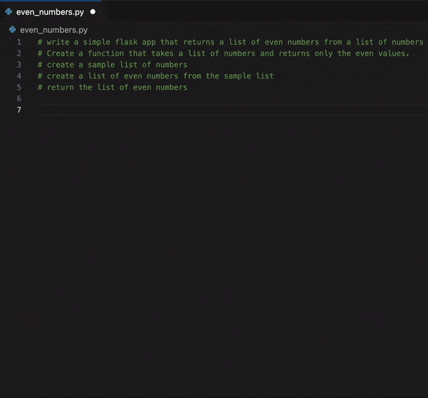
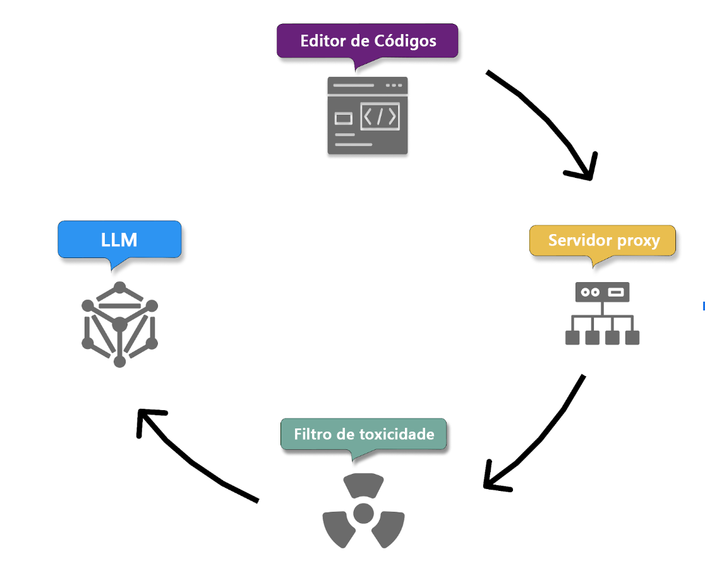
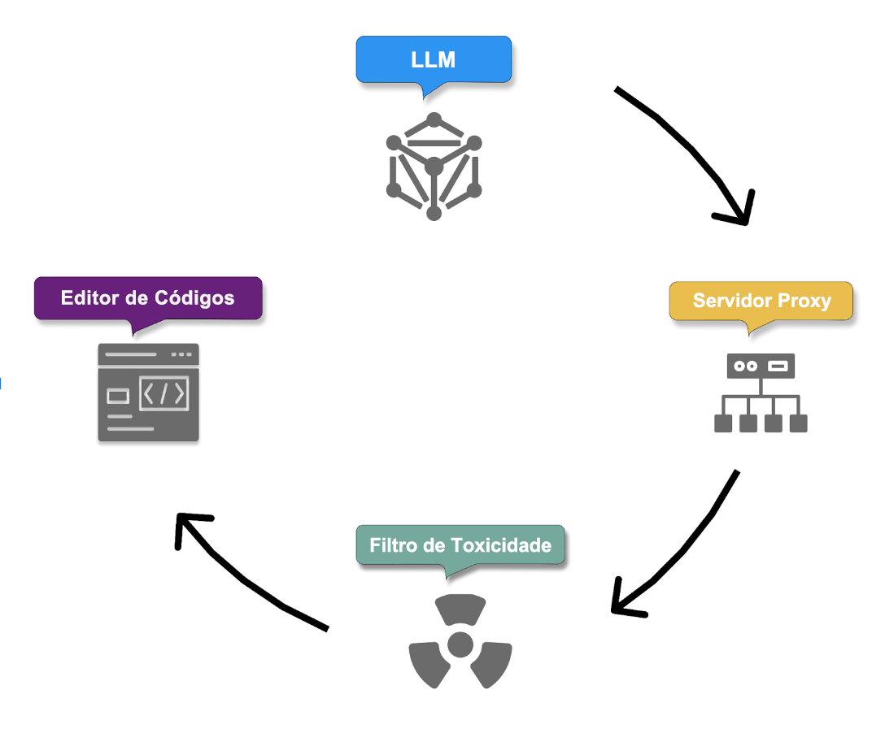
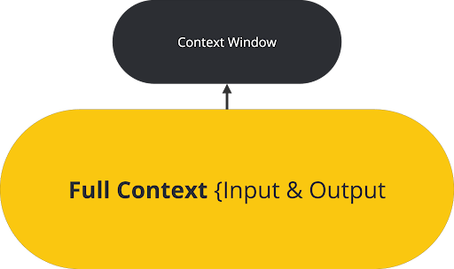
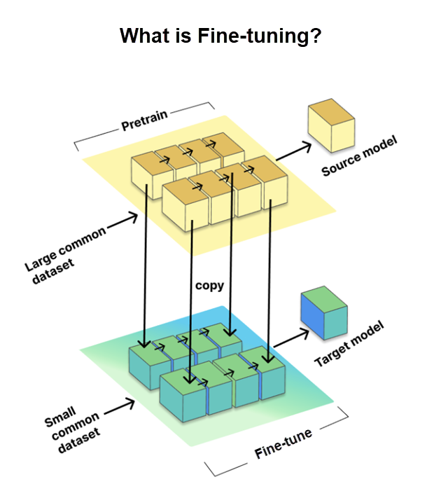

##  

O conteúdo dessa aula é baseado em materiais sobre o GitHub Copilot e o VS Code.

:::{.nonincremental}

- [Introdução à engenharia de prompts com o GitHub Copilot](https://learn.microsoft.com/pt-br/training/modules/introduction-prompt-engineering-with-github-copilot/)
- [Usando recursos avançados do Copilot](https://learn.microsoft.com/pt-br/training/modules/advanced-github-copilot/4-applied-copilot-techniques)
- [Prompt engineering for Copilot Chat](https://code.visualstudio.com/docs/copilot/chat/prompt-crafting)
- [Asking GitHub Copilot questions in your IDE](https://docs.github.com/en/copilot/how-tos/use-chat/use-chat-in-ide)

:::

. . .

É importante dizer que as ferramentas de IA estão evoluindo muito rápido.

- Mas diversas estratégias fundamentais que veremos aqui continuam fazendo sentido.

# Introdução {background-color="#40666e"}


## O que é engenharia de Prompt?

- Forma de comunicar a um assistente de IA **o que você precisa**.
  - Processo de elaborar instruções claras para guiar assistentes de IA.
- **Objetivo**
  - Gerar código adequado ao contexto e adaptado às necessidades específicas do projeto. 
  - Garantindo que seja correto sintática, funcional e contextualmente.
- Qualidade do código gerado depende da **clareza e precisão do prompt**.


## Princípios da engenharia de Prompt — os 4 Ss

* [Single]{.alert} - **Foco único**
* [Specific]{.alert} - **Específico**
* [Short]{.alert} - **Curto**
* [Surround]{.alert} - **Contexto**

## Princípios da engenharia de Prompt — os 4 Ss

* **Foco único** (_single_)
  - Foque em uma tarefa ou pergunta única e bem definida.
  - Essa clareza é fundamental para obter respostas precisas e úteis.
* **Específico** (_specific_)
  - Dê instruções explícitas e detalhadas.
  - Especificidade leva a sugestões mais precisas e aplicáveis.

## Princípios da engenharia de Prompt — os 4 Ss

* **Curto** (_short_)
  - Seja conciso: ser específico, mas direto ao ponto.
  - A ideia é garantir clareza sem sobrecarregar o Copilot ou complicar a interação.
* **Contextual** (_surround_)
  - Use nomes de arquivos descritivos e mantenha arquivos relacionados abertos no editor.
  - Isso dá contexto rico ao Copilot, levando a sugestões mais relevantes.


## 

Vamos ver agora alguns exemplos dessas práticas recomendadas para criar prompts eficazes.

1. Forneça clareza suficiente
2. Forneça contexto suficiente
3. Forneça exemplos
4. Itere

## 1. Forneça clareza suficiente

Exemplo

```text
Escreva uma função Python que receba uma lista de inteiros e 
retorne uma nova lista contendo apenas os números pares.
```

- Esse prompt tem **foco único**, é **específico** e **conciso**.

. . . 

Aqui vale tudo que já vimos antes sobre **decomposição de problemas**.

## 2. Forneça contexto suficiente

Quanto mais informação contextual for fornecida,  mais aderente será a sugestão do Copilot.

* Ex.: Comentários no topo do arquivo dão mais detalhes sobre o que você quer.

. . . 

```python
# Escreva um app Flask que retorna uma lista de números pares a partir de uma 
# lista de números
# Crie uma função que pega uma lista de números e retorne somente os números pares
# Crie uma lista de números de exemplo
# Crie uma lista de números pares a partir da lista de números
# retorna a lista de números
```

## 2. Forneça contexto suficiente

{fig-align="center" fig-alt="Exemplo de contexto suficiente com detalhes."}

## 2. Forneça contexto suficiente

Repare que no exemplo anterior foram dados mais detalhes, mas,

- ao mesmo tempo, as instruções são curtas e objetivas.

. . .

Esta prática segue o princípio **curto**, 

- equilibrando detalhe com concisão para garantir clareza e precisão na comunicação.

## 2. Forneça contexto suficiente

Você também pode controlar o que o Copilot considera como contexto.

- Você pode, por exemplo, selecionar um trecho de código para que o Copilot gere código relacionado a esse trecho.
- Além disso, o Copilot verifica os arquivos que estão atualmente abertos no editor para analisar o contexto.
  - Portanto, mantenha arquivos relacionados abertos para fornecer contexto adicional (e feche os que não são relevantes).

## 2. Forneça contexto suficiente

Outra sugestão é que se você já souber a biblioteca que pretende trabalhar,
é melhor importá-la manualmente antes de pedir ao Copilot para gerar o código.

- Ex.: se for usar o `Pandas`, importe-o antes de pedir para carregar os dados de um arquivo CSV.
- Isso direciona melhor o Copilot já que existem diferentes bibliotecas para manipulação de dados em Python. 

## 2. Forneça contexto suficiente

Utilize nomes de funções e classes descritivos.

- Isso ajuda o Copilot a entender melhor o propósito do código.
- E, claro, comentários docstring fornecem contexto ainda mais específico.

## 2. Forneça contexto suficiente

Forneça exemplos de código.

- Se for trabalhar com uma nova biblioteca, e o Copilot gerar respostas de outras ou de versões antigas:
  - forneça um exemplo de uso da nova biblioteca mesmo que não seja o que você quer fazer.
- Isso ajuda o Copilot a gerar código para a versão mais recente da biblioteca.
  - (e depois apague o código de exemplo que colocou).

. . .

Obs.: veremos mais adiante que _skills_ são hoje uma forma mais prática de tratar essa quetão.

##

::: {.callout-tip}
Dica: se estiver fazendo experimentações de código por você mesmo, pode ser interessante desabilitar temporariamente o Copilot, evitando que esses "experimentos" interfiram no contexto do Copilot.
:::

. . .


::: {.callout-tip}
Dica: mantenha uma boa qualidade de código. Aqui vale o princípio _"garbage in, garbage out"_. Ou seja, o contexto pode piorar se o código que você está escrevendo estiver com muitos erros ou for de baixa qualidade.
:::

## 3. Forneça exemplos

  O uso de exemplos pode deixar mais claros seus requisitos e expectativas.

  - Ilustrando conceitos abstratos para o Copilot.

. . .

```python
# cria uma lista de números de exemplo
# cria uma lista de números pares a partir da lista de números
# retorna a lista de números
# Exemplo: [1,2,3,4,5,6,7] -> [2,4,6]
```

## 4. Itere

Uma das chaves para desbloquear todo o potencial do Copilot é a prática da iteração.

- Nem sempre seu primeiro prompt produzirá um código perfeito.
- Se a primeira saída não for ideal, trate-a como uma etapa de um diálogo.
- Apague o código, melhore o comentário inicial com detalhes e exemplos e deixe
o Copilot tentar novamente.

## 4. Itere

::: {.callout-tip}
Usando o chat com `Ctrl`+`I`, você pode pedir ao Copilot para melhorar o código que ele mesmo gerou.

Ex.: "Adicione uma função de fibonacci", na mesma caixa, se necessário, pode continuar com instruções como
"não use recursão" e depois "melhore os nomes das variáveis".
:::

## Exemplo de refinamento de prompt

Imagine que você está usando o Copilot e faz o prompt abaixo,

- em um novo arquivo, sem nenhum código prévio para fornecer contexto ao Copilot.

. . .

::: {.callout-tip}
Escreva uma função que eleve ao quadrado os números de uma lista .
:::

. . .

À primeira vista, parece um prompt simples e eficaz.

- Mas há muitas coisas que não estão claras.

##

::: {.callout-tip}
Escreva uma função que eleve ao quadrado os números de uma lista .
:::

- Em qual linguagem a função deve ser escrita?
- Você deseja incluir números negativos?
- A entrada conterá algum elemento que não seja um número?
- A função deve modificar a lista fornecida ou retornar uma nova lista?

## 

Como podemos refinar este prompt para torná-lo mais eficaz? 

. . .


::: {.callout-tip}
Escreva uma função em Python que receba uma lista de inteiros e retorne uma nova lista onde cada número esteja elevado ao quadrado, excluindo quaisquer números negativos.
:::

. . .

Este novo prompt é claro e específico sobre:

- qual linguagem queremos usar, 
- o que a função deve fazer, 
- quais restrições existem 
- e o tipo de entrada esperado.

# Como o Copilot aprende com seus prompts  {background-color="#40666e"}

## 

O Copilot usa modelos de IA que foram treinados com grande quantidades de dados.

- Para melhorar seu reconhecimento em contextos de código específicos,
geralmente fornecemos exemplos.

. . .

Essa prática é inspirada em técnicas de **aprendizado de máquina**.

- Aprendizado Zero-Shot.
- Aprendizado One-Shot.
- Aprendizado Few-shot.


## Aprendizado Zero-Shot

É quando o Copilot gera o código sem nenhum exemplo específico, confiando apenas em seu treinamento básico.

- Escrevemos o comentário do que queremos diretamente, sem exemplos.

## Aprendizado Zero-Shot {auto-animate=true}

```python
# Preciso de uma função para converter temperaturas
# de Celsius para Fahrenheit
```

## Aprendizado Zero-Shot {auto-animate=true}

```python
# Preciso de uma função para converter temperaturas
# de Celsius para Fahrenheit

def celsius_para_fahrenheit(celsius):
    fahrenheit = (celsius * 9/5) + 32
    return fahrenheit
```

## Aprendizado One-Shot

É fornecido um único exemplo, ajudando o modelo a gerar uma resposta mais sensível ao contexto.

- Pode ser um exemplo de entrada e saída.
  - Como da função para retornar números pares que vimos antes.
- Ou talvez você já tenha uma função semelhante e queira uma variante, por exemplo.

## Aprendizado One-Shot {auto-animate=true}

```python
# Exemplo: função para converter temperaturas de Fahrenheit para Celsius

def fahrenheit_para_celsius(fahrenheit):
    celsius = (fahrenheit - 32) * 5/9
    return celsius
```

## Aprendizado One-Shot {auto-animate=true}

```python
# Exemplo: função para converter temperaturas de Fahrenheit para Celsius

def fahrenheit_para_celsius(fahrenheit):
    celsius = (fahrenheit - 32) * 5/9
    return celsius

# Agora preciso de um função para converter temperaturas de Celsius para Fahrenheit
```

## Aprendizado One-Shot {auto-animate=true}

```python
# Exemplo: função para converter temperaturas de Fahrenheit para Celsius

def fahrenheit_para_celsius(fahrenheit):
    celsius = (fahrenheit - 32) * 5/9
    return celsius

# Agora preciso de um função para converter temperaturas de Celsius para Fahrenheit

def celsius_para_fahrenheit(celsius):
    fahrenheit = (celsius * 9/5) + 32
    return fahrenheit
```


## Aprendizado Few-Shot

Nesse métdodo, o Copilot é apresentado a vários exemplos, 

- equilibrando a imprevisibilidade do zero-shot 
- com a precisão do ajuste fino do one-shot.

## Aprendizado Few-Shot

Suponha que deseje gerar um código que envie saudações ao usuário dependendo da hora do dia.

. . .

```python
# Exemplo 1: Mensagem de saudação para a manhã
# Entrada: 9:00
# Saída: "Bom dia!"

# Exemplo 2: Mensagem de saudação para a tarde
# Entrada: 14:00
# Saída: "Boa tarde!"

# Exemplo 3: Mensagem de saudação para a noite
# Entrada: 19:00
# Saída: "Boa noite!"

# Agora, gere um código python que receba a hora atual como entrada usando o 
# módulo datetime e retorne a mensagem de saudação apropriada
```

## Aprendizado Few-Shot

```python
from datetime import datetime

def saudacao():
    # Obtém a hora atual
    agora = datetime.now()
    hora_atual = agora.hour

    # Determina a saudação com base na hora atual
    if 5 <= hora_atual < 12:
        return "Bom dia!"
    elif 12 <= hora_atual < 18:
        return "Boa tarde!"
    else:
        return "Boa noite!"

# Chama a função e imprime a saudação
print(saudacao())
```

## Encadeamento de Prompt e Gerenciamento do Histórico do Chat 

. . .

Ao trabalhar em funcionalidades com várias etapas

- A conversa no chat do Copilot pode se tornar extensa.

. . .

Se, por um lado, o contexto ajuda o Copilot a fornecer respostas melhores.

- Por outro, manter longos históricos pode tornar o processo ineficiente e caro.

. . .

## {auto-animate=true}

Imagine, por exemplo, que você fez várias interações no mesmo chat para realizar uma tarefa

::: {.callout-note title="Prompt" icon="false"}
Interação 1: "Crie uma função de autenticação de usuário"

Interação 2: "Adicione tratamento de erros para credenciais inválidas"

Interação 3: "Adicione testes unitários para a função de autenticação" 

Interação 4: "Adicione comentários JSDoc para documentar a função"

Interação 5: "Otimize a função para melhor desempenho"
:::

## {auto-animate=true}

::: {.callout-note title="Prompt" icon="false"}
Interação 1: "Crie uma função de autenticação de usuário"

Interação 2: "Adicione tratamento de erros para credenciais inválidas"

Interação 3: "Adicione testes unitários para a função de autenticação" 

Interação 4: "Adicione comentários JSDoc para documentar a função"

Interação 5: "Otimize a função para melhor desempenho"
:::

Cada interação leva todo o histórico do chat, fazendo com que o contexto tenha sempre a conversa anterior mais a atual.

- Isso pode aumentar consideravelmente o consumo de tokens.

- Resumir o contexto ou reiniciar a conversa pode reduzir o consumo.

## 

Para gerenciar isso de forma eficiente:

- recomece e forneça um contexto focado para novos recursos.

. . .

Comece um chat do zero com detalhes essenciais em vez de retomar toda a conversa.

- Use referências concisas a trabalhos anteriores em vez de repetir implementações completas.

# Padrões de Prompt {background-color="#40666e"}

##

Seguindo a mesma ideia dos **Padrões de Projeto** (_Design Patterns_) de desenvolvimento de software.

- Existem iniciativas de catalogação de [Padrões de Prompt]{.alert},
- com o objetivo de documentar e divulgar boas práticas,
- que levam a resultados melhores no uso de assistentes de IA.

##

Iniciativas desse tipo são complexas, devido a diversos fatores:

- O comportamento não determinístico dos modelos de IA.
- Os resultados diferentes que obtemos ao usar diferentes modelos de IA.
- A rápida evolução dos assistentes de IA.
  - Um padrão que parece interessante hoje pode se tornar obsoleto em pouco tempo.

##

De todo modo, é interessante conhecer essas iniciativas.

- Pois, mesmo que não se tornem padrões, podem servir de inspiração sobre diferentes formas de uso dos assistentes de IA.

. . .

Veremos aqui dois exemplos inspirados no Capítulo 12 do livro da disciplina.

- _Flipped Interaction Pattern_
- _Persona Pattern_

## Flipped Interaction Pattern

A ideia do **Padrão de Interação Invertida** é trocarmos de papel com o assistente de IA.

- Em vez fazermos perguntas para ele responder,
- nós instruímos o agente para que ele nos faça as perguntas.

. . .

Por incrível que possa parecer à primeira vista,

- nós usamos esse padrão quando sabemos muito pouco sobre o que precisamos fazer.

. . .

Como assim? 🤔

##

Quando estamos trabalhando com algo que conhecemos muito pouco,

- nós não sabemos nem o que exatamente pedir para o assistente de IA.

. . .

A motivação desse padrão é que a IA pode saber o que nos perguntar

- de forma a chegar mais rápido no seu objetivo,
- do que se nós fizéssemos algum prompt vago e incompleto.

##

O padrão segue a seguinte estrutura:

::: {.callout-note title="Prompt" icon="false"}
Eu gostaria que você me fizesse perguntas para alcançarmos X.
Você deve fazer perguntas até alcançarmos X, onde X é o objetivo que gostaríamos de alcançar.
:::

. . .

A ideia aqui não é fornecer um prompt preciso,

- mas sim nos dar dicas das ideias chave que precisaremos abordar em nosso prompt.

## 

Como exemplo, no capítulo 3, nós fizemos uma função para obter uma senha forte do usuário.

- Mas suponha que não soubéssemos direito como projetar essa função.

. . .

Nós podíamos escrever um prompt para o Copilot criar a função pra gente,

- Mas, provavelmente, ele poderia tomar decisões com as quais não concordamos.

. . .

Podemos então pedir ao Copilot para nos fazer perguntas, antes da implementação.

##

::: {.callout-note title="Prompt" icon="false"}
Preciso de uma função em Python que fique perguntando para o usuário uma senha até 
ele digite uma senha forte.
Faça perguntas para mim, uma de cada vez, até que você possa implementar a função
:::

. . . 

Experimentei o prompt com dois assistentes de IA

- Chamou a atenção a diferença nas respostas.
  - Mostrando a importância de sabermos conduzir a conversa para obter o resultado que precisamos.
- [Exemplo de uso com Gemini](https://docs.google.com/document/d/1NKkVjTNxRWZlkGQAjc7v3KPzF1TyT_H4V3FvheSEmVQ/edit?usp=sharing)
- [Exemplo com o ChatGPT](https://chatgpt.com/share/6a9f082e-92dc-83e9-8e4a-695fc3e152ac)

## Persona Pattern

A ideia do **Padrão de _Persona_** é instruir o assistente de IA de forma que:

- ele atue de acordo com um personagem, profissional ou especialista específico.

. . .

Em vez de responder como um assistente genérico, a IA adota 

- a mentalidade, 
- o tom de "voz", 
- os conhecimentos técnicos 
- e até os preconceitos ou limitações daquela persona.

##

Mudança de perspectiva: 

- O modelo filtra suas respostas através das lentes da profissão ou personalidade escolhida.

. . .

Ajuste de tom e linguagem: 

- Uma persona de "chef de cozinha renomado" usará termos técnicos de culinária, enquanto um "professor de jardim de infância" explicará o mesmo assunto de forma simples e lúdica.

##

Foco no contexto: 

- Ajuda a IA a priorizar os conhecimentos mais relevantes para aquele papel específico, aumentando a precisão da resposta.

##

No contexto do desenvolvimento de software:

- O objetivo é melhorar a **qualidade** e a **relevância** do código gerado para domínios especializados. 
- Essa abordagem costuma ajudar a **acelerar** o desenvolvimento,  
  - pois tende a levar a soluções mais direcionadas já na primeira tentativa.

. . .

O padrão segue a seguinte estrutura:

::: {.callout-note title="Prompt" icon="false"}
A partir de agora, atue como persona X.
Forneça respostas que persona X criaria.
:::

##

Suponha, por exemplo, que um aluno esteja fazendo uma disciplina introdutória de programação

- na qual algumas construções de Python são proibidas,
- com objetivo de evitar que o aluno se desvie dos conceitos introdutórios da curso.

. . . 

Poderíamos usar o seguinte prompt

::: {.callout-note title="Prompt" icon="false"}
A partir de agora, atue como um instrutor de introdução à programação em Python.
No curso que você está lecionando, as seguintes características do Python não são permitidas:
list comprehensions, generators, lamda, e funções como any, all, etc.
Vou fornecer um código e você deverá verificar se existe qualquer construção de Python não
permitida e sugerir como reescrever o código para não usá-las.
:::

##

Já no contexto do dia a dia do desenvolvimento, pode ser muito útil usar o **Persona Pattern**

- instruindo o assistente de IA a atuar como um especialista de uma área específica.

. . .

Veremos alguns exemplos.


## Função de especialista em segurança {auto-animate=true}

Ao trabalhar em recursos críticos para a segurança, configure o Copilot para pensar como um especialista na área:

. . .

::: {.callout-note title="Prompt" icon="false"}
Atue como um especialista em cibersegurança. Crie uma função de validação de senha que verifique vulnerabilidades comuns e siga as diretrizes da OWASP.
:::

## Função de especialista em segurança {auto-animate=true}

::: {.callout-note title="Prompt" icon="false"}
Atue como um especialista em cibersegurança. Crie uma função de validação de senha que verifique vulnerabilidades comuns e siga as diretrizes da OWASP.
:::

Essa abordagem normalmente gera código que inclui:

- Sanitização de entrada
- Proteção contra ataques comuns
- Padrões de validação padrão do setor
- Melhores práticas de segurança

## Função de otimização de desempenho {auto-animate=true}

Para código crítico em termos de desempenho, use a função de especialista em desempenho:

. . .

::: {.callout-note title="Prompt" icon="false"}
Atue como um especialista em otimização de desempenho. Refatore este algoritmo de classificação para lidar com grandes conjuntos de dados de forma eficiente.
:::

## Função de otimização de desempenho {auto-animate=true}

::: {.callout-note title="Prompt" icon="false"}
Atue como um especialista em otimização de desempenho. Refatore este algoritmo de classificação para lidar com grandes conjuntos de dados de forma eficiente.
:::

Isso geralmente resulta em:

- Algoritmos e estruturas de dados otimizados
- Implementações com uso eficiente de memória
- Considerações sobre escalabilidade
- Sugestões para monitoramento de desempenho
- Papel de especialista em testes

## Função de especialista de testes {auto-animate=true}

Ao criar suítes de testes abrangentes, aproveite a perspectiva de um especialista em testes:

. . .

::: {.callout-note title="Prompt" icon="false"}
Atue como um especialista em testes. Crie testes unitários abrangentes para este módulo de processamento de pagamentos, incluindo casos extremos e cenários de erro.
:::

## Função de especialista de testes {auto-animate=true}

::: {.callout-note title="Prompt" icon="false"}
Atue como um especialista em testes. Crie testes unitários abrangentes para este módulo de processamento de pagamentos, incluindo casos extremos e cenários de erro.
:::

Isso normalmente produz:

- Cobertura de testes completa
- Tratamento de casos extremos
- Implementações simuladas (mocks)
- Testes de condições de erro

##

Definir uma **_persona_** pode levar a código pronto para produção mais rapidamente, 

- incorporando conhecimento do domínio nas implementações iniciais, 
- reduzindo a necessidade de múltiplos ciclos de revisão.  


# Recursos do Copilot {background-color="#40666e"}

##

Veremos a seguir alguns recursos específicos do GitHub Copilot, como:

- _slash commands_
- _chat participants_
- _chat variables_
- e modos de uso (_ask_, _plan_ e _agent_).

. . .

Obs.: essas funcionalidades se alteraram muito desde a oferta anterior da disciplina.

## Prompts implícitos (_slash commands_)

Podemos usar opções do Copilot fornecem prompts implícitos prédefinidos que podem melhorar a resposta.

- `/explain` — obtém explicações sobre o código.
- `/fix` — para correção de bugs.
- `/tests` — cria testes unitários para o código selecionado.
- `/clear` — inicia um novo chat (contexto), marcando o atual como finalizado
- `/fork` — bifurca a conversa atual em um novo chat.
- `/compact` — libera espaço de contexto, compactando contexto atual.

## Prompts implícitos (_slash commands_)

Esses comandos facilitam a interação com o Copilopt,

- permitindo que sejam geradas respostas melhores sem ter que escrever prompts mais longos.

. . .

::: {.callout-tip}
Combine os comandos com o prompt que você deseja usar.

Exemplo: `/explain como a biblioteca Pandas é usada neste código.`
:::

. . .

Experimente digitar `/` no chat do VS Code para verificar todas as opções disponíveis.

## Contexto seletivo

Nós vimos como o Copilot considera o contexto do código que está sendo trabalhado.

- Mas você pode também dizer explicitamente ao Copilot qual contexto deve ser considerado.

## Contexto seletivo

[chat participants]{.alert}

- Permitem incluir contexto de domínio (como terminal, github, etc.)

. . .

[chat variables]{.alert}

- Permitem especificar o escopo a ser considerado.

## _chat participants_

`@terminal` — fornece sugestões baseadas na saída do terminal.

- Ex.: `@terminal Como corrigir a mensagem de erro que estou vendo.`

. . .

`@vscode` — para saber mais sobre os recursos e APIs do VS Code.

- Ex.: `@vscode como eu mudo as cores do VS Code?`

. . .

`@github` — expande as informações que o Copilot pode fornecer.

- Pode, por exemplo, fazer busca em repositórios ou em histórico de commits. 

## Contexto seletivo: _chat participants_

::: {.callout-tip}
Extensões do VS Code podem adicionar participantes específicos ao Copilot.
:::

## 

| _chat variable_ | Inclui no prompt: |
| --- | --- |
| `#block` | o bloco de código atual |
| `#class` | a classe atual |
| `#comment` | o comentário atual |
| `#file` | o conteúdo do arquivo atual |
| `#function` | a função ou método atual |
| `#line` | a linha de código atual |
| `#path` | o caminho do arquivo |
| `#project` | o contexto do projeto |
| `#selection` | o texto atualmente selecionado |
| `#sym` | o símbolo atual |

## Modos de uso do Chat Copilot

No canto inferior esquerdo da janela do chat do Copilot, você pode escolher entre três modos de uso:

- Ask
- Plan
- Agent

## Modo [Ask]{.alert}

- Para perguntas gerais e explicações.
- Possíveis sugestões de código aparecem no Chat e você precisa copiar e colar no editor.

## Modo [Plan]{.alert}

- Permite criar um planejamento estruturado antes da implementação.
  - Utilize várias interações até atingir o planejamento desejado.
  - Com isso, você pode corrigir e/ou direcionar a solução ainda em nível de planejamento.
  - Levando depois a uma implementação melhor (e com menor uso de tokens).
- Ao final, é exibido um botão para disparar o início da implementação (modo agente, seguindo o planejamento)
- Dica: você pode mudar para este modo diretamente usando o comando `/plan`.

## Modo [Agent]{.alert}

- Quando quiser que o Copilot trate uma tarefa específica de modo autônomo.
- O próprio Copilot decide quais arquivos editar e como.
- Pode sugerir comandos a serem executados no terminal (você precisa revisar e aprovar).
- Funciona em modo interativo até que a tarefa seja concluída.
- Tem impactos nos custos, pois cada interação pode consumir várias solicitações de LLM.

## Planeje primeiro, implemente depois

. . .

Para alterações complexas que envolvem vários arquivos:

- É altamente **recomendável separar o planejamento da implementação**

. . .

Isso evita que a IA resolva o problema de forma errada

- levando a desperdício de créditos de IA em um código que vai acabar sendo descartado.

## Planeje primeiro, implemente depois

1. [Explore]{.alert}

- Use o modo de consulta ou um subagente para ler o código relevante e entender como ele funciona antes de fazer alterações.

2. [Planeje]{.alert}

- Use o agente de Planejamento para criar um plano de implementação estruturado. 
- Revise e refine o plano antes de executá-lo.

## Planeje primeiro, implemente depois

3. [Implemente]{.alert}

- Alterne para o modo de agente e implemente a partir do plano. 
- Inclua testes ou saídas esperadas para que o agente possa verificar seu próprio trabalho. 
- Execute sessões independentes do Copilot, Claude ou Codex em paralelo.

## Planeje primeiro, implemente depois

4. [Revise]{.alert}
- Use pontos de verificação para revisar o progresso.
- Retroceda se o agente se desviar do caminho
- Solicite uma revisão de código do Copilot no resultado final da alteração (Pull Request).


## Avançado: customização do Copilot

Você pode customizar o comportamento do Copilot de diferentes formas.

1. Com instruções customizadas (para todo o projeto ou para contextos específicos, como todos arquivos .py).
2. Com arquivos de prompt para reutilização em tarefas repetitivas.
3. Com modos de chat customizados (além de Ask, Plan e Agent).
4. Escolhendo diferentes modelos de LLM (se sua assinatura permitir).

## Avançado: customização do Copilot

5. Usando servidores MCP que permite conectar serviços externos e ferramentas especilizados aumentando as capacidades do Copilot.

. . .

Não entraremos em detalhes nesses pontos nesta aula.

- Para quem quiser saber mais acesse [Customize chat to your workflow](https://code.visualstudio.com/docs/copilot/customization/overview?originUrl=%2Fdocs%2Fcopilot%2Fcustomization%2Fprompt-files).


# Fluxo de Processamento de Prompts {background-color="#40666e"}

## 

Vamos agora ver como o Copilot transforma nossos prompts em códigos utilizáveis.

- Repare que é um processo de entrada (processamento do prompt) e saída (código gerado).


## Fluxo de entrada

{fig-align="center" fig-alt="Fluxo de entrada do processamento de prompts do GitHub Copilot." style="max-height: 60vh;"}

## 1. Transmissão segura + Coleta de contexto

Prompts transmitidos via **HTTPS** (seguro e confidencial).

. . .

Simultaneamente, o Copilot coleta detalhes do ambiente:

* Código antes e depois do cursor (contexto).
* Nome e tipo do arquivo que está sendo editado.
* Abas vizinhas abertas, para que a sugestão se alinhe a outros trechos de código do mesmo projeto.
* Informações sobre a estrutura do projeto e caminhos de arquivos.
* Informações sobre linguagens de programação e frameworks usados.

## 1. Transmissão segura + Coleta de contexto

Simultaneamente, o Copilot coleta detalhes do ambiente:

* Pré-processamento usando técnica _Fill-in-the-Midle (FIM)_.
  - Modelos especializados em programação são treinados para preencher o meio (lacuna), em vez de
    tratar apenas geração da próxima palavra a partir do contexto anterior.

. . .

Obs.: o contexto coletado tem evoluído rapidamente.

- Especialmente no modo agente, o Copilot pode fazer busca em todo o repositório de código.

## 2. Filtro de proxy

Prompt passa por servidor proxy no Azure (mantido pelo GitHub).

* Filtra tráfego malicioso
* bloqueando tentativas de manipulação do prompt 
* ou ataques de injeção para obter detalhes sobre como o modelo gera as sugestões de código.


## 3. Filtragem de toxicidade

Antes da geração, Copilot utiliza filtros para que o código gerado não inclua e nem promova:

  * Discurso de ódio ou conteúdo inapropriado (que pode ser ofensivo, por exemplo).
  * Dados pessoais (nomes, endereços, IDs) para preteger a privacidade e a segurança dos dados do usuário.


## 4. Geração de código com o modelo LLM

* Prompt filtrado → enviado para modelos de linguagem (LLMs).
* As sugestões são baseadas no entendimento do Copilot tanto do prompt quanto do contexto, 
* para produzir resultados que sejam relevantes, funcionais e alinhados aos requisitos específicos do projeto.


## Fluxo de Saída

{fig-align="center" fig-alt="Fluxo de saída do processamento de prompts do GitHub Copilot." style="max-height: 60vh;"}

## 5. Pós-processamento e validação da resposta

Filtro de toxicidade aplicado novamente sobre o código gerado.

. . .

Verificações adicionais feitas pelo servidor de proxy:

* **Qualidade do código**: verificação de bugs, vulnerabilidades comuns (como cross-site scripting XSS, ou injeção de SQL).
  * Objetivo é tentar garantir robustez e segurança.

## 5. Pós-processamento e validação da resposta

* **Correspondência com código público** (opcional)
    * Administradores podem habilitar um filtro que impede o Copilot de retornar sugestões com mais de ~150 caracteres que sejam muito semelhantes a trechos de código públicos existentes no GiHub.
    * Objetivo é evitar sugestão de código que seja coincidente com conteúdo original.

. . .

Se o código gerado falhar nessas verificações → pode ser truncada ou descartado.


## 6. Entrega de sugestões e início do ciclo de feedback

* Apenas respostas aprovadas chegam ao usuário.
* Copilot inicia seu ciclo de feedback baseado em ações do usuário.

  * Para aumentar seu próprio conhecimento com base nas sugestões aceitas.
  * Para aprender e se aprimorar por meio de modificações e rejeições das sugestões.


## 7. Repetição para prompts subsequentes

O processo é repetido à medida que o usuário forneça mais prompts.

- Com o tempo o Copilot aplica os dados acumulados de feedback e de interação.
- Incluindo os detalhes de contexto fornecidos.
- Para aprimorar o seu entendimento da intenção do usuário e refiniar seus recursos de geração de código.


# Dados do GitHub Copilot {background-color="#40666e"}


## Tratamento de dados — Sugestões de código

Copilot no editor de código **não retém solicitações**.

- Código, comentários e contexto são usados apenas no momento da sugestão.
- Após gerar a sugestão → solicitações são descartadas.

. . .

Assinantes individuais podem **recusar o compartilhamento** de dados com o GitHub para treinar modelos.

- Isso é [altamente recomendável!]{.alert}


## Tratamento de dados — Copilot Chat

Funciona como plataforma interativa, com histórico de conversas.

Difere das sugestões de código (autocomplete):

- **Formatação**: respostas adaptadas à interface de chat, como realce de código.
- **Participação do usuário**: permite perguntas de acompanhamento e refinamento.
- **Retenção**: solicitações/sugestões/contexto podem ser mantidos por **até 28 dias** (varia conforme o editor).


## Janelas de contexto são limitadas

**Janela de contexto** é a quantidade de código/texto que o modelo processa simultaneamente.

. . .

{fig-align="center" fig-alt="Janela de contexto de interações com IA." style="max-height: 50vh;"}

. . .

Ela Isso inclui não só o prompt utilizado, 

- mas também o contexto do arquivo e do projeto.

## Janelas de contexto são limitadas

O tamanho máximo da janela de contexto pode variar de acordo com a versão do Copilot

- Contextos maiores podem ser úteis em determinadas circunstâncias.
- Mas têm alto custo, e podem levar a respostas imprecisas e menos úteis.


# LLMs no Copilot {background-color="#40666e"}

##

O GitHub Copilot é alimentado por **LLMs** (_Large Language Models_).

- Eles permitem escrever código de forma integrada e com **reconhecimento de contexto**.  

## O que são LLMs?

- Modelos de IA treinados para **entender, gerar e manipular linguagem natural**.  
- **Volume de dados de treinamento**: bilhões de tokens de texto de diversas fontes.  
- **Compreensão contextual**: produzem respostas relevantes e coerentes.  
- **Base em aprendizado de máquina**: redes neurais com milhões ou bilhões de parâmetros.  
- **Versatilidade**: aplicáveis a múltiplos domínios e idiomas.


## Ajuste fino de LLMs

- Processo que adapta modelos pré-treinados a **tarefas específicas**.  
- Utiliza:  
  - **Modelo de origem** → conhecimento amplo, pré-treinado.  
  - **Conjunto de dados de destino** → dados específicos da tarefa.  
- Benefício: melhora a precisão em contextos especializados.  

## Ajuste fino de LLMs

{fig-align="center" fig-alt="Ajuste fino de LLMs." style="max-height: 60vh;"}

## Ajuste fino LoRA

- LoRA = **Low-Rank Adaptation**.  
- Em vez de ajustar todos os parâmetros da rede:  
  - Adiciona **módulos menores treináveis** em cada camada.  
  - Mantém o modelo original inalterado.  
- Vantagens:  
  - Mais rápido e econômico  
  - Mais eficiente que adaptadores e prefix tuning  
  - “Trabalhar de forma mais inteligente, não mais difícil”

# Avaliação {background-color="#40666e"}

## 1. O que é o GitHub Copilot?

::: {.nonincremental}
- Uma plataforma para os repositórios de código.
- Um modelo alimentado pelo aprendizado de máquina.
- [Um assistente para codificação.]{.correct}
- Um serviço para hospedagem na Web.
:::

## 2. Qual é a função do prompt na utilização eficaz do GitHub Copilot?

::: {.nonincremental}
- Gera correções instantâneas de bugs.
- [Aprimora a qualidade das sugestões de código]{.correct}.
- Automatiza totalmente o processo de codificação.
- Implementa a colaboração em tempo real.
:::

## 3. Qual das regras a seguir é um dos princípios do Método 4S da engenharia de Prompt?

::: {.nonincremental}
- Resuma os objetivos do código de forma concisa.
- [Especifique as instruções de forma explícita e em detalhes.]{.correct}
- Simplifique os processos para obter sugestões de código eficientes.
- Simplifique as linguagens de codificação para entendimento universal.
:::

## 4. Como o GitHub Copilot trata os dados pessoais?

::: {.nonincremental}
- Salva todos os dados pessoais para referências futuras.
- Compartilha dados pessoais com outros usuários para projetos colaborativos.
- Criptografa dados pessoais.
- [Filtra ativamente os dados pessoais para proteger a privacidade do usuário.]{.correct}
:::

## 5. O que é LoRA no contexto de LLMs (Modelos de Linguagem Grandes) de ajuste fino?

::: {.nonincremental}
- [Um método que adiciona elementos treináveis a cada camada do modelo pré-treinado sem uma revisão completa.]{.correct}
- Uma tecnologia que otimiza a comunicação entre diferentes linguagens de codificação.
- Uma biblioteca de software especializada que aprimora o desempenho do Copilot.
- Um novo paradigma de programação com suporte exclusivo do Copilot.
:::

## 6. Como o Copilot usa o contexto para fornecer sugestões de código?

::: {.nonincremental}
- Considera apenas o texto do prompt que você fornece.
- Considera o tipo de arquivo, mas não o conteúdo do arquivo.
- [Considera o código ao redor, o tipo de arquivo e o conteúdo das guias abertas paralelamente no editor de código.]{.correct}
- Seleciona aleatoriamente o contexto da Internet.
:::

## 7. Qual das seguintes estratégias ajuda a melhorar a eficácia do prompt no GitHub Copilot?

::: {.nonincremental}
- [Fornecer informações contextuais detalhadas com clareza.]{.correct}
- Tornar o prompt o mais geral possível.
- Manter o prompt longo e detalhado.
- Evitar exemplos no prompt para não restringir a criatividade do Copilot.
:::