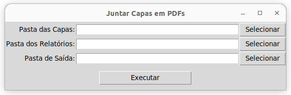
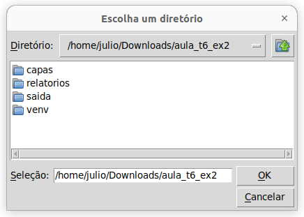

##  

O conteúdo dessa aula é baseado no **capítulo 9** do livro abaixo.

{fig-align="center" fig-alt="Capa do livro de Potter e Zingaro." style="max-height: 50vh; width: auto;"}

# Introdução {background-color="#40666e"}

##

Suponha que você seja responsável por criar 100 relatórios, cada um para uma pessoa diferente.

- Poderia ser um professor que precisa enviar correções para seus estudantes.
- Ou alguém em um departamento de RH que precisa enviar a avaliação anual para cada funcionário.

. . .

Suponha que você tenha decidido preparar os relatórios em arquivos PDF.

- E que você precisa de uma capa para os arquivos que é customizada para cada pessoa.
- Seu colega, designer gráfico, preparou essas capas para você.

##

Você e seu colega trabalharam de forma independente e agora cada um terminou sua tarefa.

- Quer dizer, quase, pois agora é necessário juntar as capas com os relatórios.

. . .

Alguém que não é programador estaria agora _"rangendo os dentes"_

- com o trabalho manual de juntar cada capa com cada relatório.
- Isso poderia levar horas!

##

Mas nós somos [programadores]{.alert}!

- E programadores nunca fariam um trabalho desse manualmente!
- Ou pelo menos não deveriam.

. . .

::: {.callout-tip}
Muitas vezes seguimos o ditado: _Casa de ferreiro, espeto de pau._

E perdemos tempo com tarefas que poderiam ser otimizadas.
:::

##

Nessa aula vamos ver como escrever programas que automatizam tarefas tediosas.

- Uma das tarefas será essa dos PDFs.
- Mas também veremos outras tipos de tarefas manuais com as quais podemos ganhar tempo
  automatizando-as.

# Por que programadores criam ferramentas? {background-color="#40666e"}

##

Muitas vezes os programadores se definem como _preguiçosos_.

- Não no sentido de que não queremos fazer nosso trabalho.
- Mas sim, que não queremos fazer tarefas que são **repetitivas**, **chatas**, **tediosas** 😒.
  - Tipos de tarefas que os computadores são muito melhores que nós.

. . .

Bons programadores costumam ter um 🕷️ _"sentido aranha"_ 🕸️ para identificar tarefas penosas.

##

Suponha, por exemplo, que tenhamos centenas de fotos que juntamos de uma viagem. 🖼️

- E queremos remover as fotos duplicadas.
- E, claro, não queremos ter o trabalho de verificar uma por uma, pois isso levaria muito tempo.

. . .

Ou suponha que um professor tenha que enviar um e-mail com notas para cada um de seus estudantes.

- Se forem poucos alunos ele pode escrever um e-mail para cada um.
- Mas se forem muitos, nenhum professor vair querer fazer isso manualmente.

##

Sempre que um **bom programador** se depara com uma tarefa com passos repetitivos

- ele pensa em como construir uma [ferramenta]{.alert} para automatizá-la.

. . .

O termo **ferramenta** está sendo usado aqui no sentido de programas 
que fazem algo que nos poupe tempo.

- Muitas vezes a ferramenta em si não é o objetivo final.
- E criar a ferramenta pode também ser meio entendiante.
- Mas uma vez que ela está pronta, ela pode nos poupar muito tempo.

##

Às vezes criamos uma ferramenta para usar uma única vez.

- Mas, na maioria das vezes, essas ferramentas acabam se tornando úteis novamente no futuro.
  - Seja do jeito que ela foi construída inicialmente,
  - ou com algumas melhorias.

##

Eu, Julio, por exemplo, envio um e-mail com feedback individual para os alunos após as correções das provas das disciplinas que leciono.

- Seria inviável fazer isso manualmente.

. . .

Eu faço a correção da prova em uma panilha do Google.

- E escrevi um script (_Apps Script_) que lê a planilha e envia o e-mail para cada aluno.
- Deu um trabalho inicialmente, e de vez em quando preciso fazer ajustes.
- Mas no final das contas, o tempo que economizo é enorme.

##

E agora que temos Assistentes de IA, como o Copilot,

- ficou ainda mais fácil criarmos ferramentas para tarefas repetitivas.

. . .

Não faz sentido um programador não usar essas ferramentas para se ajudar.

- nem no sentido pessoal (podemos usar o tempo que economizamos para coisas mais prazerosas).
- nem no sentido profissional (podemos aumentar nossa produtividade).

# Como usar o Copilot para criar ferramentas {background-color="#40666e"}

##

Muitas vezes precisamos usar [módulos]{.alert} (**bibliotecas**) do Python para realizar alguma
tarefa que precisamos.

- Pode ser que seja uma biblioteca incluída (**_built-in_**) do Python.
  - Ex.: `csv`, `json`, `zipfile`, etc.
- Ou uma biblioteca que precisamos **instalar** antes de usar.

##

Quando estamos criando ferramentas, é muito comum que: 

- precisemos lidar com arquivos de diferentes formato
  - (como arquivos zip, pdf, planilhas de excel ou imagens).
- e que precisemos fazer alguma tarefa específica
  - (como enviar e-mails, interagir com um site, mover arquivos, etc).

. . .

Para muitas dessas coisas precisaremos usar algum módulo. 

- Mas qual módulo?
- E ele é _built-in_ ou preciso instalar?

##

Assistentes de IA, como o Copilot, podem nos ajudar a começar.

- A ideia é conversarmos com o assistente de IA para descobrir qual módulo precisamos usar.
- E só depois disso entramos na etapa de criar a ferramenta propriamente dita.

. . .

Na criação da ferramenta, podemos seguir os passos que vimos anteriormente.

- Definir uma função, e sua docstring, e depois pedir para o Copilot gerar o código dela.

##

Ao fazer isso, devemos seguir o processo que já vimos antes:

- verificar a corretude do código (testes), 
- corrigir os bugs, 
- e talvez decompor o problema.

. . .

Mas aqui na aula vamos nos concentrar na interação com o Copilot para automizarmos a tarefa que precisamos.

- Para manter o foco no conteúdo que estamos trabalhando neste capítulo.

## 

Nós poderíamos pedir ao Copilot ou ao ChatGPT para fazer a ferramenta completa.

- Mas vamos manter a ideia de criar funções.

. . . 

Acreditamos que vale a pena trabalharmos com funções, documentadas.

- De forma que seja mais fácil, no futuro, fazer alguma melhoria ou evolução necessária na ferramenta.

# Exemplo 1: Lista de compras {background-color="#40666e"}

##

Suponha que você precise enviar uma **lista de compras** para alguém por WhatsApp ou e-mail.

- E que essa lista precise ser **numerada**, com **um item por linha**, e em **ordem alfabética**.

. . .

Mas você recebeu a lista de compras de alguém (talvez seu chefe)

- que simplesmente digitou os itens separados por espaço, e em uma ordem qualquer.

. . .

Vamos usar o Copilot para automatizar essa tarefa.


## 

Como você recebeu os itens por e-mail ou WhatsApp,

- a ferramenta será mais útil se pudermos **copiar (Ctrl+c)** os itens da mensagem.
- e **colar (Ctrl+v)** na nossa ferramenta para ela gerar a lista numerada.
- Caso contrário, teríamos que redigitar a lista
  - e aí não estaríamos economizando tempo.

. . .

Para isso, precisaremos usar a [Área de Transferência]{.alert} (_Clipboard_) do Sistema Operacional.

##

Essa **Área de Transferência** é onde ficam os últimos dados que copiamos com o Ctrl+c.

. . .


Podemos então criar uma ferramenta que obtenha as palavras da Área de Transferência;

- gere a lista numerada;
- e copie a lista numerada de volta para a Área de Transferência.

. . .

Assim, depois de rodar a ferramenta, podemos simplesmente colar (Ctrl+v) a lista numerada onde quisermos.

##

Basicamente o que precisamos fazer em um programa em Python é:

- Ler o conteúdo da Área de Transferência e guardar em uma string.
- Gerar a lista numerada e ordenada a partir dessa string.
- Guardar a lista em uma nova string.
- Colocar a nova string na Área de Transferência.

. . .

Mas como podemos usar a Área de Transferência em um programa Python?

## 

Vamos descobrir isso usando a janela de chat do Copilot.

- Mas vamos fazer uma exploração mais ampla antes de implementar uma solução.

. . .

Vamos abrir uma pasta vazia no VS Code e usar o modo `Ask` do chat do Copilot.

##


::: {.callout-caution title="Prompt" icon="false"}
Eu gostaria de escrever um programa em Python que 
acessa a área de transferência e que permita copiar 
e colar usando a área de transferência. 
Como posso fazer isso?
:::

##

::: {.callout-note title="GitHub Copilot" icon="false" .nonincremental}
Você pode usar o módulo `pyperclip` para acessar a área de transferência no Python. 

Ele permite copiar e colar texto facilmente. Veja como fazer:

1. Instale o pacote:
```bash
pip install pyperclip
```

2. Exemplo de código para copiar e colar:

````python
import pyperclip

# Copiar texto para a área de transferência
pyperclip.copy("Olá, área de transferência!")

# Colar (obter) texto da área de transferência
texto = pyperclip.paste()
print("Texto copiado:", texto)
````

Esse código copia um texto para a área de transferência e depois lê o que está lá.  
Funciona em Linux, Windows e macOS.
:::

##

A resposta do Copilot nos ensina que podemos usar o módulo `pyperclip` para
interagir com a Área de Transferência em um programa em Python.

- E nos dá um exemplo de como usar o módulo.
- Ele também nos diz como instalar o módulo.
  - O que mostra que ele é não é _built-in_.

. . .

Mas será que não daria para fazer nossa ferramenta sem instalar um módulo?

- Vamos perguntar ao Copilot.

##


::: {.callout-caution title="Prompt" icon="false"}
Existe alguma forma de fazer isso sem precisar instalar um módulo Python?
:::

##

::: {.callout-note title="GitHub Copilot" icon="false" .nonincremental}
Sim, é possível acessar a área de transferência sem instalar módulos externos, mas depende do sistema operacional. 
No Linux, você pode usar comandos do sistema como `xclip` ou `xsel` via `subprocess`. Veja um exemplo usando `xclip`:

````python
import subprocess

# Copiar texto para a área de transferência
texto = "Olá, área de transferência!"
process = subprocess.Popen(['xclip', '-selection', 'clipboard'], stdin=subprocess.PIPE)
process.communicate(input=texto.encode())

# Colar (obter) texto da área de transferência
process = subprocess.Popen(['xclip', '-selection', 'clipboard', '-o'], stdout=subprocess.PIPE)
saida, _ = process.communicate()
print("Texto copiado:", saida.decode())
````

**Observações:**

- Você precisa ter o `xclip` instalado (`sudo apt install xclip`).
- Para Windows, pode-se usar `clip` e `powershell` via subprocess.
- Para macOS, use `pbcopy` e `pbpaste`.

Se precisar de exemplos para outros sistemas, é só pedir!
:::

##

Bom essa solução tem uma desvantagem: depende de um programa externo e do sistema operacional.

- Se formos tratar a tarefa apenas uma única vez poderia nos atender.
- Mas pensando em usos futuros, não é a melhor solução.

. . .

Vamos explorar mais soluções.

##


::: {.callout-caution title="Prompt" icon="false"}
Existe algum outro jeito de fazer isso sem precisar instalar um módulo Python?
:::


##

::: {.callout-note title="GitHub Copilot" icon="false" .nonincremental}
Sim, mas você ainda vai precisar de algum utilitário externo já instalado no sistema, 
como `xclip` ou `xsel` no Linux, `pbcopy`/`pbpaste` no macOS, ou `clip` no Windows. 
 
O Python puro não oferece acesso direto à área de transferência na biblioteca padrão.

No Linux, por exemplo, se o `xclip` já estiver instalado, você pode usar o seguinte código:

````python
import subprocess

# Copiar texto para a área de transferência
subprocess.run("echo 'Texto para copiar' | xclip -selection clipboard", shell=True)

# Colar texto da área de transferência
resultado = subprocess.run("xclip -selection clipboard -o", shell=True, capture_output=True, text=True)
print("Texto colado:", resultado.stdout)
````

**Resumo:**  
Sem instalar módulos Python, você pode usar comandos do sistema operacional via `subprocess`, 
desde que o utilitário de área de transferência já esteja disponível no seu sistema.
:::


##

Bom, essa resposta não ajudou muito, afinal continua basicamente fazendo a mesma coisa
da resposta anterior

. . .

No livro, a primeira solução dada pelo Copilot usava o módulo `tkinter`.

- Que tem a limitação de só funcionar em ambientes gráficos (não funciona em servidores Linux, por exemplo).

. . .

Ao pedir outra opção, o Copilot sugeriu um código específico para Windows usando `win32clipboard`.

- Porque os autores estavam em ambiente Windows.
- Mas tem o mesmo tipo de limitação da nossa solução com `xclip`.

##

Avaliando então as opções que temos, a melhor é usar o módulo `pyperclip`.

- Afinal instalar um módulo não é algo tão complicado.
- E o `pyperclip` funciona em Linux, Windows e macOS,
  - sem depender de programas externos.

##

:::{.callout-note}
## Mas por que devemos explorar e entender várias opções?

Há vários motivos porque não deveríamos simplesmente usar a primeira opção do Copilot:

- Pode não funcionar em todos os sistemas operacionais. 
  - O que limita os potenciais usuários da ferramenta.
- Pode não funcionar para a tarefa que precisamos, ou pode ser que cheguemos em um ponto
que ficamos travados em como resolver um problema.
  - E aí sabermos que temos outras opções pode nos ajudar a sair do impasse.
- Módulos são atualizados com frequência.
  - E funções que existiam, podem não existir nas versões mais atuais.
  - Ou sua forma de uso pode ter sido alterada.
  - E, assim, uma sugestão do Copilot pode não funcionar mais.
:::

## 

Agora que sabemos como acessar a Área de Transferência, podemos criar nossa ferramenta.

- como vamos precisar instalar um módulo, vamos aproveitar para aprender como fazer isso do jeito mais correto.
- Claro, com a ajuda do Copilot.

. . .


::: {.callout-caution title="Prompt" icon="false"}
Vou seguir com a sugestão que usa pyperclip. Mas, antes disso, me explique a melhor forma de instalar um módulo Python para um projeto?
:::

##

::: {.callout-note title="GitHub Copilot" icon="false" .nonincremental}
 A melhor forma de instalar um módulo Python para um projeto é usar um ambiente virtual. Assim, as dependências ficam isoladas e não afetam outros projetos ou o sistema.

**Passos recomendados:**

1. **Crie um ambiente virtual na pasta do projeto:**
```bash
python3 -m venv venv
```

2. **Ative o ambiente virtual:**
```bash
source venv/bin/activate  # Linux/Mac
venv\Scripts\activate     # Windows
```

3. **Instale o módulo desejado (exemplo: pyperclip):**
```bash
python -m pip install pyperclip
```

4. **(Opcional) Gere um arquivo de dependências:**
```bash
python -m pip freeze > requirements.txt
```

Assim, você mantém seu projeto organizado e fácil de compartilhar ou replicar em outros ambientes.
:::

##

O Copilot nos ensinou a criar um ambiente virtual.

- De modo que a instalação do módulo `pyperclip` fique dentro da pasta do próprio projeto.
- Evitando interferências e conflitos de versões com outros projetos.

. . .

Também aprendemos a gerar um arquivo `requirements.txt`

- mas não ficou muito claro para que ele serve, já que foi gerado somente ao final.

. . .

Vamos perguntar ao Copilot.

##


::: {.callout-caution title="Prompt" icon="false"}
Para que serve o arquivo requirements.txt?
:::

. . .

::: {.callout-note title="GitHub Copilot" icon="false" .nonincremental}
O arquivo requirements.txt serve para listar todas as dependências (módulos e suas versões) necessárias para o seu projeto Python. Ele facilita a instalação dessas dependências em outros ambientes ou por outros desenvolvedores, usando o comando:

```bash
pip install -r requirements.txt
```

Assim, todos os pacotes listados no arquivo serão instalados automaticamente, garantindo que o projeto funcione corretamente.
:::

##

Agora ficou mais claro.

- Quando formos instalar o projeto em outro computador, ou quando alguém for usar o projeto,
- basta criar um ambiente virtual e rodar o comando `pip install -r requirements.txt`.

. . .

Vamos, enfim, criar nossa ferramenta.

- Para isso, vamos, criar um arquivo Python, importar o módulo `pyperclip`
- e definir a assinatura e docstring função que gera a lista numerada.

##

**Prompt**

::: {.r-fit-text .nonincremental}
```python
import pyperclip

def gerar_lista_numerada():
    """"
    A área de transferêcia tem linhas de texto contendo
    palavras separadas por espaços e/ou vírgulas.

    A função extrai as palavras obtidas da área de transferência,
    ordena-as em ordem alfabética e cria uma lista numerada com
    um item por linha.

    O resultado é copiado de volta para a área de transferência.    
    """
```
:::

##

Código gerado pelo Copilot.

::: {.r-fit-text .nonincremental}
```python
def gerar_lista_numerada():
    """"
    A área de transferêcia tem linhas de texto contendo
    palavras separadas por espaços e/ou vírgulas.

    A função extrai as palavras obtidas da área de transferência,
    ordena-as em ordem alfabética e cria uma lista numerada com
    um item por linha.

    O resultado é copiado de volta para a área de transferência.    
    """
    # Obtém o texto da área de transferência
    texto = pyperclip.paste()

    # Substitui vírgulas por espaços e divide o texto em palavras
    palavras = texto.replace(',', ' ').split()

    # Remove duplicatas e ordena as palavras em ordem alfabética
    palavras_unicas = sorted(set(palavras))

    # Cria a lista numerada
    lista_numerada = [f"{i + 1}. {palavra}" for i, palavra in enumerate(palavras_unicas)]

    # Junta a lista em uma única string com quebras de linha
    resultado = '\n'.join(lista_numerada)

    # Copia o resultado de volta para a área de transferência
    pyperclip.copy(resultado)

if __name__ == "__main__":
    gerar_lista_numerada()
```
:::

##

:::{.callout-tip}
Como nós criamos o ambiente virtual pelo terminal do VS Code, precisamos conferir se o
VS Code identificou automaticamente o ambiente virtual, caso contrário, se tentarmos usar 
a opção `Run`, o programa não vai funcionar (pois não conseguirá importar o módulo `pyperclip`).

Precisamos escolher a versão do Python que está dentro do ambiente virtual.
Basta clicar no canto inferior direito do VS Code e escolher o Python correto.

Obs.: se criarmos o ambiente virtual pelo VS Code (`Ctrl+Shift+P` e escolhendo 
`Python: Create Environment`), o VS Code já escolhe o Python correto.
:::

##

Vamos então testar o nosso programa.

. . .

Suponha que tenhamos recebido a seguinte lista de compras:

- feijão, arroz, sorvete, café, batata, óleo, cebola

. . .

Copie a lista acima (Ctrl+c) e rode o programa.

- Em seguida cole (Ctrl+v) a lista numerada em algum editor de texto.

##

Veja que deu quase tudo certo.

- Exceto que a palavra `óleo` apareceu fora da ordem alfabética.

. . .

```{.text code-line-numbers="false"}
1. arroz
2. batata
3. café
4. cebola
5. feijão
6. sorvete
7. óleo
```


## 

Provavelmente o erro aconteceu porque a palavra tem acento.

- Vamos pedir ao Copilot para corrigir isso.

. . .


::: {.callout-caution title="Prompt" icon="false"}
A ordenação está errada, pois a palavra "óleo" deveria aparecer antes de "sorvete". Pode corrigir isso?
:::

##

::: {.callout-note title="GitHub Copilot _(início)_" icon="false" .nonincremental}
 Claro! O problema ocorre porque a ordenação padrão do Python (`sorted`) não considera corretamente os acentos para a ordem alfabética em português. Para corrigir, você pode usar o módulo `locale` e configurar para `'pt_BR.UTF-8'`. Veja como ajustar:

````python
import pyperclip
import locale

def gerar_lista_numerada():
    """
    A área de transferêcia tem linhas de texto contendo
    palavras separadas por espaços e/ou vírgulas.

    A função extrai as palavras obtidas da área de transferência,
    ordena-as em ordem alfabética e cria uma lista numerada com
    um item por linha.

    O resultado é copiado de volta para a área de transferência.    
    """
    # Configura a ordenação para o padrão do português do Brasil
    locale.setlocale(locale.LC_COLLATE, 'pt_BR.UTF-8')

    # Obtém o texto da área de transferência
    texto = pyperclip.paste()

    # Substitui vírgulas por espaços e divide o texto em palavras
    palavras = texto.replace(',', ' ').split()

    # Remove duplicatas e ordena as palavras em ordem alfabética considerando acentos
    palavras_unicas = sorted(set(palavras), key=locale.strxfrm)

    # Cria a lista numerada
    lista_numerada = [f"{i + 1}. {palavra}" for i, palavra in enumerate(palavras_unicas)]

    # Junta a lista em uma única string com quebras de linha
    resultado = '\n'.join(lista_numerada)

    # Copia o resultado de volta para a área de transferência
    pyperclip.copy(resultado)

if __name__ == "__main__":
    gerar_lista_numerada()
````
:::

##

::: {.callout-note title="GitHub Copilot _(continuação)_" icon="false" .nonincremental}

Agora, palavras acentuadas serão ordenadas corretamente conforme o português.  

**Obs:** Certifique-se de que o locale `pt_BR.UTF-8` está instalado no seu sistema Linux. Se não estiver, instale com:

```bash
sudo locale-gen pt_BR.UTF-8
sudo update-locale
```
:::

##

Agora sim!

- Temos uma ferramenta que nos economiza tempo pegar gerar a lista no formato correto.
- Claro que esse é um exemplo simples e didático.
  - Seguindo a mesma ideia você pode criar ferramentas para tarefas mais complexas.

##

Mas tem algo que ainda é complicado em nossa ferramenta.

- Precisamos usar o VS Code para rodar o programa.
- Ou então abrir o terminal, navegar até a pasta do projeto, ativar o ambiente virtual e rodar o programa.
- Isso não é muito prático.

. . .

Seria melhor se pudéssemos simplesmente clicar duas vezes em um ícone na área de trabalho.

- E aí a ferramenta rodaria sem precisar abrir o VS Code ou o terminal.

##

Vamos conversar com o Copilot para descobrir como fazer isso.

. . .

::: {.callout-caution title="Prompt" icon="false"}
Eu gostaria que esse programa estivesse disponível para o usuário como um comando de terminal. Sem precisar entrar na pasta do projeto, ativer o ambiente virtual e rodar o programa manualmente. Como posso fazer isso?
:::

##

::: {.callout-note title="GitHub Copilot _(início)_" icon="false" .nonincremental}
Para tornar seu programa disponível como um comando de terminal, você pode empacotá-lo 
como um **script executável** e instalá-lo no sistema. 
 
O jeito mais comum em projetos Python é criar um **entry point** usando o `setuptools`. Veja como fazer:

**1. Crie um arquivo `setup.py` na raiz do projeto:**

````python
from setuptools import setup

setup(
    name="gerador-lista-numerada",
    version="1.0",
    py_modules=["gerador_lista_numerada"],
    install_requires=["pyperclip"],
    entry_points={
        "console_scripts": [
            "gerador-lista-numerada=gerador_lista_numerada:gerar_lista_numerada",
        ],
    },
)
````
:::

##

::: {.callout-note title="GitHub Copilot _(continuação)_" icon="false" .nonincremental}

**2. Instale o pacote no modo editável (para desenvolvimento):**

No terminal, dentro da pasta do projeto:

```bash
pip install --user --editable .
```

**3. Use o comando no terminal**

Agora, você pode rodar o comando de qualquer lugar:

```bash
gerador-lista-numerada
```

---

**Dicas:**

- O comando será instalado em `~/.local/bin` (Linux). Certifique-se de que esse diretório está no seu `$PATH`.
- Para outros usuários do sistema, use `sudo pip install .` (não recomendado para ambientes compartilhados).
- Se quiser distribuir, pode empacotar e publicar no PyPI.

Se quiser um nome de comando diferente, basta alterar em `console_scripts`.
:::

##

Legal! Agora podemos abrir um terminal, rodar o comando `gerador-lista-numerada` e pronto!

- Teremos nossa lista de compras numerada na Área de Transferência.

## No entanto...

. . .

Bom, sistemas em produção são sempre mais complicados.

- O código que apresentei até aqui funcionou no meu computador.
- Mas ao testar no notebook para preparar a aula, tive que fazer alguns ajustes.
  - Porque nele, a versão do Ubuntu e do Python são mais recentes.
- E, claro, o Copilot me ajudou a fazer as alterações necessárias.

##

O problema é que nas versões mais recentes do Python, o comando abaixo não é permitido:

```bash
pip install --user --editable .
```

. . .

Isso para proteger a integridade do sistema, evitando instalação de pacotes sem usar um ambiente virtual.

- Mas, para o nosso caso, queremos mesmo instalar o pacote para o usuário.
- E, assim, termos o comando disponível globalmente.

##

Perguntando então ao Copilot, precisei instalar com o comando abaixo:

```bash
pip install --user --break-system-packages .
```

. . .

E também precisei rodar os comandos abaixo para garantir que o diretório `~/.local/bin` estivesse no meu `$PATH`.

```bash
echo 'export PATH=$PATH:~/.local/bin' >> ~/.bashrc
source ~/.bashrc
```

##

Mas será que não podemos fazer algo ainda mais prático?

- Para um usuário leigo, é ruim ter que abrir um terminal e saber o nome do comando.

. . . 

Bora, conversar com o Copilot novamente.

::: {.callout-caution title="Prompt" icon="false"}
E como faço para ter um ícone na área de trabalho para executar o programa?
:::

##

::: {.callout-note title="GitHub Copilot _(início)_" icon="false" .nonincremental}
 Para criar um atalho com ícone na área de trabalho (no Linux), siga estes passos:

**1. Crie um arquivo `.desktop`**

Crie um arquivo chamado, por exemplo, `GeradorListaNumerada.desktop` na sua área de trabalho (`~/Área de Trabalho` ou `~/Desktop`):

````ini
[Desktop Entry]
Version=1.0
Type=Application
Name=Gerador Lista Numerada
Comment=Gera uma lista numerada a partir da área de transferência
Exec=gerador-lista-numerada
Icon=/caminho/para/um/icone.png
Terminal=false
Categories=Utility;
````

- **Exec**: o comando instalado pelo seu script (`gerador-lista-numerada`).
- **Icon**: caminho para um arquivo de ícone (PNG, SVG, etc). Você pode usar um ícone próprio ou algum do sistema.
- **Terminal**: coloque `true` se quiser que abra um terminal, ou `false` para rodar em segundo plano.
:::

##

::: {.callout-note title="GitHub Copilot _(continuação)_" icon="false" .nonincremental}

**2. Torne o atalho executável**

No terminal, rode:

```bash
chmod +x ~/Área\ de\ Trabalho/GeradorListaNumerada.desktop
```

**3. (Opcional) Escolha um ícone**

Se não tiver um ícone, pode baixar um PNG ou usar algum já presente no sistema, como `/usr/share/icons/hicolor/48x48/apps/accessories-text-editor.png`.

---

Agora, basta clicar duas vezes no ícone para executar o programa!  
Se aparecer um aviso de segurança, clique em "Confiar" ou "Permitir execução".
:::

##

Aqui tive que fazer outra adaptação para rodar no notebook.

- Referente ao caminho do executável que precisa ser completo no Ubuntu mais recente.

. . . 

No final das contas utilizei esse arquivo `GeradorListaNumerada.desktop`:

```ini
[Desktop Entry]
Version=1.0
Type=Application
Name=Gerador Lista Numerada
Comment=Gera uma lista numerada a partir da área de transferência
Exec=/home/julio/.local/bin/gerador-lista-numerada
Icon=/home/julio/Área de trabalho/icone.png
Terminal=false
Categories=Utility;
```

##

Bacana! Temos agora um programa disponível na área de trabalho.

- Ficou muito mais rápido gerar a lista numerada.

. . .

Poderíamos melhorar nosso programa dando algum retorno de que ele foi executado com sucesso.

- E, claro, para criar o atalho na Área de Trabalho do Windows o processo seria diferente.

##

Poderíamos também pensar em outros exemplos de programas com abordagem parecida:

- Copiar duas colunas de uma planilha contendo e-mail e nota dos alunos e gerar texto
  para um e-mail para a secretaria informando o número de aprovados e reprovados.
- Copiar trechos do arquivo PDF da Resolução CEPE 473 e acertar as quebras de linha.

. . .

Mas vamos tratar outra demanda tediosa agora.

# Exemplo 2: Adicionando capas a arquivos PDF {background-color="#40666e"}

##

Vamos voltar ao cenário comentado no início da aula.

- Suponha que temos 100 arquivos PDF, cada um com um relatório diferente.
- E que precisamos adicionar uma capa personalizada a cada um desses arquivos.

. . .

Primeiramente, vale ressaltar que não é possível ler arquivos PDF da mesma forma que lemos arquivos texto e CSV.

- Arquivos PDF, do Word, Excel, etc., possuem uma estrutura interna diferente.

##

O arquivo [AulaT6-ex2.zip](dados/AulaT6-ex2.zip) contém duas pastas:

- `capas`: com as 100 capas individuais em PDF.
- `relatorios`: com os 100 relatórios individuais também em PDF.

. . .

Poderíamos usar algum software, como o Adobe Acrobat, para fazer isso manualmente.

- Mas imagina a trabalheira que daria.
- Em vez disso, vamos pedir ao Copilot para criar uma ferramenta que faça isso para nós.

##

Antes de pedirmos o Copilot para criar a ferramenta completa, 

- vamos explorar como podemos lidar com a junção (_merge_) de arquivos PDF em Python.

. . .

::: {.callout-caution title="Prompt" icon="false"}
Eu gostaria de escrever um programa em Python que junte dois arquivos PDF em um só. Como posso fazer isso?
:::

##

::: {.callout-note title="GitHub Copilot" icon="false" .nonincremental}
 Você pode usar a biblioteca `PyPDF2` para juntar dois arquivos PDF em Python. Veja um exemplo simples:

1. Instale a biblioteca (caso ainda não tenha):
```bash
pip install PyPDF2
```

2. Código para juntar dois PDFs:

````python
from PyPDF2 import PdfMerger

# Lista dos arquivos PDF a serem unidos
arquivos = ['arquivo1.pdf', 'arquivo2.pdf']

merger = PdfMerger()
for pdf in arquivos:
    merger.append(pdf)
merger.write('pdf_unido.pdf')
merger.close()
````

Basta substituir `'arquivo1.pdf'` e `'arquivo2.pdf'` pelos nomes dos seus arquivos. O resultado será salvo como `pdf_unido.pdf`.
:::

##

Já temos então uma opção que parece atender o que precisamos.

- Mas vamos explorar se existe alguma opção com módulo _built-in_.

. . .


::: {.callout-caution title="Prompt" icon="false"}
Existe alguma forma de fazer isso sem precisar instalar um módulo Python?
:::

##

::: {.callout-note title="GitHub Copilot" icon="false" .nonincremental}
 Não existe uma forma nativa em Python puro para manipular ou juntar arquivos PDF, pois o formato PDF é complexo e não é suportado pela biblioteca padrão do Python. 

Se você não quiser instalar módulos Python, pode usar ferramentas externas já instaladas no Linux, como o `pdftk` ou o `qpdf`. Por exemplo, usando o terminal:

**Com `pdftk`:**
```bash
pdftk arquivo1.pdf arquivo2.pdf cat output pdf_unido.pdf
```

**Com `qpdf`:**
```bash
qpdf --empty --pages arquivo1.pdf arquivo2.pdf -- pdf_unido.pdf
```

Essas ferramentas precisam estar instaladas no seu sistema, mas não exigem instalar módulos Python. Se preferir uma solução 100% Python, será necessário instalar um módulo como o `PyPDF2`.
:::

##

Bom, a solução apresentada depende da instalação de programas externos, o que parece mais complicado do que instalar um módulo Python.

- Obs.: no livro, o Copilot sugeriu criar um script Python que no final das contas usava esses programas.

. . .

A primeira opção parece boa, mas vamos explorar se existem alternativas.

. . . 


::: {.callout-caution title="Prompt" icon="false"}
Existem outros módulos Python que eu deveria considerar para tratar essa tarefa?
:::

##

::: {.callout-note title="GitHub Copilot" icon="false" .nonincremental}
Sim! Além do **PyPDF2**, você pode considerar outros módulos Python para manipulação de PDFs:

- **pypdf**: É uma continuação moderna do PyPDF2, com mais recursos e manutenção ativa.
- **PyMuPDF (fitz)**: Muito rápido e poderoso, permite manipular, mesclar, dividir e até extrair texto e imagens de PDFs.
- **pdfminer.six**: Focado em extração de texto, mas também pode manipular PDFs em alguns casos.
- **pdfrw**: Permite ler e escrever PDFs, além de mesclar e dividir arquivos.

Para tarefas simples de juntar PDFs, **pypdf** e **PyMuPDF** são ótimas opções. Exemplo com pypdf:

````python
from pypdf import PdfMerger

merger = PdfMerger()
merger.append("arquivo1.pdf")
merger.append("arquivo2.pdf")
merger.write("pdf_unido.pdf")
merger.close()
````

Escolha o módulo conforme suas necessidades e preferências!
:::

##

A resposta do Copilot nos mostrou que existe um módulo mais moderno que o `PyPDF2`, o `pypdf`.

- E cujo exemplo de código parece bem simples.

. . . 

Mas antes de seguirmos com o `pypdf`, vamos entender melhor os prós e contras de cada módulo sugerido.

. . .


::: {.callout-caution title="Prompt" icon="false"}
Quais são os prós e contras de cada um desses módulos?
:::

##

::: {.callout-note title="GitHub Copilot _(início)_" icon="false" .nonincremental}
 Aqui está um resumo dos prós e contras dos principais módulos Python para manipulação de PDFs:

---

**1. PyPDF2**

**Prós:**

- Fácil de usar para tarefas básicas (juntar, dividir, rotacionar).
- Bastante documentado e com muitos exemplos.
- Não depende de bibliotecas externas.

**Contras:**

- Desenvolvimento desacelerado (pode estar desatualizado).
- Suporte limitado para PDFs complexos ou protegidos.
- Algumas funções avançadas podem não funcionar corretamente.
:::

##

::: {.callout-note title="GitHub Copilot _(continuação)_" icon="false" .nonincremental}

**2. pypdf**

**Prós:**

- Continuação moderna do PyPDF2, com manutenção ativa.
- Interface semelhante ao PyPDF2, facilitando a migração.
- Corrige bugs e adiciona novos recursos.
- Boa documentação.

**Contras:**

- Ainda pode ter limitações com PDFs muito complexos.
- Algumas funções avançadas podem não estar presentes.
:::

##

::: {.callout-note title="GitHub Copilot _(continuação)_" icon="false" .nonincremental} 

**3. PyMuPDF (fitz)**

**Prós:**

- Muito rápido e eficiente.
- Suporte avançado para manipulação de páginas, extração de texto, imagens e metadados.
- Suporta PDFs complexos e outros formatos (XPS, EPUB).
- Documentação detalhada.

**Contras:**

- API um pouco mais complexa para tarefas simples.
- Pode ser mais pesado para instalar (depende de bibliotecas C).

:::

##

::: {.callout-note title="GitHub Copilot _(continuação)_" icon="false" .nonincremental}

**4. pdfrw**

**Prós:**

- Leve e puro Python.
- Permite mesclar, dividir e modificar PDFs.
- Útil para manipulação de formulários PDF.

**Contras:**

- Menos mantido e atualizado.
- Suporte limitado para PDFs complexos.
- Documentação menos detalhada.
:::

##

::: {.callout-note title="GitHub Copilot _(continuação)_" icon="false" .nonincremental}

**5. pdfminer.six**

**Prós:**

- Excelente para extração de texto detalhada.
- Suporta PDFs complexos e multilíngues.

**Contras:**

- Não é focado em manipulação (juntar/dividir) de PDFs.
- API mais complexa para tarefas simples de manipulação.

---

**Resumo:**  

- Para juntar/dividir PDFs: **pypdf** ou **PyMuPDF** são as melhores opções.
- Para extração de texto: **pdfminer.six** ou **PyMuPDF**.
- Para manipulação leve e sem dependências: **pdfrw**.

Escolha conforme sua necessidade!
:::

## 

A resposta do Copilot nos ajudou a entender melhor as opções.

- O `pypdf` parece ser uma boa escolha, pois é uma versão mais moderna do `PyPDF2`.
- E o exemplo de código que ele nos deu é bem simples.

. . .

Vamos partir para a criação da ferramenta. 

- Vamos definir a assinatura da função e a docstring com o que queremos.

##

::: {.callout-tip}
Antes de continuarmos, vale a pena chamar a atenção para [cuidados]{.alert} que devemos 
tomar **ao fazer automatizações que lidam com arquivos**.

Se a ferramenta que criarmos estiver incorreta, podemos perder arquivos em nosso computador.
Algumas dicas são:

- Sempre trabalhar com cópias dos arquivos, nunca com os originais.
- Verifique se os arquivos que a ferramenta vai processar estão corretos.
  - Ex.: podemos comentar as linhas que manipulam os arquivos e imprimir os nomes dos arquivos que seriam processados.
  - Assim conseguimos conferir se são realmente os arquivos que pretendemos usar.
- Sempre fazer testes com poucos arquivos, antes de rodar a ferramenta com todos os arquivos.
:::

##

Para definirmos a assinatura da função, veja que precisaremos de três parâmetros: 

- as pastas das capas, dos relatórios e de onde queremos colocar os arquivos gerados.

. . .

Também precisaremos explicar o padrão de nomes dos arquivos.

- Para que o Copilot gera um código que junte a capa correta com o relatório correto.

. . .

E podemos importar a bibliteca `pypdf` que já sabemos que vamos usar.

##

Lembre-se também que precisamos seguir o mesmo procedimento do exemplo anterior
para criar o ambiente virtual e instalar o módulo `pypdf`.

. . .

```{.bash code-line-numbers="false"}
python3 -m venv venv
source venv/bin/activate  # Linux/Mac
venv\Scripts\activate     # Windows
python -m pip install pypdf
python -m pip freeze > requirements.txt
```

. . .

Lembre-se também de configurar o VS Code para usar o Python do ambiente virtual.

##

Vamos então criar um arquivo Python e definir a assinatura da função e a docstring.

::: {.r-fit-text .nonincremental}
```python
import pypdf

def adicionar_capas_a_pdfs(pasta_capas, pasta_relatorios, pasta_saida):
    """
    Adiciona capas personalizadas a arquivos PDF de relatórios.

    Parâmetros:
    - pasta_capas: Caminho da pasta contendo os arquivos PDF das capas.
      Os arquivos têm nome cover1.pdf, cover2.pdf, etc.
    - pasta_relatorios: Caminho da pasta contendo os arquivos PDF dos relatórios.
      Os arquivos têm nome 1.pdf, 2.pdf, etc.
    - pasta_saida: Caminho da pasta onde os arquivos PDF resultantes serão salvos.

    A função lê cada arquivo de capa e o respectivo relatório,
    junta os dois em um único arquivo PDF e salva na pasta de saída.
    """
```
:::

##

Esse foi o código gerado pelo Copilot no meu caso.

::: {.r-fit-text .nonincremental}
```python
import pypdf

def adicionar_capas_a_pdfs(pasta_capas, pasta_relatorios, pasta_saida):
    """
    Adiciona capas personalizadas a arquivos PDF de relatórios.

    Parâmetros:
    - pasta_capas: Caminho da pasta contendo os arquivos PDF das capas.
      Os arquivos têm nome cover1.pdf, cover2.pdf, etc.
    - pasta_relatorios: Caminho da pasta contendo os arquivos PDF dos relatórios.
      Os arquivos têm nome 1.pdf, 2.pdf, etc.
    - pasta_saida: Caminho da pasta onde os arquivos PDF resultantes serão salvos.

    A função lê cada arquivo de capa e o respectivo relatório,
    junta os dois em um único arquivo PDF e salva na pasta de saída.
    """
    import os

    # Lista os arquivos de capa e relatório
    capas = sorted([f for f in os.listdir(pasta_capas) if f.startswith('cover') and f.endswith('.pdf')])
    relatorios = sorted([f for f in os.listdir(pasta_relatorios) if f.endswith('.pdf')])

    # Verifica se o número de capas e relatórios é o mesmo
    if len(capas) != len(relatorios):
        raise ValueError("O número de capas e relatórios deve ser o mesmo.")

    for capa, relatorio in zip(capas, relatorios):
        caminho_capa = os.path.join(pasta_capas, capa)
        caminho_relatorio = os.path.join(pasta_relatorios, relatorio)
        caminho_saida = os.path.join(pasta_saida, relatorio)

        # Lê os arquivos PDF
        leitor_capa = pypdf.PdfReader(caminho_capa)
        leitor_relatorio = pypdf.PdfReader(caminho_relatorio)

        escritor_pdf = pypdf.PdfWriter()

        # Adiciona a capa
        for pagina in leitor_capa.pages:
            escritor_pdf.add_page(pagina)

        # Adiciona o relatório
        for pagina in leitor_relatorio.pages:
            escritor_pdf.add_page(pagina)

        # Salva o novo arquivo PDF com a capa adicionada
        with open(caminho_saida, 'wb') as arquivo_saida:
            escritor_pdf.write(arquivo_saida)

# Exemplo de uso:
# adicionar_capas_a_pdfs('pasta_capas', 'pasta_relatorios',
#                          'pasta_saida')

if __name__ == "__main__":
    # Exemplo de uso
    adicionar_capas_a_pdfs('pasta_capas', 'pasta_relatorios', 'pasta_saida')
```
:::

##

Vamos agora copiar as pastas de capas e relatórios para dentro do nosso projeto.

- E criar uma pasta `saida` vazia para onde os arquivos gerados serão salvos.
- Precisamos acertar os nomes das pastas no script.

. . .

Exemplo:

```python
if __name__ == "__main__":
    # Exemplo de uso
    adicionar_capas_a_pdfs('capas', 'relatorios', 'saida')
```

##

Hora de testar o programa!

- Confira, por amostragem, pelo menos 3 arquivos gerados para conferir se deu certo.

## Reutilizando a ferramenta

Vamos supor que essa operação fosse necessária mais vezes.

- E que precisasse ser feita por alguém que não é programador.
- Que tal pedirmos o Copilot para gerar uma interface gráfica simples para a ferramenta?

. . .


::: {.callout-caution title="Prompt" icon="false"}
Eu gostaria de criar uma interface gráfica simples para essa ferramenta. Pode me ajudar?
:::

##

::: {.callout-note title="GitHub Copilot _(início)_" icon="false" .nonincremental}
 Claro! Você pode criar uma interface gráfica simples usando o Tkinter, que já vem com o Python. Vou sugerir um exemplo básico onde o usuário pode selecionar as três pastas (capas, relatórios e saída) e clicar em um botão para executar a função.

Adicione o seguinte código ao final do seu arquivo junta_capas.py:

```python
# ...existing code...

import tkinter as tk
from tkinter import filedialog, messagebox

def selecionar_pasta(entry_widget):
    pasta = filedialog.askdirectory()
    if pasta:
        entry_widget.delete(0, tk.END)
        entry_widget.insert(0, pasta)

def executar():
    pasta_capas = entry_capas.get()
    pasta_relatorios = entry_relatorios.get()
    pasta_saida = entry_saida.get()
    try:
        adicionar_capas_a_pdfs(pasta_capas, pasta_relatorios, pasta_saida)
        messagebox.showinfo("Sucesso", "Arquivos gerados com sucesso!")
    except Exception as e:
        messagebox.showerror("Erro", str(e))
```
:::

##

::: {.callout-note title="GitHub Copilot _(continuação)_" icon="false" .nonincremental}

```python
if __name__ == "__main__":
    root = tk.Tk()
    root.title("Juntar Capas em PDFs")

    tk.Label(root, text="Pasta das Capas:").grid(row=0, column=0, sticky="e")
    entry_capas = tk.Entry(root, width=40)
    entry_capas.grid(row=0, column=1)
    tk.Button(root, text="Selecionar", command=lambda: selecionar_pasta(entry_capas)).grid(row=0, column=2)

    tk.Label(root, text="Pasta dos Relatórios:").grid(row=1, column=0, sticky="e")
    entry_relatorios = tk.Entry(root, width=40)
    entry_relatorios.grid(row=1, column=1)
    tk.Button(root, text="Selecionar", command=lambda: selecionar_pasta(entry_relatorios)).grid(row=1, column=2)

    tk.Label(root, text="Pasta de Saída:").grid(row=2, column=0, sticky="e")
    entry_saida = tk.Entry(root, width=40)
    entry_saida.grid(row=2, column=1)
    tk.Button(root, text="Selecionar", command=lambda: selecionar_pasta(entry_saida)).grid(row=2, column=2)

    tk.Button(root, text="Executar", command=executar, width=20).grid(row=3, column=0, columnspan=3, pady=10)

    root.mainloop()
# ...existing code...
```
:::

##

::: {.callout-note title="GitHub Copilot _(continuação)_" icon="false" .nonincremental}

**Como funciona:**

- O usuário seleciona as três pastas usando os botões "Selecionar".
- Ao clicar em "Executar", a função é chamada e mostra uma mensagem de sucesso ou erro.

Se quiser, pode separar a interface em outro arquivo, mas assim fica tudo em um só. Se precisar de melhorias, é só pedir!
:::

##

Com esse código, temos uma interface gráfica simples, mas bem prática:

::: {.columns}
::: {.column}
{fig-align="center" fig-alt="Tela principal do programa para juntar capas em PDFs." style="max-height: 50vh; width: auto;"}
:::
::: {.column}
{fig-align="center" fig-alt="Tela para navegar na estrutura de pastas e selecionar uma pasta." style="max-height: 50vh; width: auto;"}
:::
:::

. . .

Se quiséssemos poderíamos novamente criar um atalho na área de trabalho para abrir essa interface gráfica.


# Fluxo de trabalho para usar módulos do Python com o Copilot {background-color="#40666e"}

##

Após termos feito esses dois exemplos, podemos pensar em um fluxo de trabalho para usar o Copilot
na criação de ferramentas que usem módulos do Python.

1. Pedir ao Copilot (ou ChatGPT) para listar módulos do Python que podem ser usados para a tarefa de interesse.
2. Perguntar ao Copilot sobre os prós e contras de cada módulo.
3. Escolher o módulo que parece mais adequado.
4. Se necessário, criar um ambiente virtual e instalar o módulo.
5. Seguir o Ciclo de Projeto de Funções que vimos anteriormente, incluindo o módulo escolhido.
6. Se ficarmos travados, tentamos um módulo diferente.


# Exemplo 3: Interface para Oficina de Programação de Jogos {background-color="#40666e"}

##

Dentro do UFLA de Portas Abertas.

- Costuma acontecer a Oficina de Programação de Jogos.

. . .

Nessa oficina, os alunos participantes do evento:

- experimentam e modificam jogos implementados em atividades acadêmicas da UFLA:
  - como trabalhos da disciplina IPOO de Sistemas de Informação.
  - E um jogo para ensino de Python, desenvolvido como TCC de Ciência da Computação.

##

Nos anos antertiores tínhamos duas dificuldades:

- Deixávamos todos os jogos em todas as máquinas, mas abríamos um jogo
  em cada máquina alternadamente.
  - A ideia era que os participantes percebessem que havia vários jogos.
- Depois que os participantes alteravam o código de um jogo,
  precisávamos restaurar o código original para a próxima turma.
- Dava uma trabalheira fazer isso na mão.

##

Usei então o ChatGPT e Copilot para criar uma interface gráfica simples

- que funcionasse como uma tela inicial (_launcher_) que mostrasse os jogos disponíveis.
  - Que permitisse iniciar os jogos ao clicar neles.
- E que também tivesse um botão para restaurar o código original do jogo.
  - Para isso, usei um repositório git local para cada jogo.
  - Restaurar o jogo era simplesmente rodar o comando `git restore .` na pasta do jogo.

##

Esse foi meu primeiro prompt para o ChatGPT:

::: {.callout-caution title="Prompt" icon="false"}
Tenho alguns jogos desenvolvidos em Java usando a IDE Greenfoot que gostaria de utilizar em uma demonstração. A ideia é que a pessoa chegue e jogue os 7 jogos disponíveis no computador. Para jogar cada jogo é necessário abrir o projeto no Greenfoot e executar. Para facilitar esse processo, gostaria de ter uma espécie de "landing page" que mostrasse uma imagem de cada jogo e que, quando o usuário clicasse na imagem, o Greenfoot fosse aberto com o projeto do jogo em questão. Estou usando Linux Ubuntu e creio que para abrir o Greenfoot bastaria executar uma linha de comando passando o caminho do projeto como parâmetro. Essa "landing page" pode ser com qualquer tipo de tecnologia que seja fácil de fazer (pode ser web rodando local, ou uma aplicação Python, enfim, qualquer coisa). Procuro algo simples e rápido de fazer ou alterar.
:::

##

O ChatGPT sugeriu três opções, já com exemplos de código

1. Uma página HTML que precisaria ser aberta com Electron ou com um servidor Python para conseguir executar scripts locais.
2. Uma aplicação Python com interface gráfica usando `Tkinter`.
3. Um menu no terminal para a escolha do jogo.

. . .

Não entendi porque ele sugeriu a opção 3 🤔

- Mas, enfim, escolhi a opção 2, que me pareceu mais prática.

##

Usei o prompt:

::: {.callout-caution title="Prompt" icon="false"}
Gostei da opção 2. Mas gostaria que a aplicação fosse aberta maximizada e que as imagens dos jogos ficasse todas do mesmo tamanho em um grid com 2 linhas e 4 colunas
:::

. . .

Não vou colocar todos os prompts aqui, não fiz de forma muito estruturada.

- De um certo ponto em diante passei para o Copilot.

##

Mas alguns dos passos foram:

- Foram geradas algumas versões de código que geravam erro (eu colava o erro no ChatGPT).
- Durante o processo, às vezes aparecia só o primeiro jogo, outra hora o primeiro e o quinto.
- Quando apareceram todos os jogos, a janela deixou de ficar maximizada.
- Depois, pedi para substituir um dos espaços de jogo por uma imagem.
- Pedi que, ao abrir um jogo, a IDE fosse fechada antes (para não deixar várias instâncias em execução).

##

Mas alguns dos passos foram:

- Acrescentei um dos jogos que era via Godot Engine e não via Greenfoot.
- Acrescentei o botão para restaurar o código original dos jogos.

. . .

E esse foi o resultado final...

##

{fig-align="center" fig-alt="Capa do livro de Potter e Zingaro." style="max-height: 50vh; width: auto;"}

##

No dia do evento, ainda tivemos uma surpresa.

- Eu tinha testado o programa em uma máquina do laboratório.
  - E como, em tese, todas as máquinas têm a mesma imagem, tudo funcionaria.
- Mas ao fazer a instalação pela manhã, vimos que o programa não funcionava em algumas máquinas.
  - Por que o módulo `tkinter` depende de instalação no sistema operacional.
- Consegui apoio para fazer a instalação (dependia de senha de administrador).

##

Mas enquanto estava tentando isso, usei o ChatGPT e ele informou que uma alternativa seria usar o `pygame`.

- Pois é um módulo Python que não depende de instalação no sistema operacional.

. . .

E, claro, é mais uma oportunidade de usar IA para nos apoiar 😉

## Outro exemplo: `lab-exam-sender`

Outro caso que usei UIA na prática para automatização de tarefa:

- foi a criação de um utilitário para envio de provas no laboratório.

. . .

Nas aulas de IPOO e POO, aplico prova que é feita no BlueJ e VS Code.

- Antes eu coletava as provas usando pendrive.
- Mas, com apoio de IA, criei uma ferramenta na qual o próprio aluno envia a prova para a máquina do professor.

