##  

O conteúdo dessa aula é inspirado:

:::: {.columns}

:::{.column width="50%"}
No **capítulo 8** do livro:

{fig-align="center" fig-alt="Capa do livro de Python para Ciência de Dados." style="max-height: 50vh; width: auto;"}

:::

:::{.column width="50%"}
E no **capítulo 15** do livro:

{fig-align="center" fig-alt="Capa do livro de Curso Intensivo de Python." style="max-height: 50vh; width: auto;"}
:::

::::


# Introdução {background-color="#40666e"}

## 

Imagine que você trabalha em uma empresa que comercializa um app para Smartphones.

- A empresa tem informações sobre a quantidade de licenças vendidas por mês.
- E sobre o perfil de usuário (como idade, país, etc.) relacionado a essas vendas.

. . .

Você precisa apresentar essas informações para a diretoria da empresa.

- O objetivo é ajudar a entender como aumentar o faturamento da empresa.

## 

Como você apresentaria as informações para a diretoria?

- você mostraria os dados em tabelas?
- ou você faria gráficos?

. . .

A maioria das pessoas entende melhor informações apresentadas em gráficos do que em tabelas.

- Um formato visual traz muito mais clareza para os dados.

##

Mas veja que não basta mostrar os dados em um gráfico qualquer.

- É necessário que o gráfico seja simples, 
- visualmente agradável
- e, principalmente, que permita que todos entendem claramente o que veem.

. . .

Com isso, as pessoas conseguirão identificar padrões e tendências nos dados.

##

É disso que se trata o que chamamos de [visualização de dados]{.alert};

- que é o uso de representações visuais para explorar e para evidenciar padrões em conjuntos de dados.

. . .

Um conjunto de dados (ou _dataset_) pode ser:

- desde uma simples lista de números 
- até terabytes de dados com diversos tipos diferentes de inforamações.

. . . 

A visualização está estreitamente ligada ao que chamamos de **análise exploratória de dados**.


##

Exemplos de áreas que fazem uso intensivo de dados são:

- genética, pesquisa climática, análise política, análise econômica, 
- e diversas outras.

. . .

Mas há muitos outros usos mesmo para áreas que não são tão _"intensas em dados"_ assim.

- Qualquer empresa que queira tomar decisões baseadas em dados pode se beneficiar de visualizações eficazes.

- Participei, por exemplo, de projeto com mineradora brasileira no qual a primeira fase consistia
em uma análise exploratória de dados.

##

Nosso foco na disciplina não será em Ciência dos Dados em si, nosso objetivo será:

- Ter uma visão geral sobre as principais **bibliotecas de visualização de dados** em Python.
- Conhecer alguns dos **tipos de gráficos mais comuns**.
- Tratar alguns exemplos de **geração de dados**.
- E aprender a usar essas bibliotecas **com a ajuda do GitHub Copilot**.

##

Python deve ser a linguagem mais usada em Ciência de Dados.

. . .

E as bibliotecas mais usadas para visualização de dados em Python são:

- Matplotlib
- Seaborn
- Pandas
- Plotly

##

Antes de demonstrarmos o uso das bibliotecas, vamos criar uma pasta com um arquivo
`requirements.txt` com as bibliotecas que usaremos e abri-la no VS Code.

. . .

```text
pandas
matplotlib
seaborn
plotly
```

. . .

Lembre-se que para instalar as bibliotecas, você deve criar um ambiente virtual
e instalar as bibliotecas.

- Você pode fazer isso manualmente, como mostrei antes, ou...

. . .

```bash
python3 -m venv venv
source venv/bin/activate  # Linux/Mac
venv\Scripts\activate     # Windows
python -m pip install -r requirements.txt
```

##

Você pode, em vez de fazer manualmente, usar o VS Code para facilitar o processo.

. . .

Se você tiver um arquivo `requirements.txt` na raiz do projeto

- e depois acessar a paleta de comandos (Ctrl+Shift+P) e digitar **Python: Create Environment**
- o VS Code cria o ambiente virtual e já instala as bibliotecas listadas no arquivo.

# Matplotlib {background-color="#40666e"}

## Matplotlib

- É a biblioteca **fundamental** para gráficos em Python.  
- Suporta grande variedade de gráficos 2D (linhas, barras, dispersão, histogramas).  
- Muito flexível, mas exige mais código para personalizações.  
- É a **base** de várias outras bibliotecas (como Seaborn e Pandas).  

. . .

```python
# Exemplo simples
import matplotlib.pyplot as plt

plt.plot([1, 2, 3, 4], [10, 20, 25, 30])
plt.title("Exemplo Matplotlib")
plt.show()
```

##

Com o exemplo anterior, seria mostrado o gráfico abaixo:

:::: {.columns}
::: {.column width="50%"}
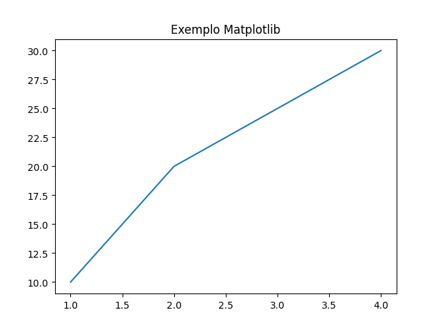{fig-align="center" fig-alt="Exemplo gráfico matplotlib."}
:::

::: {.column width="50%"}
- Note que a primeira lista representa os valores do eixo X e a segunda os do eixo Y.

```{.python code-line-numbers="false"}
plt.plot([1, 2, 3, 4], [10, 20, 25, 30])
```
:::
::::

##

Repare que o gráfico é exibido em uma tela que possui uma barra de ferramentas na parte inferior.

:::: {.columns}
::: {.column width="50%"}
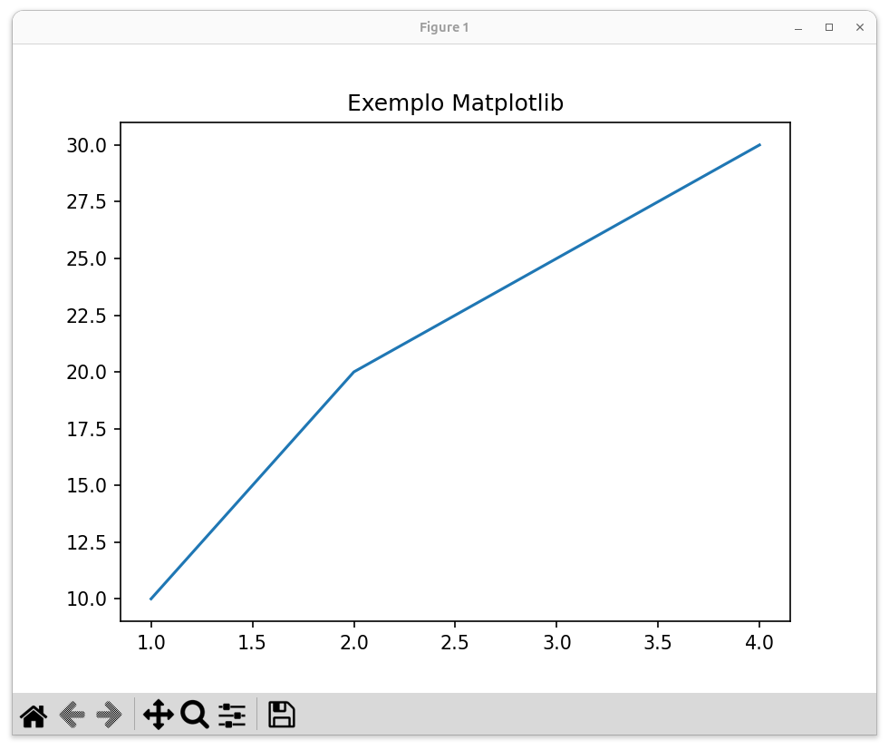{fig-align="center" fig-alt="Tela do exemplo gráfico matplotlib."}
:::

::: {.column width="50%"}
- Com essa barra, podemos salvar o gráfico como uma imagem,
- ou interagir com o gráfico, fazendo zoom, por exemplo.
- Ou ainda alterando configurações como o tamanho e espaçamento do gráfico.
:::
::::


##

Vamos usar agora, como exemplo, um conjunto de dados simples,
sobre 📊 **vendas mensais de três produtos** 

- Vamos pedir ao Copilot para gerar um gráfico de linhas com esses dados,
usando a biblioteca Matplotlib.


| Mês | Produto A | Produto B | Produto C |
|-----|-----------|-----------|-----------|
| Jan |   150     |   100     |    80     |
| Fev |   200     |   120     |    90     |
| Mar |   250     |   180     |   100     |
| Abr |   300     |   160     |   120     |
| Mai |   280     |   170     |   140     |
| Jun |   320     |   150     |   160     |

##

::: {.callout-caution title="Prompt" icon="false"}
Gere um gráfico de linhas usando Matplotlib com os dados abaixo que se referem às vendas mensais 
de três produtos.

```
Mês	Produto A	Produto B	Produto C
Jan	150	100	80
Fev	200	120	90
Mar	250	180	100
Abr	300	160	120
Mai	280	170	140
Jun	320	150	160
```
:::

##

::: {.callout-note title="GitHub Copilot" icon="false" .nonincremental}
```python
import matplotlib.pyplot as plt

meses = ['Jan', 'Fev', 'Mar', 'Abr', 'Mai', 'Jun']
produto_a = [150, 200, 250, 300, 280, 320]
produto_b = [100, 120, 180, 160, 170, 150]
produto_c = [80, 90, 100, 120, 140, 160]

plt.plot(meses, produto_a, marker='o', label='Produto A')
plt.plot(meses, produto_b, marker='o', label='Produto B')
plt.plot(meses, produto_c, marker='o', label='Produto C')

plt.title('Vendas Mensais por Produto')
plt.xlabel('Mês')
plt.ylabel('Vendas')
plt.legend()
plt.grid(True)
plt.tight_layout()
plt.show()
```
:::

##  

Note que o Copilot criou uma lista para cada coluna dos dados.

- E o gráfico de resultado seria esse:

. . .

:::: {.columns}
::: {.column width="50%"}
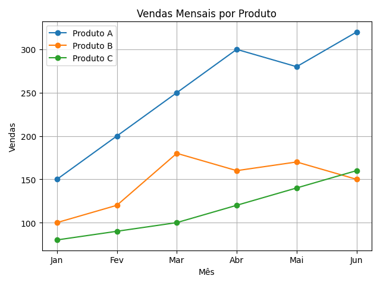{fig-align="center" fig-alt="Gráfico de vendas mensais usando matplotlib."}
:::

::: {.column width="50%"}

- Avalie o gráfico e o código gerado pelo Copilot e tente identificar o que cada parte do código faz.

- Depois, compare com o código e gráficos do primeiro exemplo mostrado.
:::
::::

##

Com o Copilot é fácil alterarmos a forma como o gráfico é gerado.

- Podemos, por exemplo, pedir que use marcadores diferentes para cada produto,
- Ou linhas mais grossas, cores diferentes, etc.

. . .

::: {.callout-caution title="Prompt" icon="false"}
Altere o gráfico usando marcadores diferentes para cada produto, linhas mais grossas
e esconda nas linhas de grade.
:::

##

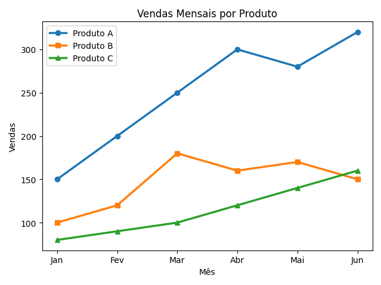{fig-align="center" fig-alt="Gráfico de vendas mensais alterado usando matplotlib."}

##

Dava bastante trabalho 😮‍💨 customizar gráficos antes dos Assisentes de IA;

. . .

Agora com o Copilot podemos concentrar 

- [mais]{.alert} atenção [no que queremos]{.alert} mostrar 🤓 com o gráfico  
- e **menos em como** fazer isso.

# Tipos de Gráficos com Matplotlib {background-color="#40666e"}

## Gráfico de Linhas

[Gráficos de linhas]{.alert}, como os que apresentamos, são úteis quando precisamos:

- ilustrar tendências em dados ao longo de um período de tempo.

. . .

Geralmente usamos períodos de tempo no eixo `X` (horizontal).

- e uma ou mais colunas numéricas no eixo `Y` (vertical).

## 

Podemos fazer gráficos de linha mais complexos, como quando sobrepomos dados de diferentes escalas.

. . .

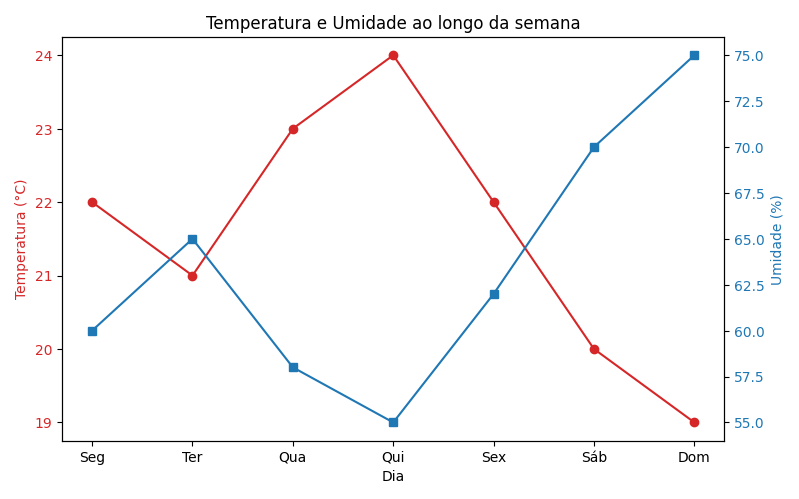{fig-align="center" fig-alt="Gráfico de temperatura e umidade em diferentes escalas."}

##

O gráfico do slide anterior anterior foi gerado com o seguinte código:

```python
import matplotlib.pyplot as plt

# Dados de exemplo
dias = ['Seg', 'Ter', 'Qua', 'Qui', 'Sex', 'Sáb', 'Dom']
temperatura = [22, 21, 23, 24, 22, 20, 19]
umidade = [60, 65, 58, 55, 62, 70, 75]

fig, ax1 = plt.subplots(figsize=(8, 5))

ax1.plot(dias, temperatura, marker='o', color='tab:red', label='Temperatura (°C)')
ax1.set_xlabel('Dia')
ax1.set_ylabel('Temperatura (°C)', color='tab:red')
ax1.tick_params(axis='y', labelcolor='tab:red')

ax2 = ax1.twinx()
ax2.plot(dias, umidade, marker='s', color='tab:blue', label='Umidade (%)')
ax2.set_ylabel('Umidade (%)', color='tab:blue')
ax2.tick_params(axis='y', labelcolor='tab:blue')

plt.title('Temperatura e Umidade ao longo da semana')
fig.tight_layout()
plt.show()
```

##

Como esse é um exemplo um pouco mais complexo, vamos pedir ao Copilot para explicar o código linha a linha

::: {.callout-caution title="Prompt" icon="false"}
`/explain` Explique o código linha a linha.
:::

##

::: {.callout-note title="GitHub Copilot (início)" icon="false" .nonincremental}

Vou explicar o código Python linha a linha. Este código cria um gráfico com dois eixos Y para mostrar temperatura e umidade ao longo da semana:

[Linha 1]{.alert}

```python
import matplotlib.pyplot as plt
```
Importa a biblioteca matplotlib.pyplot com o alias `plt`. Esta biblioteca é usada para criar gráficos e visualizações em Python.

[Linhas 3-6]{.alert}

```python
# Dados de exemplo
dias = ['Seg', 'Ter', 'Qua', 'Qui', 'Sex', 'Sáb', 'Dom']
temperatura = [22, 21, 23, 24, 22, 20, 19]
umidade = [60, 65, 58, 55, 62, 70, 75]
```
- **Linha 3**: Comentário indicando que os dados são de exemplo
- **Linha 4**: Cria uma lista com os dias da semana abreviados
- **Linha 5**: Cria uma lista com valores de temperatura em graus Celsius para cada dia
- **Linha 6**: Cria uma lista com valores de umidade em percentual para cada dia
:::

##

::: {.callout-note title="GitHub Copilot (continuação)" icon="false" .nonincremental}

[Linha 8]{.alert}

```python
fig, ax1 = plt.subplots(figsize=(8, 5))
```
Cria uma figura (fig) e um eixo principal (ax1) com tamanho de 8x5 polegadas. A função `subplots()` retorna tanto a figura quanto o(s) eixo(s).

[Linhas 10-13]{.alert}

```python
ax1.plot(dias, temperatura, marker='o', color='tab:red', label='Temperatura (°C)')
ax1.set_xlabel('Dia')
ax1.set_ylabel('Temperatura (°C)', color='tab:red')
ax1.tick_params(axis='y', labelcolor='tab:red')
```
- **Linha 10**: Plota a temperatura no eixo principal com marcadores circulares ('o') em cor vermelha
- **Linha 11**: Define o rótulo do eixo X como 'Dia'
- **Linha 12**: Define o rótulo do eixo Y esquerdo como 'Temperatura (°C)' em cor vermelha
- **Linha 13**: Configura a cor dos números do eixo Y esquerdo para vermelho
:::

##

::: {.callout-note title="GitHub Copilot (continuação)" icon="false" .nonincremental}

[Linhas 15-18]{.alert}

```python
ax2 = ax1.twinx()
ax2.plot(dias, umidade, marker='s', color='tab:blue', label='Umidade (%)')
ax2.set_ylabel('Umidade (%)', color='tab:blue')
ax2.tick_params(axis='y', labelcolor='tab:blue')
```
- **Linha 15**: Cria um segundo eixo Y (ax2) que compartilha o mesmo eixo X com ax1
- **Linha 16**: Plota a umidade no segundo eixo com marcadores quadrados ('s') em cor azul
- **Linha 17**: Define o rótulo do eixo Y direito como 'Umidade (%)' em cor azul
- **Linha 18**: Configura a cor dos números do eixo Y direito para azul

[Linhas 20-23]{.alert}

```python
plt.title('Temperatura e Umidade ao longo da semana')
fig.tight_layout()
plt.show()
```
- **Linha 20**: Define o título do gráfico
- **Linha 21**: Ajusta automaticamente o layout para evitar sobreposição de elementos
- **Linha 22**: Linha em branco para melhor legibilidade
- **Linha 23**: Exibe o gráfico na tela
:::

##

::: {.callout-note title="GitHub Copilot (continuação)" icon="false" .nonincremental}

[Resultado]{.alert}

O código gera um gráfico que mostra duas linhas:

- Uma linha vermelha com círculos mostrando a temperatura (eixo Y esquerdo)
- Uma linha azul com quadrados mostrando a umidade (eixo Y direito)

Ambas as linhas compartilham o mesmo eixo X (dias da semana), permitindo comparar facilmente como temperatura e umidade variam ao longo da semana.
:::

##

::: {.callout-tip}
Você pode estar se perguntando para que pedir explicações sobre o código ao Copilot,
se basta pedir a ele novamente se precisarmos fazer algo diferente.

Repare que, quanto mais um programador conhece uma biblioteca, melhor uso ele 
consegue fazer dos assistentes de IA.

Claro que não é necessário entender os detalhes de sintaxe e decorar as funções que 
fazem os gráficos. E dependendo do seu objetivo, talvez nem precise entender nada.

Mas, dependendo do que precisa, pode ser especialmente útil saber o que a biblioteca é
capaz de fazer e entender o suficiente do código para que tornar mais fácil o processo 
de depuração e customização do código gerado.
:::

## Gráficos de Barras

[Gráficos de Barras]{.alert}, também conhecidos como **Gráficos de Colunas**, são úteis para:

- comparar quantidades entre diferentes categorias.

. . .

Vamos usar o Copilot de maneira ligeiramente diferente que usamos antes.

- Vamos pedir que ele não só gere o gráfico, como também totalize os dados mensais antes
  de gerar o gráfico.

##

::: {.callout-caution title="Prompt" icon="false"}
Gere um gráfico de barras usando Matplotlib mostrando as vendas **totais** de cada produto
a partir da tabela abaixo que contém dados de vendas mensais de três produtos.

```
Mês	Produto A	Produto B	Produto C
Jan	150	100	80
Fev	200	120	90
Mar	250	180	100
Abr	300	160	120
Mai	280	170	140
Jun	320	150	160
```
:::

##

::: {.callout-note title="GitHub Copilot" icon="false" .nonincremental}
```python
import matplotlib.pyplot as plt

# Dados de vendas mensais
meses = ['Jan', 'Fev', 'Mar', 'Abr', 'Mai', 'Jun']
produto_a = [150, 200, 250, 300, 280, 320]
produto_b = [100, 120, 180, 160, 170, 150]
produto_c = [80, 90, 100, 120, 140, 160]

# Calculando vendas totais por produto
total_a = sum(produto_a)
total_b = sum(produto_b)
total_c = sum(produto_c)

produtos = ['Produto A', 'Produto B', 'Produto C']
totais = [total_a, total_b, total_c]

# Criando o gráfico de barras
plt.bar(produtos, totais, color=['blue', 'green', 'orange'])
plt.title('Vendas Totais por Produto (Jan-Jun)')
plt.xlabel('Produto')
plt.ylabel('Vendas Totais')
plt.tight_layout()
plt.show()
```
:::

##

Esse é o gráfico gerado:

:::: {.columns}
::: {.column width="50%"}
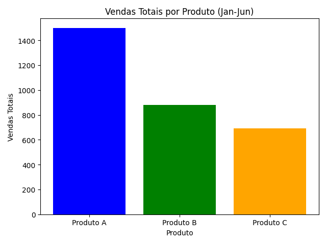{fig-align="center" fig-alt="Gráfico de vendas totais por produto usando matplotlib."}
:::

::: {.column width="50%"}
- Veja que, no código, foi usado o método `bar` em vez do método `plot`.
- Ele recebe como primeiro argumento uma lista com os nomes das categorias (produtos)
- e como segundo argumento uma lista com os valores numéricos (vendas totais).
:::
::::

##

Vamos ver outras melhorias de visualização que podemos fazer com a ajuda do Copilot.

- Podemos, por exemplo, pedir que o gráfico seja gerado na horizontal,
- ou que as barras sejam exibidas com cores diferentes.

. . .

::: {.callout-caution title="Prompt" icon="false"}
Altere o gráfico para que as barras sejam exibidas na horizontal, e os valores de 
cada barra sejam exibidos dentro da própria barra. Use uma paleta de cores.
Também altere o título do eixo X para Produtos e mude a cor do título e dos nomes dos
eixos para azul escuro.
:::

##

::: {.callout-note title="GitHub Copilot" icon="false" .nonincremental}
```python
import matplotlib.pyplot as plt

# Dados de vendas mensais
meses = ['Jan', 'Fev', 'Mar', 'Abr', 'Mai', 'Jun']
produto_a = [150, 200, 250, 300, 280, 320]
produto_b = [100, 120, 180, 160, 170, 150]
produto_c = [80, 90, 100, 120, 140, 160]

# Calculando vendas totais por produto
total_a = sum(produto_a)
total_b = sum(produto_b)
total_c = sum(produto_c)

produtos = ['Produto A', 'Produto B', 'Produto C']
totais = [total_a, total_b, total_c]

# Paleta de cores
colors = plt.cm.Set2.colors[:3]

# Criando o gráfico de barras horizontais
bars = plt.barh(produtos, totais, color=colors)
plt.title('Vendas Totais por Produto (Jan-Jun)', color='#003366')
plt.xlabel('Vendas Totais', color='#003366')
plt.ylabel('Produtos', color='#003366')

# Adicionando os valores dentro das barras
for bar in bars:
    width = bar.get_width()
    plt.text(width / 2, bar.get_y() + bar.get_height() / 2,
             str(width),
             ha='center', va='center', color='white', fontsize=10, fontweight='bold')

plt.tight_layout()
plt.show()
```
:::

##

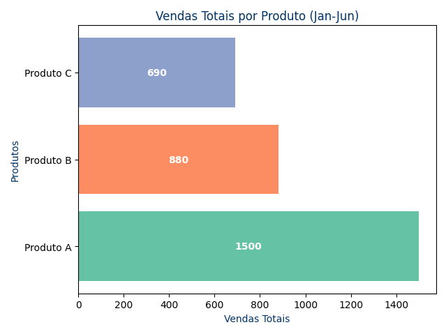{fig-align="center" fig-alt="Gráfico de vendas totais por produto alterado, usando Matplolib."}

. . .

Você pode notar pelo código gerado, que a Matplotlib é uma biblioteca bastante flexível,
mas que pode exigir bastante código para fazer gráficos como queremos.

## Gráficos de Pizza

[Gráficos de Pizza]{.alert} são úteis para:

- mostrar proporções de cada categoria em relação ao total,
- geralmente expressas em porcentagens.

. . .

Vamos pedir ao Copilot para mostrar as vendas totais de cada produto em um gráfico de pizza.

- E, em seguida, entender que diferença faz mostrar esses dados em gráficos de barras ou de pizza.

##

::: {.callout-caution title="Prompt" icon="false"}
Gere um gráfico de **pizza** usando Matplotlib mostrando as vendas totais de cada produto
a partir da tabela abaixo que contém dados de vendas mensais de três produtos.

```
Mês	Produto A	Produto B	Produto C
Jan	150	100	80
Fev	200	120	90
Mar	250	180	100
Abr	300	160	120
Mai	280	170	140
Jun	320	150	160
```
:::

##

::: {.callout-note title="GitHub Copilot" icon="false" .nonincremental}
```python
import matplotlib.pyplot as plt

# Dados de vendas mensais
produtos = ['Produto A', 'Produto B', 'Produto C']
vendas = [
    [150, 200, 250, 300, 280, 320],  # Produto A
    [100, 120, 180, 160, 170, 150],  # Produto B
    [80, 90, 100, 120, 140, 160]     # Produto C
]

# Soma das vendas de cada produto
vendas_totais = [sum(v) for v in vendas]

# Gráfico de pizza
plt.figure(figsize=(6, 6))
plt.pie(vendas_totais, labels=produtos, autopct='%1.1f%%', startangle=90)
plt.title('Vendas Totais por Produto')
plt.axis('equal')
plt.show()
```
:::

##

Esse é o gráfico gerado:

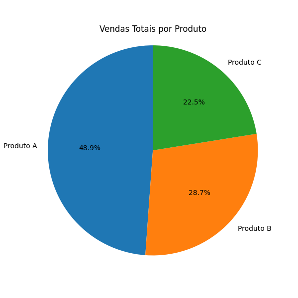{fig-align="center" fig-alt="Gráfico de vendas totais por produto em gráfico de pizza usando Matplolib."}

## 

Em que situações você preferiria usar o **gráfico de barras** ou o **gráfico de pizza**?

:::: {.columns}
::: {.column width="50%"}
{fig-align="center" fig-alt="Gráfico de vendas totais por produto usando matplotlib."}
:::

::: {.column width="50%"}
{fig-align="center" fig-alt="Gráfico de vendas totais por produto em gráfico de pizza usando Matplolib."}
:::
::::

## 

Repare que **gráficos de barra** são mais eficazes para comparar valores absolutos entre categorias.

- Eles facilitam a visualização de diferenças entre os valores.
- No nosso caso, conseguimos ver facilmente que o Produto A teve vendas muito maiores que os outros.

. . .

Já **gráficos de pizza** são mais úteis para comparar as proporções em relação ao total.

- Eles ajudam a entender a participação de cada categoria.
- No nosso caso, conseguimos ver facilmente que o Produto A representa quase metade das vendas totais.


## Histogramas

Os [histogramas]{.alert} são úteis para:

- mostrar distribuições de frequência,
- ou seja, quantas vezes cada valor ou intervalo de valores ocorre em um conjunto de dados. 

. . .

Cada valor (ou intervalo) é representado por uma barra vertical, cuja altura corresponde 
à frequência daquele valor.

##

Suponha, por exemplo, que um professor queira analisar as notas de uma turma.

- Ele pode usar um histograma para visualizar a distribuição das notas.

. . .

::: {.callout-caution title="Prompt" icon="false"}
```python
import matplotlib.pyplot as plt

notas = [91, 92, 60, 82, 94, 54, 83, 81, 74, 91, 75, 70, 81, 48, 0, 82, 90, 65, 88, 89, 56, 51, 64, 63, 60, 61, 80, 66, 65, 79, 49, 71, 44, 72, 78, 60, 55, 53, 87, 80, 63, 60, 66, 61, 75, 48, 87, 53, 63, 39, 74, 27, 61]

# gerar um histograma com as notas, considerando intervalos de 10 em 10
```
:::

##

::: {.callout-note title="GitHub Copilot" icon="false" .nonincremental}
```python
import matplotlib.pyplot as plt

notas = [91, 92, 60, 82, 94, 54, 83, 81, 74, 91, 75, 70, 81, 48, 0, 82, 90, 65, 88, 89, 56, 51, 64, 63, 60, 61, 80, 66, 65, 79, 49, 71, 44, 72, 78, 60, 55, 53, 87, 80, 63, 60, 66, 61, 75, 48, 87, 53, 63, 39, 74, 27, 61]

# gerar um histograma com as notas, considerando intervalos de 10 em 10
plt.hist(notas, bins=range(0, 101, 10), edgecolor='black', alpha=0.7)
plt.title('Distribuição de Notas')
plt.xlabel('Notas')
plt.ylabel('Número de Alunos')
plt.xticks(range(0, 101, 10))
plt.grid(axis='y', alpha=0.75)
plt.show()
```
:::

##

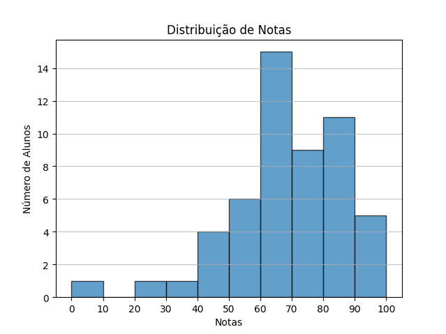{fig-align="center" fig-alt="Histograma de notas usando Matplolib."}

. . .

Analisando o histograma podemos ver que 15 alunos ficaram com nota entre 60 e 70.

- E que a maioria das notas está entre 60 e 90.

## Gráficos de Dispersão

Os [gráficos de dispersão]{.alert} são úteis para:

- mostrar a relação entre duas (ou mais) variáveis numéricas.
- Cada ponto do gráfico tem o valor de uma variável no eixo X e o valor da outra variável no eixo Y.

. . .

Suponha, por exemplo, que um professor queira analisar a relação entre a presença nas aulas e as notas dos alunos.

- Ele pode usar um gráfico de dispersão para visualizar essa relação.

##

::: {.callout-caution title="Prompt" icon="false"}
```python
import matplotlib.pyplot as plt

notas = [91, 79, 39, 62, 96, 84, 82, 24, 69, 15, 50, 38, 64, 30, 62, 76, 57, 58, 75, 72, 63, 74, 47, 72, 60, 79, 67, 70, 24, 59, 75, 60, 58, 14, 42, 89, 83, 47, 79, 46, 48, 91, 63, 83, 74, 90, 92]
faltas = [12, 28, 6, 16, 4, 12, 4, 32, 12, 12, 14, 14, 16, 16, 12, 8, 16, 2, 10, 54, 4, 54, 0, 16, 10, 8, 10, 8, 14, 16, 2, 12, 12, 22, 20, 2, 4, 18, 20, 6, 4, 4, 10, 2, 20, 12, 4]

# gerar um gráfico de dispersão relacionando notas e faltas
```
:::

##

::: {.callout-note title="GitHub Copilot" icon="false" .nonincremental}
```python
import matplotlib.pyplot as plt

notas = [91, 79, 39, 62, 96, 84, 82, 24, 69, 15, 50, 38, 64, 30, 62, 76, 57, 58, 75, 72, 63, 74, 47, 72, 60, 79, 67, 70, 24, 59, 75, 60, 58, 14, 42, 89, 83, 47, 79, 46, 48, 91, 63, 83, 74, 90, 92]
faltas = [12, 28, 6, 16, 4, 12, 4, 32, 12, 12, 14, 14, 16, 16, 12, 8, 16, 2, 10, 54, 4, 54, 0, 16, 10, 8, 10, 8, 14, 16, 2, 12, 12, 22, 20, 2, 4, 18, 20, 6, 4, 4, 10, 2, 20, 12, 4]

# gerar um gráfico de dispersão relacionando notas e faltas
plt.figure(figsize=(10, 6))
plt.scatter(faltas, notas, color='blue', alpha=0.6)
plt.title('Relação entre Notas e Faltas')
plt.xlabel('Número de Faltas')
plt.ylabel('Notas')
plt.xlim(0, max(faltas) + 5)
plt.ylim(0, 100)
plt.grid(True)
plt.axhline(y=60, color='r', linestyle='--', label='Nota de Corte')
plt.legend()
plt.show()
```
:::

##

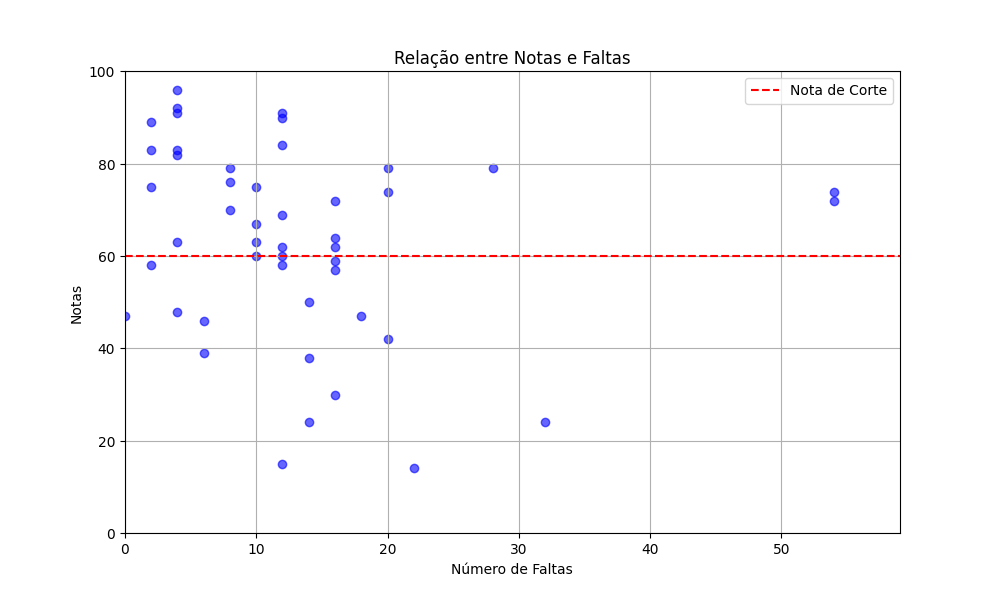{fig-align="center" fig-alt="Gráfico de dispersão relacionando notas e faltas usando Matplolib."}

##

Esse gráficos traz algumas questões interessantes.

1. O Copilot adicionou, por conta própria, uma linha horizontal indicando a nota de corte (60).

- Já que ele fez isso, seria interessante destacar também o limite de faltas para reprovação.
- Que inclusive, depende se a nota é 60 ou 70. 

##

2. Aĺém disso, tem dois pontos no gráfico bem estranhos.

- Alunos que faltaram em quase todas as aulas e ainda assim passaram. O que poderia ser?
- São alunos de matrícula especial (turma Z).
- Esses dados deveriam excluídos (limpeza de dados) ou destacados de alguma forma no gráfico.

##

Vamos então alterar o gráfico:

- removendo os alunos de turma Z.
- destacando o limite de faltas/notas para reprovação.

. . . 

::: {.callout-caution title="Prompt" icon="false"}
Altere o gráfico acrescentando uma nova linha de corte para a nota: 70 (em azul).
E linhas de corte também para as faltas: 17 (em vermelho) e 23 (em azul).
:::

##

::: {.callout-note title="GitHub Copilot" icon="false" .nonincremental}
```python
import matplotlib.pyplot as plt

notas = [91, 79, 39, 62, 96, 84, 82, 24, 69, 15, 50, 38, 64, 30, 62, 76, 57, 58, 75, 63, 47, 72, 60, 79, 67, 70, 24, 59, 75, 60, 58, 14, 42, 89, 83, 47, 79, 46, 48, 91, 63, 83, 74, 90, 92]
faltas = [12, 28, 6, 16, 4, 12, 4, 32, 12, 12, 14, 14, 16, 16, 12, 8, 16, 2, 10, 4, 0, 16, 10, 8, 10, 8, 14, 16, 2, 12, 12, 22, 20, 2, 4, 18, 20, 6, 4, 4, 10, 2, 20, 12, 4]

plt.figure(figsize=(10, 6))
plt.scatter(faltas, notas, color='blue', alpha=0.6)
plt.title('Relação entre Notas e Faltas')
plt.xlabel('Número de Faltas')
plt.ylabel('Notas')
plt.xlim(0, max(faltas) + 5)
plt.ylim(0, 100)
plt.grid(True)

# Linhas horizontais de corte para notas
plt.axhline(y=60, color='r', linestyle='--', label='Nota de Corte 60')
plt.axhline(y=70, color='blue', linestyle='--', label='Nota de Corte 70')

# Linhas verticais de corte para faltas
plt.axvline(x=17, color='r', linestyle='-.', label='Faltas Corte 17')
plt.axvline(x=23, color='blue', linestyle='-.', label='Faltas Corte 23')

plt.legend()
plt.show()
```
:::

##

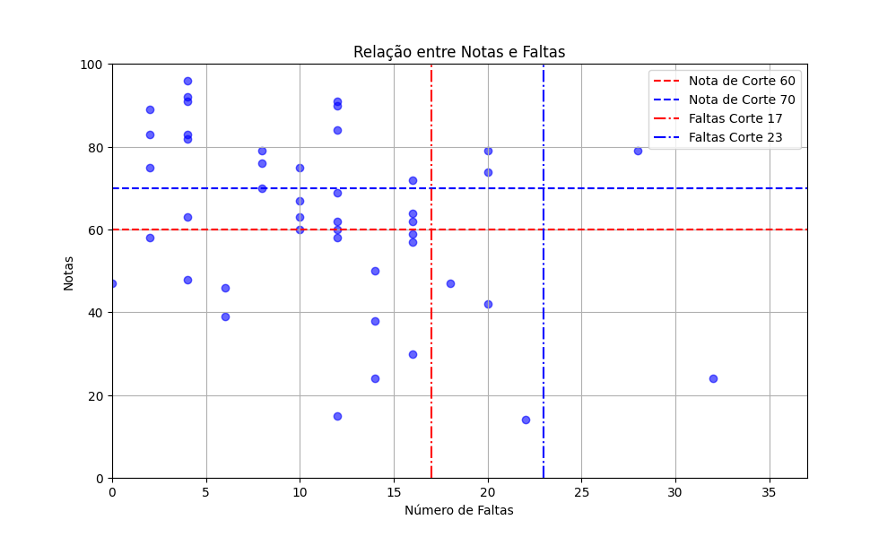{fig-align="center" fig-alt="Gráfico de dispersão relacionando notas e faltas alterado, usando Matplolib."}

## Outros tipos de gráficos e funcionalidades do Matplotlib

Como já citado anteriormente, o Copilot nos permite manter foco no que queremos,

- em vez de preocuparmos sobre detalhes sobre como isso pode ser feito.

. . .

Por isso, é interessante ter uma ideia do que é possível fazer com as bibliotecas de visualização
como o Matplotlib.

- Você pode explorar isso com o próprio Copilot.
- Ou pode consultar a documentação oficial da biblioteca.

##

Uma funcionalidade interessante da Matplotlib, por exemplo, é a possibilidade de criar vários subgráficos 
em uma única figura.

. . .

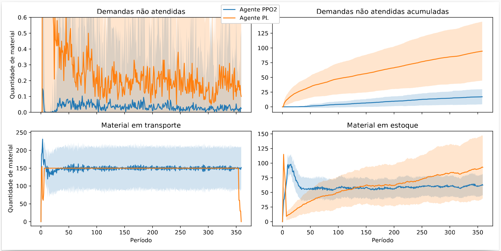{fig-align="center" fig-alt="Exemplo de vários gráficos em uma única figura usando Matplolib."}

##

Criei a figura do slide anterior para a minha tese de doutorado.

- Além de mostrar o uso de vários gráficos em uma única figura,
- ela também mostra que é possível usar preenchimento de área em gráficos de linha.

. . .

Pena que não existia Copilot 😢😢 durante o meu doutorado.

##

Outra funcionalidade interessante do Matplotlib são seus estilos predefinidos.

- Cada estilo tem uma variedade de configurações padrões para cores de fundo,
   linhas da grade, espessura de linha, fontes, etc.
- Assim podemos tornar nossas visualizações mais elegantes, sem precisar fazer muitas customizações.

. . .

Para demonstrar essas funcionalidades, vamos pedir ao Copilot para gerar o gráfico
de linhas de vendas, mas com diferentes estilos.

##

::: {.callout-caution title="Prompt" icon="false"}
Os dados abaixo que se referem às vendas mensais de três produtos.
Gostaria de ver, em uma única figura, vários gráficos de linha com estilos diferentes
usando Matplotlib.

```
Mês	Produto A	Produto B	Produto C
Jan	150	100	80
Fev	200	120	90
Mar	250	180	100
Abr	300	160	120
Mai	280	170	140
Jun	320	150	160
```
:::

##

Não era o bem o que eu queria.

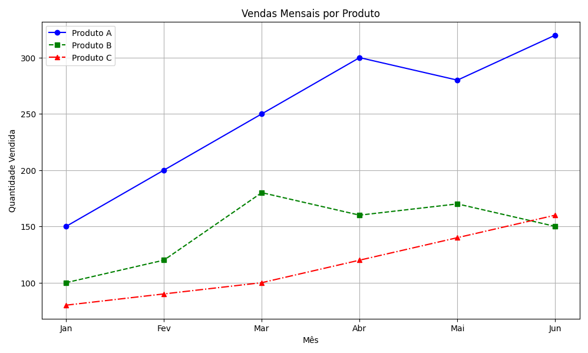{fig-align="center" fig-alt="Gráfico de vendas mensais com linhas de diferentes estilos usando Matplolib."}

##

Pelo código vemos que o Copilot entendeu que queríamos diferentes estilos de linha para cada produto.

::: {.callout-note title="GitHub Copilot" icon="false" .nonincremental}
```python
import matplotlib.pyplot as plt

# Dados
meses = ['Jan', 'Fev', 'Mar', 'Abr', 'Mai', 'Jun']
produto_a = [150, 200, 250, 300, 280, 320]
produto_b = [100, 120, 180, 160, 170, 150]
produto_c = [80, 90, 100, 120, 140, 160]

plt.figure(figsize=(10, 6))

# Gráficos de linha com estilos diferentes
plt.plot(meses, produto_a, label='Produto A', color='blue', linestyle='-', marker='o')
plt.plot(meses, produto_b, label='Produto B', color='green', linestyle='--', marker='s')
plt.plot(meses, produto_c, label='Produto C', color='red', linestyle='-.', marker='^')

plt.title('Vendas Mensais por Produto')
plt.xlabel('Mês')
plt.ylabel('Quantidade Vendida')
plt.legend()
plt.grid(True)
plt.tight_layout()
plt.show()
```
:::

##

Vamos então fazer um pouco de **Engenharia de Prompt** para tentar obter o que queremos.

::: {.callout-caution title="Prompt" icon="false"}
Os dados abaixo que se referem às vendas mensais de três produtos.
Gostaria de experimentar diferentes estilos padrões disponíveis na biblioteca matplotlib.
Para isso, gostaria que gerasse vários subgráficos em uma única figura, de forma que
cada subgráfico usasse um estilo diferente da biblioteca.

```
Mês	Produto A	Produto B	Produto C
Jan	150	100	80
Fev	200	120	90
Mar	250	180	100
Abr	300	160	120
Mai	280	170	140
Jun	320	150	160
```
:::

##

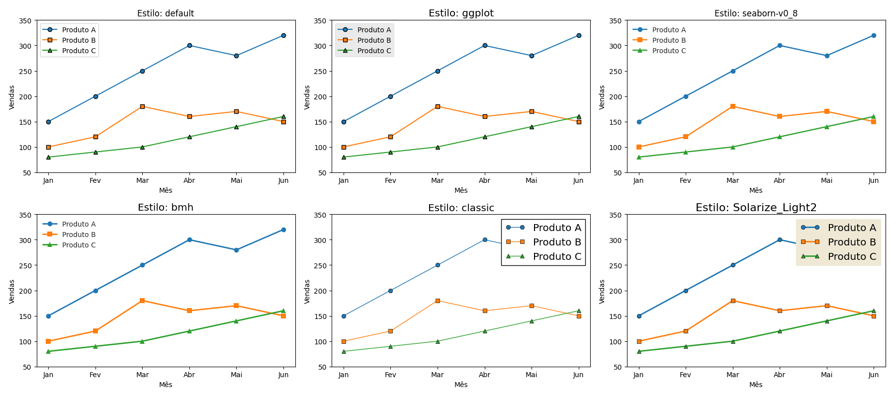{fig-align="center" fig-alt="Gráfico de vendas mensais com linhas de diferentes estilos usando Matplolib."}

Pelo menos agora foram gerados subgráficos.

- Mas o resultado ainda me pareceu decepcionante.

##

No código, vemos que foi usada uma lista de estilos predefinidos do Matplotlib.

- E foi gerado um subgráfico usando cada estilo.

::: {.callout-note title="GitHub Copilot" icon="false" .nonincremental}
```python
import matplotlib.pyplot as plt

# Dados
meses = ['Jan', 'Fev', 'Mar', 'Abr', 'Mai', 'Jun']
produto_a = [150, 200, 250, 300, 280, 320]
produto_b = [100, 120, 180, 160, 170, 150]
produto_c = [80, 90, 100, 120, 140, 160]

# Seleciona alguns estilos disponíveis
estilos = ['default', 'ggplot', 'seaborn-v0_8', 'bmh', 'classic', 'Solarize_Light2']

fig, axs = plt.subplots(2, 3, figsize=(18, 8))
axs = axs.flatten()

for i, estilo in enumerate(estilos):
    plt.style.use(estilo)
    ax = axs[i]
    ax.plot(meses, produto_a, marker='o', label='Produto A')
    ax.plot(meses, produto_b, marker='s', label='Produto B')
    ax.plot(meses, produto_c, marker='^', label='Produto C')
    ax.set_title(f'Estilo: {estilo}')
    ax.set_xlabel('Mês')
    ax.set_ylabel('Vendas')
    ax.legend()

plt.tight_layout()
plt.show()
```
:::

##

Durante a preparação do material, a minha hipótese foi de que misturar diferentes
estilos em uma mesma figura pode não funcionar muito bem.

. . .

Pedi então ao Copilot para alterar o código

::: {.callout-caution title="Prompt" icon="false"}
Altere o código de forma que cada estilo seja usado em uma figura separada, em vez de se utilizar subgráficos.
:::

##

:::: {.columns}
::: {.column width="33%"}
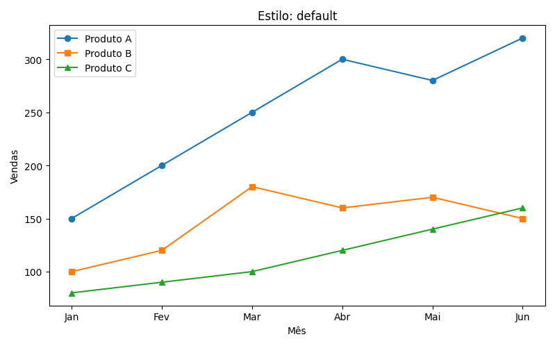{fig-align="center" fig-alt="Estilo default"}
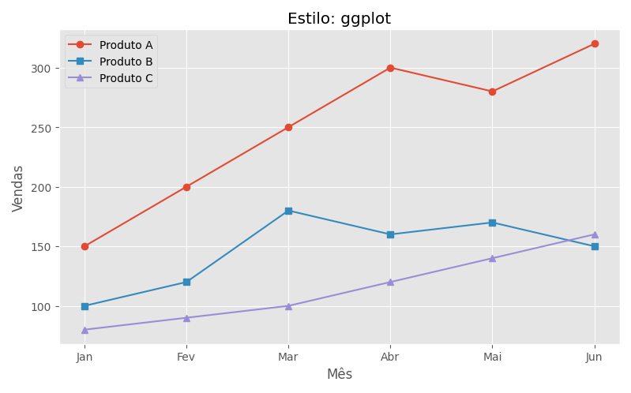{fig-align="center" fig-alt="Estilo ggplot"}
:::
::: {.column width="33%"}
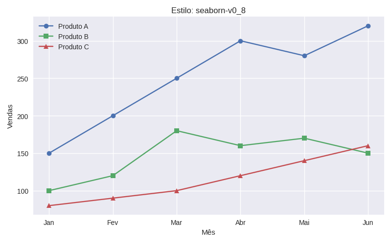{fig-align="center" fig-alt="Estilo seaborn"}
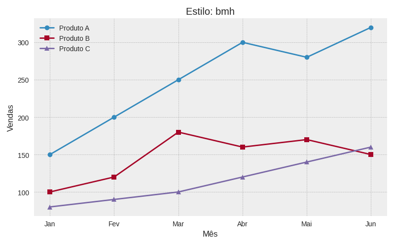{fig-align="center" fig-alt="Estilo bmh"}
:::
::: {.column width="33%"}
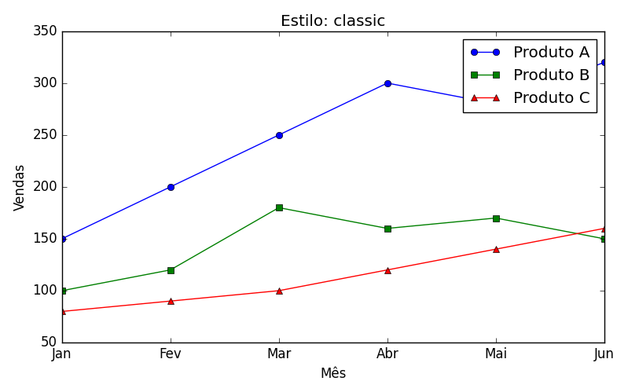{fig-align="center" fig-alt="Estilo classic"}
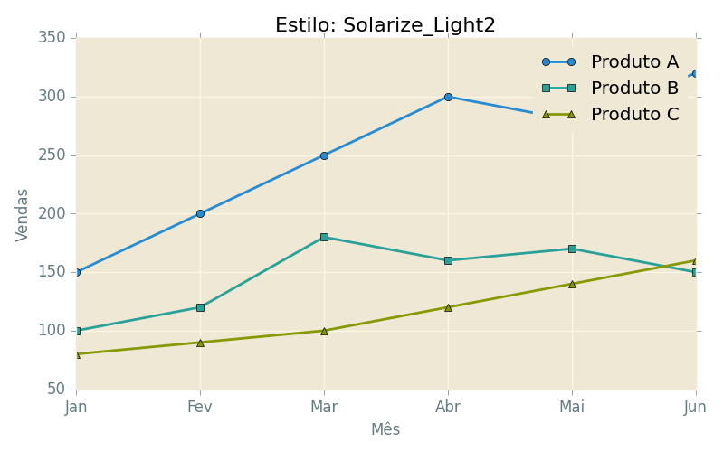{fig-align="center" fig-alt="Estilo solarize"}
:::
::::

##

- Veja que o método `plt.show()` é chamado separadamente para cada estilo.

::: {.callout-note title="GitHub Copilot" icon="false" .nonincremental}
```python
import matplotlib.pyplot as plt

# Dados
meses = ['Jan', 'Fev', 'Mar', 'Abr', 'Mai', 'Jun']
produto_a = [150, 200, 250, 300, 280, 320]
produto_b = [100, 120, 180, 160, 170, 150]
produto_c = [80, 90, 100, 120, 140, 160]

# Seleciona alguns estilos disponíveis
estilos = ['default', 'ggplot', 'seaborn-v0_8', 'bmh', 'classic', 'Solarize_Light2']

for estilo in estilos:
    plt.style.use(estilo)
    fig, ax = plt.subplots(figsize=(8, 5))
    ax.plot(meses, produto_a, marker='o', label='Produto A')
    ax.plot(meses, produto_b, marker='s', label='Produto B')
    ax.plot(meses, produto_c, marker='^', label='Produto C')
    ax.set_title(f'Estilo: {estilo}')
    ax.set_xlabel('Mês')
    ax.set_ylabel('Vendas')
    ax.legend()
    plt.tight_layout()
    plt.show()
```
:::

##

Pelo comentário no código gerado, vemos que o Copilot selecionou apenas alguns dos estilos disponíveis.

. . .

Perguntei a ele então como saber quais estilos estão disponíveis.

- Ele gerou a linha de código abaixo.

. . .

```python
print(plt.style.available)
```

. . .

Que trouxe o seguinte resultado:

```python
['Solarize_Light2', '_classic_test_patch', '_mpl-gallery', '_mpl-gallery-nogrid', 
 'bmh', 'classic', 'dark_background', 'fast', 'fivethirtyeight', 'ggplot', 
 'grayscale', 'petroff10', 'seaborn-v0_8', 'seaborn-v0_8-bright', 'seaborn-v0_8-colorblind', 
 'seaborn-v0_8-dark', 'seaborn-v0_8-dark-palette', 'seaborn-v0_8-darkgrid', 'seaborn-v0_8-deep', 
 'seaborn-v0_8-muted', 'seaborn-v0_8-notebook', 'seaborn-v0_8-paper', 'seaborn-v0_8-pastel', 
 'seaborn-v0_8-poster', 'seaborn-v0_8-talk', 'seaborn-v0_8-ticks', 'seaborn-v0_8-white', 
 'seaborn-v0_8-whitegrid', 'tableau-colorblind10']
```

## 

Nós também podemos salvar os gráficos gerados em arquivos de imagem, via código.

- O Copilot pode nos ajudar com isso também.

. . .

::: {.callout-caution title="Prompt" icon="false"}
Altere o código para que cada gráfico seja salvo em um arquivo PNG, em vez de ser
exibido na tela.
:::


##

```python
import matplotlib.pyplot as plt

# Dados
meses = ['Jan', 'Fev', 'Mar', 'Abr', 'Mai', 'Jun']
produto_a = [150, 200, 250, 300, 280, 320]
produto_b = [100, 120, 180, 160, 170, 150]
produto_c = [80, 90, 100, 120, 140, 160]

# Seleciona alguns estilos disponíveis
estilos = ['default', 'ggplot', 'seaborn-v0_8', 'bmh', 'classic', 'Solarize_Light2']

for estilo in estilos:
    plt.style.use(estilo)
    fig, ax = plt.subplots(figsize=(8, 5))
    ax.plot(meses, produto_a, marker='o', label='Produto A')
    ax.plot(meses, produto_b, marker='s', label='Produto B')
    ax.plot(meses, produto_c, marker='^', label='Produto C')
    ax.set_title(f'Estilo: {estilo}')
    ax.set_xlabel('Mês')
    ax.set_ylabel('Vendas')
    ax.legend()
    plt.tight_layout()
    # Salva o gráfico em um arquivo PNG
    fig.savefig(f'grafico_{estilo}.png')
    plt.close(fig)
```

##

Você pode conhecer o que a biblioteca Matplotlib é capaz de fazer consultando a documentação oficial.

- Veja, por exemplo, os [tipos de gráficos disponíveis](https://matplotlib.org/stable/plot_types/index.html#plot-types).
- E a [galeria de exemplos](https://matplotlib.org/stable/gallery/index.html).

# Geração de dados {background-color="#40666e"}

##

Os exemplos que vimos até agora geraram visualizações para dados que já tínhamos.

- Mas há situações nas quais nossos próprios programas podem gerar os dados que precisamos.

. . .

Veremos a seguir dois exemplos simples dessa ideia.

## Exemplo 1: Números quadrados

Vamos começar mostrar um gráfico simples dos números quadrados de 1 a 1000.

. . .

::: {.callout-caution title="Prompt" icon="false"}
Gere um gráfico de dispersão usando Matplotlib mostrando os números quadrados de 1 a 1000.
Use o estilo seaborn.
:::

##

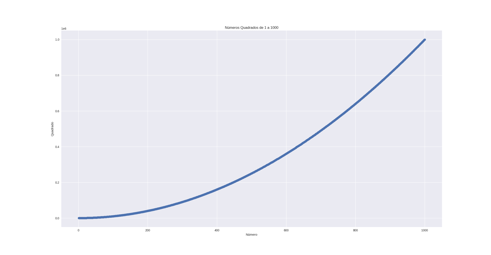{fig-align="center" fig-alt="Gráfico de dispersão dos números quadrados de 1 a 1000 usando Matplolib."}

## 

::: {.callout-note title="GitHub Copilot" icon="false" .nonincremental}
```python
import numpy as np

import matplotlib.pyplot as plt

plt.style.use('seaborn-v0_8')

x = np.arange(1, 1001)
y = x ** 2

plt.scatter(x, y)
plt.title('Números Quadrados de 1 a 1000')
plt.xlabel('Número')
plt.ylabel('Quadrado')
plt.show()
```
:::

Vemos que o código gerado usa a biblioteca `NumPy`.

- Vamos conhecer mais sobre ela com a ajuda do Copilot.

## 

::: {.callout-caution title="Prompt" icon="false"}
Dê uma visão geral sobre a biblioteca Numpy e explique o uso dela nesse exemplo.
:::

. . .

::: {.callout-note title="GitHub Copilot (início)" icon="false" .nonincremental}
A biblioteca **NumPy** (Numerical Python) é uma das principais bibliotecas para computação numérica em Python. Ela fornece suporte para arrays multidimensionais e funções matemáticas eficientes, sendo amplamente utilizada em ciência de dados, machine learning e processamento de imagens.

[Principais características do NumPy]{.alert}:

- **Arrays eficientes:** Estruturas de dados otimizadas para operações matemáticas rápidas.
- **Funções matemáticas:** Grande variedade de funções para álgebra linear, estatística, transformadas, etc.
- **Integração:** Compatível com outras bibliotecas como Pandas, Matplotlib e SciPy.
:::

##

::: {.callout-note title="GitHub Copilot (continuação)" icon="false" .nonincremental}

[Uso do NumPy no exemplo (app.py)]{.alert}:

No seu código, o NumPy é utilizado para criar um array de números inteiros de 1 a 1000:

```python
x = np.arange(1, 1001)
```

- **`np.arange(1, 1001)`**: Gera um array NumPy com valores de 1 até 1000 (inclusive).
- Em seguida, o array `x` é elevado ao quadrado para criar o array `y`:
  
  ```python
  y = x ** 2
  ```

- O uso do NumPy permite que essas operações sejam feitas de forma vetorizada, ou seja, sem a necessidade de loops explícitos, tornando o código mais simples e eficiente.

Resumindo: **NumPy** facilita a criação e manipulação de grandes conjuntos de dados numéricos, como no exemplo onde gera rapidamente os números e seus quadrados para visualização.
:::

##

Vamos aproveitar esse exemplo para mostrar outra funcionalidade do Matplotlib: [`Color Maps`]{.alert}.

- (ou mapas de cores) são gradientes de cores usados para representar valores numéricos em gráficos.
- O gradiente varia de uma cor inicial a uma cor final.
- Eles ajudam a visualizar a densidade ou intensidade dos dados.

. . .

Podemos, por exemplo, usar cores claras para valores baixos e cores escuras para valores altos.

##

Vamos demonstrar o uso de `Color Maps` no gráfico dos números quadrados.

::: {.callout-caution title="Prompt" icon="false"}
Altere o gráfico de dispersão dos números quadrados de 1 a 1000 para
usar um mapa de cores (Color Map) que vá do azul claro (valores baixos) ao azul escuro (valores altos).
:::

##

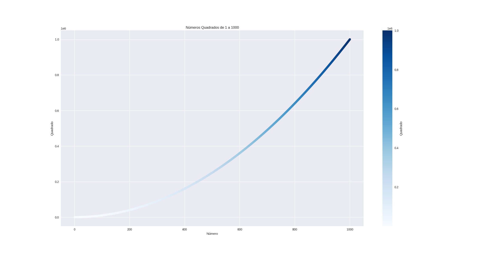{fig-align="center" fig-alt="Gráfico de dispersão dos números quadrados de 1 a 1000 usando Matplolib com Color Map."}

##

::: {.callout-note title="GitHub Copilot" icon="false" .nonincremental}
```python
import numpy as np
import matplotlib.pyplot as plt

plt.style.use('seaborn-v0_8')

x = np.arange(1, 1001)
y = x ** 2

# Usando o colormap 'Blues' para ir do azul claro ao azul escuro
plt.scatter(x, y, c=y, cmap='Blues')
plt.title('Números Quadrados de 1 a 1000')
plt.xlabel('Número')
plt.ylabel('Quadrado')
plt.colorbar(label='Quadrado')  # Adiciona a barra de cores
plt.show()
```
:::

##

Um uso mais interessante de Color Maps é em gráficos de dispersão com muitas observações.

- Podemos usar a densidade de pontos para definir as cores.
- Assim, regiões com muitos pontos ficam mais escuras, e regiões com poucos pontos ficam mais claras.

. . .

Outra possibilidade é usar Color Maps para representar uma terceira variável em gráficos de dispersão 2D.

- Nesse caso, cada ponto do gráfico tem uma cor que representa o valor dessa terceira variável.

##

Vamos ver um exemplo disso, usando um [arquivo Excel](dados/municipios-mg.xlsx) com dados de municípios de Minas Gerais, obtidos do IBGE.

. . .

::: {.callout-caution title="Prompt" icon="false"}
O arquivo municipios-mg.xlsx possui dados sobre os municípios de Minas Gerais. A terceira linha possui a identificação das colunas e os dados vêm a partir da quarta linha. Gostaria que o gráfico incluísse apenas os 40 municípios mais populosos.

Gostaria de gerar um gráfico de dispersão que mostrasse no eixo X o PIB per capita (coluna N) , no eixo Y a população (coluna F) e como mapa de cores o IDH (coluna J). Gostaria que o nome do município fosse exibido (coluna A).
:::

##

::: {.callout-note title="GitHub Copilot" icon="false" .nonincremental}
```python
import pandas as pd
import matplotlib.pyplot as plt

# Carregar o arquivo Excel, pulando as duas primeiras linhas (header na linha 2)
df = pd.read_excel('municipios-mg.xlsx', header=2)

# Selecionar apenas as colunas necessárias usando índices
# Supondo que as colunas estejam assim:
# Coluna F (índice 5): População
# Coluna J (índice 9): IDH
# Coluna N (índice 13): PIB per capita
# Coluna B (índice 0): Nome do município

df = df.iloc[:, [0, 5, 9, 13]]

# Renomear as colunas para facilitar
df.columns = ['municipio', 'populacao', 'idh', 'pib_per_capita']

# Selecionar os 40 municípios mais populosos
df_top40 = df.sort_values(by='populacao', ascending=False).head(40)

# Plotar o gráfico de dispersão
plt.figure(figsize=(12, 8))
scatter = plt.scatter(
    df_top40['pib_per_capita'],
    df_top40['populacao'],
    c=df_top40['idh'],
    cmap='viridis',
    s=100,
    alpha=0.7
)
plt.colorbar(scatter, label='IDH')
plt.xlabel('PIB per capita')
plt.ylabel('População')
plt.title('40 municípios mais populosos de MG: PIB per capita x População (cores = IDH)')

# Adicionar o nome dos municípios
for i, row in df_top40.iterrows():
    plt.text(row['pib_per_capita'], row['populacao'], row['municipio'], fontsize=8, alpha=0.7)

plt.tight_layout()
plt.show()
```
:::

##

Ao tentar executar o código gerado pela primeira vez, obtive o seguinte erro:

```bash
  File "/home/julio/Downloads/aula_t7/.venv/lib/python3.11/site-packages/pandas/compat/_optional.py", line 138, in import_optional_dependency
    raise ImportError(msg)
ImportError: Missing optional dependency 'openpyxl'.  Use pip or conda to install openpyxl.
```

. . .

O código gerado usa a biblioteca `Pandas` para ler o arquivo Excel.

- E ela depende uma biblioteca externa chamada `openpyxl`.

##

Como nós havíamos criado um arquivo `requirements.txt` para o projeto,

- basta incluirmos uma linha com o nome da biblioteca que queremos instalar.
- E depois rodarmos o comando `pip install -r requirements.txt` para instalar todas as dependências do projeto.
  - Não esqueça de rodar com o ambiente virtual ativado.

##

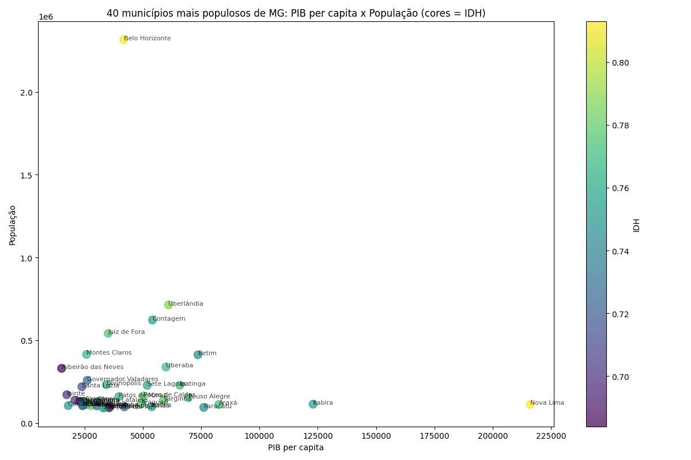{fig-align="center" fig-alt="Gráfico de dispersão dos municípios mais populosos de Minas Gerais, mostrando PIB per capita, população e IDH usando Matplolib."}

##

É melhor analisar esse gráfico pela tela do programa.

. . .

E, mais adiante, conheceremos melhor a biblioteca `Pandas` com mais detalhes.

## Exemplo 2: Passeios aleatórios

Vamos ver outro exemplo simples de geração de dados: [Passeios Aleatórios]{.alert}.

- Vamos usar o Python para gerar dados a partir de um passeio aleatório.
- E depois usar a Matplotlib para criar uma representação visual desse passeio.

. . .

Um **passeio aleatório** é um caminho determinado por uma série de decisões simples,
tomadas inteiramente ao acaso.

##

Um passeio aleatório pode ser, por exemplo:

- O caminho de que uma formiga confusa tomaria se desse cada passo em uma direção aleatória.

. . .

Esses passeios têm usos práticos na natureza, na física, biologia, química e economia.

- Um grão de pólen, por ex., flutua sobre uma gota de água que se move de um lado por outro 
  devido ao movimento das moléculas de água,
- e o movimento molecular da água é aleatório,
- fazendo com que o caminho percorrido pelo grão de pólen seja um passeio aleatório.

##

Portanto, o código abaixo modela muitas situações do mundo cotidiano.

```python
from random import choice

def gerar_passeio_aleatorio(num_pontos):
    # passeios começam na coordenada (0,0)
    valores_x = [0]
    valores_y = [0]

    while len(valores_x) < num_pontos:
        
        # Decide qual direção toma, e até onde ir
        direcao_x = choice([1,-1])
        distancia_x = choice([0,1,2,3,4])
        passo_x = direcao_x * distancia_x

        direcao_y = choice([1,-1])
        distancia_y = choice([0,1,2,3,4])
        passo_y = direcao_y * distancia_y

        # Rejeita movimentos que não vão a lugar algum
        if passo_x == 0 and passo_y == 0:
            continue

        # Calcula a nova posição
        x = valores_x[-1] + passo_x
        y = valores_y[-1] + passo_y

        valores_x.append(x)
        valores_y.append(y)

    return valores_x, valores_y
```

##

::: {.callout-caution title="Prompt" icon="false"}
```python
# Gera um gráfico de dispersão usando a biblioteca matplotlib
# de um passeio aleatório de 5000 pontos.
# Use pontos de tamanho 15.
# Mantenha os eixos x e y com a mesma escala
```
:::

##

```python
if __name__ == '__main__':
    import matplotlib.pyplot as plt

    x, y = gerar_passeio_aleatorio(5000)

    plt.figure(figsize=(10,6))
    plt.scatter(x, y, s=15)
    plt.title('Passeio Aleatório em 2D')
    plt.xlabel('X')
    plt.ylabel('Y')
    plt.grid(True)
    plt.axis('equal')
    plt.show()
```

##

Vamos usar mapas de cores para destacar o início e o fim do passeio.

- E também destacar o ponto inicial na cor verde e final na cor vermelha.

. . .

::: {.callout-caution title="Prompt" icon="false"}
Altere  o gráfico do passeio aleatório para usar um mapa de cores que vá do azul claro (início do passeio) ao azul escuro (fim do passeio).
Além disso, destaque o ponto inicial na cor verde e o ponto final na cor vermelha (ambos com tamanho 100).
:::

##

```python
if __name__ == '__main__':    
    x, y = gerar_passeio_aleatorio(5000)

    pontos = np.arange(len(x))
    cmap = cm.get_cmap('Blues')

    plt.figure(figsize=(10,6))
    plt.scatter(x, y, c=pontos, cmap=cmap, s=15)
    # Destaca o ponto inicial em verde
    plt.scatter(x[0], y[0], c='green', s=100, label='Início')
    # Destaca o ponto final em vermelho
    plt.scatter(x[-1], y[-1], c='red', s=100, label='Fim')
    plt.title('Passeio Aleatório em 2D')
    plt.xlabel('X')
    plt.ylabel('Y')
    plt.grid(True)
    plt.axis('equal')
    plt.legend()
    plt.show()
```

##

Vamos alterar o código para gerar 50 mil pontos no passeio aleatório,

- e vamos diminuir o tamanho para 1 para que a visualização fique mais interessante.

##

Agora vamos gerar vários passeios aleatórios com o mesmo código.

- Cada um deles terá uma cor diferente.

::: {.callout-caution title="Prompt" icon="false"}
Altere o código para gerar 3 passeios aleatórios, cada um com uma cor diferente
e com 50000 pontos cada (use pontos de tamanho 1).
Mantenha os eixos x e y com a mesma escala, os pontos do início e do fim de cada passeio destacados
e os mapas de cores dos pontos.
:::

##

```python
if __name__ == '__main__':    
    num_passeios = 3
    num_pontos = 50000
    cores = ['Blues', 'Oranges', 'Greens']
    labels = ['Passeio 1', 'Passeio 2', 'Passeio 3']
    inicios = ['green', 'lime', 'yellow']
    fins = ['red', 'magenta', 'black']

    plt.figure(figsize=(12, 8))

    for i in range(num_passeios):
        x, y = gerar_passeio_aleatorio(num_pontos)
        pontos = np.arange(len(x))
        cmap = cm.get_cmap(cores[i])
        plt.scatter(x, y, c=pontos, cmap=cmap, s=1, label=labels[i], alpha=0.6)
        plt.scatter(x[0], y[0], c=inicios[i], s=60, edgecolors='k', marker='o', label=f'Início {i+1}')
        plt.scatter(x[-1], y[-1], c=fins[i], s=60, edgecolors='k', marker='X', label=f'Fim {i+1}')

    plt.title('3 Passeios Aleatórios em 2D')
    plt.xlabel('X')
    plt.ylabel('Y')
    plt.grid(True)
    plt.axis('equal')
    plt.legend()
    plt.show()
```

##

Para um gráfico como esse o valor em si da coordenadas X e Y não é tão importante.

- Vamos então remover os valores dos eixos X e Y.

. . .

::: {.callout-caution title="Prompt" icon="false"}
Altere o gráfico para que os valores dos eixos X e Y não sejam exibidos 
(e nem as linhas da grade e títulos de eixo).
:::

##

```python
if __name__ == '__main__':    
    num_passeios = 3
    num_pontos = 50000
    cores = ['Blues', 'Oranges', 'Greens']
    labels = ['Passeio 1', 'Passeio 2', 'Passeio 3']
    inicios = ['green', 'lime', 'yellow']
    fins = ['red', 'magenta', 'black']

    plt.figure(figsize=(12, 8))

    for i in range(num_passeios):
        x, y = gerar_passeio_aleatorio(num_pontos)
        pontos = np.arange(len(x))
        cmap = cm.get_cmap(cores[i])
        plt.scatter(x, y, c=pontos, cmap=cmap, s=1, label=labels[i], alpha=0.6)
        plt.scatter(x[0], y[0], c=inicios[i], s=60, edgecolors='k', marker='o', label=f'Início {i+1}')
        plt.scatter(x[-1], y[-1], c=fins[i], s=60, edgecolors='k', marker='X', label=f'Fim {i+1}')

    plt.title('3 Passeios Aleatórios em 2D')
    plt.axis('equal')
    plt.legend()
    plt.xticks([])  # Remove valores do eixo X
    plt.yticks([])  # Remove valores do eixo Y
    plt.grid(False) # Remove linhas da grade
    plt.show()
```

##

Nessa aula pudemos conhecer a biblioteca Matplotlib para visualização de dados.

- Revisamos para que servem alguns tipos de gráficos mais comuns.
- E trabalhamos com alguns exemplos simples de geração de dados.

. . .

Na aula prática, vamos trabalhar com a biblioteca Pandas

- e experimentar um tipo diferente de visualização de dados.