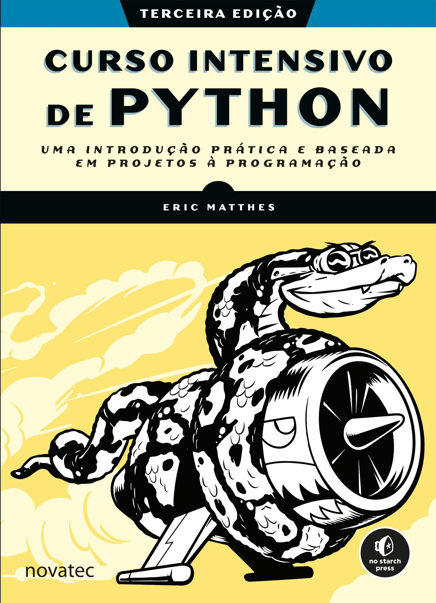

##  

O conteúdo dessa aula é baseado nos **capítulos 9, 12 e 13** do livro:


{fig-align="center" fig-alt="Capa do livro de Curso Intensivo de Python." style="max-height: 50vh; width: auto;"}

##

Nessa aula nós vamos [desenvolver um jogo]{.alert} usando a biblioteca [`pygame`]{.alert}.

- E, para isso,  usaremos conceitos de POO: [Programação Orientada a Objetos]{.alert}.

. . .

Usaremos POO porque um jogo é um projeto bem mais complexo do que os
exemplos que vimos na disciplina até agora.

- Mas, em vez de apresentar como se implementa OO em Python e depois desenvolver o jogo,
- vamos aprender a usar OO à medida que o jogo é desenvolvido.

# Ideias sobre o formato da aula {background-color="#40666e"}

##

Ao preparar a aula na primeira oferta, estudei os capítulos do livro.

- E também experimentei usar um Assistente de IA em modo interativo.

. . .

Testei primeiro o Copilot e depois o ChatGPT.

- Apresento a seguir um resumo dessas tentativas.

## Experimentando o Copilot

_(com GPT 4.1 no modo Ask)_

::: {.callout-caution title="Prompt" icon="false"}
Gostaria de iniciar uma sessão interativa para aprender a usar a biblioteca pygame para desenvolver um jogo 2D em Python. Nesta seção considere que conheço o básico de Python, mas nunca utilizei Orientação a Objetos nessa linguagem (eu aprendi usando Java). Gostaria que o jogo fosse construído um passo de cada vez, de forma bem didática. O jogo se chamará Invasão Alienígena. O jogador controlará uma nave que ficará na parte inferior da tela e poderá se movimentar da direita para a esquerda. A nave consegue atirar. Os inimigos são naves alienígenas que aparecem no topo da tela e se movimentam lateralmente, hora para esquerda, hora para a direita e também se movimentam verticalmente, descendo em direção à nave do jogador. Se as nave alienígenas atingirem a nave do jogador, o jogo termina. Se o tiro da nave do jogador atinge uma nave alienígena, ela é eliminada.
:::

##


O copilot rodou com `@workspace`, gerando uma estrutura de projeto com o jogo já "pronto" e sem nenhuma interação.

- Mas o projeto tinha vários erros.

. . .

Cliquei em `Rerun without`

- Aí sim, o jogo começou a ser gerado em um processo interativo.
- E eu podia direcionar a sequência da conversa pedindo mais ou menos detalhes.
- Mas o resultado não era tão bom quanto os capítulos de livro, pois muita coisa 
  era feita de forma direta, sem uma explicação clara.

## Experimentando o ChatGPT

Experimentei o mesmo prompt no ChatGPT (veja [aqui](https://chatgpt.com/share/68e1078b-4544-800e-a468-29bfe8b4b34b)).

- O resultado foi mais interessante que usando o Copilot.
- As partes do código que eram criadas eram explicadas em mais detalhes.
- Apesar de ter alguns erros em exemplos (de Java) de vez em quando.
- Foram também legais as sugestões de onde conseguir imagens.

##

Mas, no geral, o material do livro era realmente bem mais didático.

- E usava construções e funcionalidades importantes do pygame que 
  eram ignoradas nas sessões com Assitentes de AI.

. . .

Eu poderia tentar uma **Engenharia de Prompt** para melhorar o resultado.

- Mas acabei decidindo basear a aula nos capítulos do livro mesmo.
- E, na Aula Prática, a ideia é que vocês incrementem o jogo com ajuda do Copilot.

# Invasão Alienígena {background-color="#40666e"}

## Planejando seu projeto

. . .

Antes de começar um projeto maior como um jogo,

- é essencial definir bem o que se quer desenvolver.

. . .

No caso de um jogo, isso significa saber exatamente que jogo se quer desenvolver
e como ele vai funcionar.

- Para o nosso exemplo, o jogo será uma versão simplificada do clássico
  _Space Invaders_.
- A descrição dada no prompt usado com os Assistentes de AI é um começo.

##

Mas a descrição completa do jogo, dada no livro é:

::: {.callout-note title="Planejamento do Jogo" icon="false" .nonincremental .smaller}
No jogo _Invasão Alienígena_, o jogador controla uma nave que aparece no centro inferior da tela.
O jogador pode controlar a nave para a direita e para a esquerda, usando as setas do teclado e
atirar usando a barra de espaço. Quando o jogo começa, um esquadrão de alienígenas toma conta do
céu, deloscando-se para a esquerda e para a direita, enquanto desce pela tela. O jogador pode
destruir os alienígenas ao disparar. Se o jogador destruir todos os alienígenas, aparece um
novo esquadrão que se desloca mais rápido que o esquadrão anterior. Se algum alienígena 
encostar na nave do jogador ou chegar à parte inferior da tela, o jogador perde uma nave.
O jogo termina quando o jogador perde três naves.
:::

## Instalando PyGame

Pygame não é um módulo _built-in_, portanto, precisa ser instalado.

- Logo, vamos usar a estratégia de criar um arqiuvo `requirements.txt`.
- E instalar o pygame em um ambiente virtual.

## Iniciando o Projeto do Jogo

::: {.r-fit-code .nonincremental}
```{.python filename="invasao_alien.py"}
import sys

import pygame

class InvasaoAlien:
    """Classe geral para gerenciar ativos e comportamento do jogo."""

    def __init__(self):
        """Inicializa o jogo e cria os recursos do jogo."""
        pygame.init()                                      # 1

        self.tela = pygame.display.set_mode((1200, 800))   # 2
        pygame.display.set_caption("Invasão Alienígena")
        
    def executar_jogo(self):
        """Inicia o loop principal do jogo."""
        while True:                                        # 3
            # Observa eventos de teclado e mouse.
            for evento in pygame.event.get():              # 4
                if evento.type == pygame.QUIT:             # 5
                    sys.exit()

            pygame.display.flip()                          # 6

if __name__ == '__main__':
    ai = InvasaoAlien()                                   
    ai.executar_jogo()                                    
```
:::

##

Destaques no código:

1. Inicializa as configurações que o `pygame` precisa para funcionar corretamente.
2. Cria uma janela para exibição (_Surface_).
3. Loop de jogo.
4. Loop dos eventos detectados desde a última iteração.
5. Evento gerado quando o jogador clica no botão de fechar a janela.
6. Atualiza o desenho na tela (_double buffer_).

## Classes em Python

- Classes são declaradas com a palavra-chave `class`.
  - A convenção é usar nomes `camelCase` para classes.
  - E `snake_case` para atributos e métodos.
- O método `__init__()` é o construtor da classe.
- Todos os métodos da classe precisam, obrigatoriamente,
  declarar um parâmetro chamado `self`.
  - `self` é o equivalente ao `this` do Java.
- Os atributos da classe são criados dinamicamente.
  - Eles não são previamente declarados como em Java.
  - Assim, um atributo pode ser criado em qualquer método, mas, recomenda-se 
    criá-los no construtor da classe.

## Classes em Python

- Atributos e métodos da classe são sempre acessados usando `self.`.
- Objetos são criados com a sintaxe `variavel = Classe()`.
- Métodos são chamados com `variavel.metodo(param1, param2, ...`).
  - Observação importante, não passamos valor para o parâmetro `self` explicitamente.
  - Internamente, Python transforma a chamada acima em `metodo(variavel, param1, param2, ...)`.
  - Portanto, `self` vai receber o endereço da `variavel`. 

## Classes em Python

- Todos os atributos e métodos são públicos em Python 😵‍💫
- Por convenção, métodos iniciados com `_` são tratados como se fossem privados.
- Os atributos geralmente são tratados como públicos.
  - Assim, são acessados diretamente `objeto.atributo`.
  - Mas podemos criar métodos com `@property` para ter a mesma proteção de métodos 
    `get` e `set` sem quebrar a chamada acima.
- Por convenção, podemos usar prefixo `_` para atributos que são protegidos.
  - Ou ainda `__` que "dificulta" o acesso.

## Classes em Python

- Podemos ainda usar _type hints_  que ajudam muito a aumentar a produtividade
  e evitar erros de implementação.
- Como o foco aqui é em desenvolvimento de jogos, vamos usar apenas o básico de OO.
  - Mas você pode ver mais detalhes [nessa conversa com o ChatGPT](https://chatgpt.com/share/68e3b321-d30c-800e-a4dd-4fea8caf87f1).

## Controlando o _frame rate_

:::: {.columns}

::: {.column width="60%"}
::: {.r-fit-code .nonincremental}
```{.python filename="invasao_alien.py" code-line-numbers="4,12"}
    def __init__(self):
        """Inicializa o jogo e cria os recursos do jogo."""
        pygame.init()
        self.clock = pygame.time.Clock()
        # -- trecho de código omitido -- 
        
    def executar_jogo(self):
        """Inicia o loop principal do jogo."""
        while True:
            # -- trecho de código omitido -- 
            pygame.display.flip()
            self.clock.tick(60)  # Limita a 60 quadros por segundo                                 
```
:::
:::

::: {.column width="40%"}
- `clock.tick(60)` evita que o loop rode mais de 60 vezes por segundo.
  - Evita sobrecarga da CPU.
  - Mantém consistência (FPS) do jogo.
- Obs.: pode ser necessário ajustar o valor.
:::

::::


## Definindo a cor de fundo

```{.python filename="invasao_alien.py" code-line-numbers="5-6,16-17"}
    def __init__(self):
        # -- trecho de código omitido -- 
        pygame.display.set_caption("Invasão Alienígena")

        # Define a cor de fundo
        self.cor_fundo = (230, 230, 230)
        
    def executar_jogo(self):
        """Inicia o loop principal do jogo."""
        while True:
            # Observa eventos de teclado e mouse.
            for evento in pygame.event.get():
                if evento.type == pygame.QUIT:
                    sys.exit()
            
            # Redesenha a tela a cada passada do loop.
            self.tela.fill(self.cor_fundo)

            pygame.display.flip()
            self.clock.tick(60)  # Limita a 60 quadros por segundo
```

## Criando uma classe de Configuração

```{.python filename="config.py"}
class Config:
    """ Classe para armazenar as configurações do jogo Invasão Alienígena. """

    def __init__(self):
        """ Inicializa as configurações do jogo. """
        # Configurações da tela
        self.largura_tela = 1200
        self.altura_tela = 800
        self.cor_fundo = (230, 230, 230)  # Cor de fundo cinza claro
```

- Boa prática para facilitar alterações na aparência e comportamento do jogo.
- Concentra as configurações em um único local, em vez de deixar espalhadas pelo código.

##

::: {.r-fit-code .nonincremental}
```{.python filename="invasao_alien.py" code-line-numbers="3,12,14-15,22"}
import sys
import pygame
from config import Config

class InvasaoAlien:
    """Classe geral para gerenciar ativos e comportamento do jogo."""

    def __init__(self):
        """Inicializa o jogo e cria os recursos do jogo."""
        pygame.init()
        self.clock = pygame.time.Clock()
        self.config = Config()

        self.tela = pygame.display.set_mode(
            (self.config.largura_tela, self.config.altura_tela))
        pygame.display.set_caption("Invasão Alienígena")
        
    def executar_jogo(self):
            # -- trecho de código omitido -- 
            
            # Redesenha a tela a cada passada do loop.
            self.tela.fill(self.config.cor_fundo)

            pygame.display.flip()
            self.clock.tick(60)  # Limita a 60 quadros por segundo
```
:::

# Criando uma nave {background-color="#40666e"}

##

Vamos agora criar a nave controlada pelo jogador.

- Aqui vamos usar uma imagem escolhida pelos autores do livro.
- Mas existem diversos sites com imagens gratuitas.
  - Além dos Assistentes de IA que geram imagens.

##

::: {.callout-note title="ChatGPT 🌐 Sites de Sprites Gratuitos" icon="false" .nonincremental}

[Kenney.nl](https://kenney.nl/assets)

  - Sprites profissionais e organizados.
  - Tudo em CC0 (sem restrição de uso).

[OpenGameArt.org](https://opengameart.org)

  - Gigante repositório de sprites gratuitos.
  - Muitos já vêm em pixel art ou estilo retrô arcade.

[Itch.io – Asset Packs gratuitos](https://itch.io/game-assets/free)

  - Packs de sprites feitos por artistas independentes.
  - Muitos permitem uso em jogos comerciais.
:::

##

::: {.callout-note title="ChatGPT 🌐 Sites de Sprites Gratuitos" icon="false" .nonincremental}

[CraftPix.net (Freebies)](https://craftpix.net/freebies/)

- Arte mais elaborada.
- Tem alguns pacotes gratuitos, mas muitos são pagos.

**Google + Filtros de Licença** 

- Vá em Google Images > Ferramentas > Direitos de uso, filtre por _Creative Commons_.
- Assim evita problemas de copyright.
:::

## Criando a classe Nave

```{.python filename="nave.py"}
import pygame

class Nave:
    """ Classe para cuidar da nave do jogador """

    def __init__(self, jogo):
        """ Inicializa a nave e define sua posição inicial. """
        self.tela = jogo.tela
        self.ret_tela = jogo.tela.get_rect()                          # 1

        # Carrega a imagem da nave e obtém seu retângulo.
        # Método convert é importante para melhorar desempenho!       
        self.imagem = pygame.image.load('imagens/nave.png').convert() # 2
        self.ret = self.imagem.get_rect()

        # Começa cada nave nova no centro inferior da tela.
        self.ret.midbottom = self.ret_tela.midbottom                  # 3

    def desenhar(self):
        """ Desenha a nave em sua posição atual. """
        self.tela.blit(self.imagem, self.ret)                         # 4
```

## Criando a classe Nave {.smaller}

1. `pygame` trata todos os objetos como retângulos (`Rect`).
  - Permitindo tratamento de colisão e posicionamento mais eficientes.
2. O método `convert()` melhora o desempenho do jogo.
  - Converte a imagem para um formato do próprio `pygame`.
3. Posiciona a nave no centro inferior da tela.
  - Veja que posicionamos o retângulo da nave, não a imagem.
  - Retângulos têm propriedades como `top`, `bottom`, `left`, `right`, `center`, etc.
4. Desenha a imagem da nave na tela na posição definida pelo retângulo.
  - Obs: `(0,0)` é o canto superior esquerdo da tela.

## Desenhando a nave na tela

```{.python filename="invasao_alien.py" code-line-numbers="2,11,17"}
from config import Config
from nave import Nave

class InvasaoAlien:
    """Classe geral para gerenciar ativos e comportamento do jogo."""

    def __init__(self):
        # -- trecho de código omitido -- 
        pygame.display.set_caption("Invasão Alienígena")

        self.nave = Nave(self)
        
    def executar_jogo(self):
            # -- trecho de código omitido -- 
            # Redesenha a tela a cada passada do loop.
            self.tela.fill(self.config.cor_fundo)
            self.nave.desenhar()
```

- Nave deve ser desenhada após o preenchimento do fundo.

## Refatoração

```{.python filename="invasao_alien.py" code-line-numbers="4-5,8-19"}
    def executar_jogo(self):
        """Inicia o loop principal do jogo."""
        while True:
            self._verificar_eventos()
            self._atualizar_tela()
            self.clock.tick(60)
    
    def _verificar_eventos(self):
        """Responde a eventos de teclado e mouse."""
        for evento in pygame.event.get():
            if evento.type == pygame.QUIT:
                sys.exit()
    
    def _atualizar_tela(self):
        """Desenha a nova imagem da tela do jogo e a utiliza na tela."""
        self.tela.fill(self.config.cor_fundo)
        self.nave.desenhar()
        
        pygame.display.flip()
```

## Pilotando a nave

```{.python filename="invasao_alien.py" code-line-numbers="6-8"}
    def _verificar_eventos(self):
        """Responde a eventos de teclado e mouse."""
        for evento in pygame.event.get():
            if evento.type == pygame.QUIT:
                sys.exit()
            elif evento.type == pygame.KEYDOWN:
                if evento.key == pygame.K_RIGHT:
                    self.nave.ret.x += 1
```

- Verificamos se um dos eventos é uma tecla pressionada.
- Se a tecla pressionada for a seta para a direita, movemos a nave 1 pixel para a direita.
  - Até aqui precisamos ficar pressionando a tecla para mover a nave.

## Movimento contínuo

```{.python filename="nave.py" code-line-numbers="7-13"}
    def __init__(self, jogo):
        # -- trecho de código omitido --

        # Começa cada nave nova no centro inferior da tela.
        self.ret.midbottom = self.ret_tela.midbottom

        # Flag de movimento; começa com uma nave que não está se movendo.
        self.movendo_direita = False
    
    def atualizar(self):
        """ Atualiza a posição da nave com base na flag de movimento. """
        if self.movendo_direita:
            self.ret.x += 1
```

- Definimos um atributo para indicar se a nave está se movendo para a direita.
- Criamos um método `atualizar` que vai ser chamado a cada passo do loop na classe `InvasaoAlien`.

## Movimento contínuo

```{.python filename="invasao_alien.py" code-line-numbers="5,14-19"}
    def executar_jogo(self):
        """Inicia o loop principal do jogo."""
        while True:
            self._verificar_eventos()
            self.nave.atualizar()
            self._atualizar_tela()
            self.clock.tick(60)
    
    def _verificar_eventos(self):
        """Responde a eventos de teclado e mouse."""
        for evento in pygame.event.get():
            if evento.type == pygame.QUIT:
                sys.exit()
            elif evento.type == pygame.KEYDOWN:
                if evento.key == pygame.K_RIGHT:
                    self.nave.movendo_direita = True
            elif evento.type == pygame.KEYUP: # se for evento de tecla liberada
                if evento.key == pygame.K_RIGHT:
                    self.nave.movendo_direita = False
```

## Movendo nas duas direções

```{.python filename="nave.py" code-line-numbers="6,12-13"}
    def __init__(self, jogo):
        # -- trecho de código omitido --

        # Flags de movimento; começa com uma nave que não está se movendo.
        self.movendo_direita = False
        self.movendo_esquerda = False
    
    def atualizar(self):
        """ Atualiza a posição da nave com base nas flags de movimento. """
        if self.movendo_direita:
            self.ret.x += 1
        if self.movendo_esquerda:
            self.ret.x -= 1
```

- Movimento para a esquerda é tratado de forma similar.

##

```{.python filename="invasao_alien.py" code-line-numbers="3-8"}
    def _verificar_eventos(self):
            # -- trecho de código omitido --  
            if evento.type == pygame.KEYDOWN:
                if evento.key == pygame.K_LEFT:
                    self.nave.movendo_esquerda = True
            elif evento.type == pygame.KEYUP:
                if evento.key == pygame.K_LEFT:
                    self.nave.movendo_esquerda = False
```

## Ajustando a velocidade da nave

```{.python filename="config.py" code-line-numbers="4-5"}
    def __init__(self):
        # -- trecho de código omitido --

        # Configurações da nave
        self.velocidade_nave = 10.0
```

- Criamos uma configuração para definir a velocidade da nave.
- Vamos incrementar por esse valor em vez de 1 a cada passo do loop do jogo.
- Vamos criar um atributo na nave para guardar a posição da nave com o tipo `float`
  para dar mais precisão ao movimento.
  - O atributo `x` guardará a posição mais precisa.
  - E o atributo `ret.x` continuará guardando a posição arredondada para desenhar a nave.

##

```{.python filename="nave.py" code-line-numbers="5,9-10,15,17,19"}
    def __init__(self, jogo):
        """ Inicializa a nave e define sua posição inicial. """
        self.tela = jogo.tela
        self.ret_tela = jogo.tela.get_rect()
        self.config = jogo.config
        
        # -- trecho de código omitido --

        # Armazena um float para guardar a posição horizontal exata da nave
        self.x = float(self.ret.x)
    
    def atualizar(self):
        """ Atualiza a posição da nave com base nas flags de movimento. """
        if self.movendo_direita:
            self.x += self.config.velocidade_nave
        if self.movendo_esquerda:
            self.x -= self.config.velocidade_nave
        
        self.ret.x = int(self.x)
```

## Restringindo o alcance da Nave

```{.python filename="nave.py" code-line-numbers="3,5"}
    def atualizar(self):
        """ Atualiza a posição da nave com base nas flags de movimento. """
        if self.movendo_direita and self.ret.right < self.ret_tela.right:
            self.x += self.config.velocidade_nave
        if self.movendo_esquerda and self.ret.left > 0:
            self.x -= self.config.velocidade_nave
        
        self.ret.x = int(self.x)
```

- Vamos evitar que a nave saia da tela.
- Usamos as propriedades `right` e `left` do retângulo da nave e da tela.

## Refatorando o método `_verificar_eventos()`

::: {.r-fit-code .nonincremental}
```{.python filename="invasao_alien.py" code-line-numbers="6-23"}
    def _verificar_eventos(self):
        """Responde a eventos de teclado e mouse."""
        for evento in pygame.event.get():
            if evento.type == pygame.QUIT:
                sys.exit()
            elif evento.type == pygame.KEYDOWN:
                self._verificar_eventos_tecla_pressionada(evento)
            elif evento.type == pygame.KEYUP:
                self._verificar_eventos_tecla_liberada(evento)
    
    def _verificar_eventos_tecla_pressionada(self, evento):
        """ Responde a teclas pressioandas"""
        if evento.key == pygame.K_RIGHT:
            self.nave.movendo_direita = True
        elif evento.key == pygame.K_LEFT:
            self.nave.movendo_esquerda = True
    
    def _verificar_eventos_tecla_liberada(self, evento):
        """ Responde a teclas liberadas"""
        if evento.key == pygame.K_LEFT:
            self.nave.movendo_esquerda = False
        elif evento.key == pygame.K_RIGHT:
            self.nave.movendo_direita = False
```
:::

# Modo Tela Cheia {background-color="#40666e"}

## Fechar o jogo com a tecla `q`

```{.python filename="invasao_alien.py" code-line-numbers="7-8"}
    def _verificar_eventos_tecla_pressionada(self, evento):
        """ Responde a teclas pressioandas"""
        if evento.key == pygame.K_RIGHT:
            self.nave.movendo_direita = True
        elif evento.key == pygame.K_LEFT:
            self.nave.movendo_esquerda = True
        elif evento.key == pygame.K_q:
            sys.exit()
```

- `sys.exit()` não é a forma mais elegante de encerrar o jogo.
- Mas estava assim no livro :)

## Executando o jogo em modo Tela Cheia

```{.python filename="invasao_alien.py" code-line-numbers="7-9"}
    def __init__(self):
        """Inicializa o jogo e cria os recursos do jogo."""
        pygame.init()
        self.clock = pygame.time.Clock()
        self.config = Config()

        self.tela = pygame.display.set_mode((0,0), pygame.FULLSCREEN)
        self.config.largura_tela = self.tela.get_rect().width
        self.config.altura_tela = self.tela.get_rect().height
        pygame.display.set_caption("Invasão Alienígena")
```

- Agora a largura e altura do jogo não é pré-definida.
    - Provavelmente pode ser interessante mudar a velocidade da nave.

##

::: {.callout-warning} 
Se não tivéssemos tratado a tecla `q` para sair do jogo, não teríamos uma forma
de sair do jogo no modo tela cheia.
:::

. . .

Nessa demonstração vamos ficar no modo janela mesmo.

- Devido ao tamanho das imagens e como foi planejada a inclusão dos alienígenas.

# Atirando {background-color="#40666e"}

## Configuração dos projéteis

```{.python filename="config.py" code-line-numbers="4-8"}
    def __init__(self):
        # -- trecho de código omitido --

        # Configurações dos projéteis
        self.velocidade_projetil = 15.0
        self.largura_projetil = 3
        self.altura_projetil = 15
        self.cor_projetil = (60, 60, 60)  # Cor cinza escuro
```

- Vamos definir as configurações dos projéteis (balas).
- Vamos criar uma classe para os projéteis.
  - Nela vamos usar um retângulo simples para representar o projétil,
    em vez de uma imagem.

## Classe Projetil

::: {.r-fit-code .nonincremental}
```{.python filename="projetil.py"}
import pygame
from pygame.sprite import Sprite
class Projetil(Sprite):
    """ Classe para gerenciar projéteis disparados pela nave. """

    def __init__(self, jogo):
        """ Cria um objeto de projétil na posição atual da nave. """
        super().__init__()
        self.tela = jogo.tela
        self.config = jogo.config
        self.cor = self.config.cor_projetil

        # Cria um projétil na posição (0,0) e depois define a posição correta.
        self.ret = pygame.Rect(0, 0, self.config.largura_projetil,
            self.config.altura_projetil)
        self.ret.midtop = jogo.nave.ret.midtop

        # Guarda a posição do projétil como um float.
        self.y = float(self.ret.y)

    def update(self):
        """ Move o projétil para cima na tela. """
        # Atualiza a posição exata do projétil.
        self.y -= self.config.velocidade_projetil
        # Atualiza a posição do retângulo.
        self.ret.y = self.y

    def desenhar(self):
        """ Desenha o projétil na tela. """
        pygame.draw.rect(self.tela, self.cor, self.ret)
```
:::

## Herança em Python

Antes de criarmos os objetos projéteis no jogo, veja que estamos usando herança em Python.

- A classe `Projetil` herda de `Sprite`, que é uma classe do `pygame`.
  - Estamos fazendo isso para conseguirmos usar grupos de sprites do `pygame`.
- A herança é declarada com a sintaxe `class ClasseFilha(ClassePai):`.
- O construtor da classe pai é chamado com `super().__init__()`.

## Herança em Python

- Métodos da classe pai podem ser sobrescritos na classe filha.
  - Como fizemos com o método `update()`.
  - Podemos chamar métodos da classe pai com `super().metodo()`.

## Grupos de projéteis

```{.python filename="invasao_alien.py" code-line-numbers="2,10,17"}
from nave import Nave
from projetil import Projetil

class InvasaoAlien:

    def __init__(self):
        # -- trecho de código omitido --

        self.nave = Nave(self)
        self.projeteis = pygame.sprite.Group()
        
    def executar_jogo(self):
        """Inicia o loop principal do jogo."""
        while True:
            self._verificar_eventos()
            self.nave.atualizar()
            self.projeteis.update() # Chama update() de cada projétil no grupo
            self._atualizar_tela()
            self.clock.tick(60)
```

## Disparando projéteis

::: {.r-fit-code .nonincremental}
```{.python filename="invasao_alien.py" code-line-numbers="5-6,11-14,19-20"}
    def _verificar_eventos_tecla_pressionada(self, evento):
        # -- trecho de código omitido --
        elif evento.key == pygame.K_q:
            sys.exit()
        elif evento.key == pygame.K_SPACE: # tiros serão disparados com espaço
            self._disparar_projetil()
    
    def _verificar_eventos_tecla_liberada(self, evento):
        # -- trecho de código omitido --

    def _disparar_projetil(self):
        """ Cria um novo projétil e o adiciona ao grupo de projéteis. """
        novo_projetil = Projetil(self)
        self.projeteis.add(novo_projetil)
    
    def _atualizar_tela(self):
        """Desenha a nova imagem da tela do jogo e a utiliza na tela."""
        self.tela.fill(self.config.cor_fundo)
        for projetil in self.projeteis.sprites(): # sprites() retorna uma lista
            projetil.desenhar()
        self.nave.desenhar()
        
        pygame.display.flip()
```
:::

## Apagando projéteis fora da tela

```{.python filename="invasao_alien.py" code-line-numbers="8-12"}
    def executar_jogo(self):
        """Inicia o loop principal do jogo."""
        while True:
            self._verificar_eventos()
            self.nave.atualizar()
            self.projeteis.update()

            # Descarta os projéteis que desapareceram
            for projetil in self.projeteis.copy():   # 1
                if projetil.ret.bottom <= 0:
                    self.projeteis.remove(projetil)
            print(len(self.projeteis))               # 2

            self._atualizar_tela()
            self.clock.tick(60)
```

1. Fazemos cópia para conserguirmos remover dentro do loop.
2. **Atenção**: `print` deve ser removido depois de testar! Pois afeta o desempenho.

## Limitando o número de projéteis

```{.python filename="config.py" code-line-numbers="4"}
    def __init__(self):
        # -- trecho de código omitido --
        self.cor_projetil = (60, 60, 60)  # Cor cinza escuro
        self.max_projeteis = 5
```

```{.python filename="invasao_alien.py" code-line-numbers="3"}
    def _disparar_projetil(self):
        """ Cria um novo projétil e o adiciona ao grupo de projéteis. """
        if len(self.projeteis) < self.config.max_projeteis:
            novo_projetil = Projetil(self)
            self.projeteis.add(novo_projetil)
```

- Limitar o número de projéteis incentiva o jogador a atirar com mais precisão.

## Refatoração

```{.python filename="invasao_alien.py" code-line-numbers="6,12-19"}
    def executar_jogo(self):
        """Inicia o loop principal do jogo."""
        while True:
            self._verificar_eventos()
            self.nave.atualizar()
            self._atualizar_projeteis()
            self._atualizar_tela()
            self.clock.tick(60)
    
    # -- trecho de código omitido --

    def _atualizar_projeteis(self):
        """ Atualiza a posição dos projéteis e descarta os projéteis antigos. """
        self.projeteis.update()

        # Livra-se dos projéteis que desapareceram.
        for projetil in self.projeteis.copy():
            if projetil.ret.bottom <= 0:
                self.projeteis.remove(projetil)
```

# Alienígenas {background-color="#40666e"}

##

Vamos agora adicionar os inimigos do jogo: os alienígenas.

- Vamos definir uma classe para representar um alienígena.
- Depois vamos criar um esquadrão de alienígenas.
  - Faremos isso passo a passo.
  - Primeiro definindo uma linha de alienígenas.
  - E depois adicionamos mais linhas.

## Criando a classe Alien

```{.python filename="alien.py"}
import pygame
from pygame.sprite import Sprite
class Alien(Sprite):
    """ Classe para representar um único alien de um esquadrão. """

    def __init__(self, jogo):
        """ Inicializa o alien e define sua posição inicial. """
        super().__init__()
        self.tela = jogo.tela

        # Carrega a imagem do alien e define seu atributo retangulo.
        self.image = pygame.image.load('imagens/alien.png').convert()   # 1
        self.rect = self.image.get_rect()                               # 2

        # Começa cada novo alien próximo ao canto superior esquerdo da tela.
        # Considera um espaço a partir da borda, do tamanho do retângulo.
        self.rect.x = self.rect.width
        self.rect.y = self.rect.height

        # Armazena a posição horizontal exata do alien.
        self.x = float(self.rect.x)
```

## Criando a classe Alien

Aqui temos uma observação muito importante:

1. O atributo da imagem do alien deve ser chamado `image`.
2. E o do retângulo do alien `rect`.
- Necessários para que possamos usar grupos de sprites do `pygame`.

. . .

Isso tem relação com o conceito de [_duck typing_]{.alert} do Python.

## _Duck Typing_ em Python

Se um objeto tem os atributos e métodos esperados, ele pode ser usado.

- Não importa a classe do objeto.

. . .

Portanto, não precisamos definir uma interface, 

- pois o Python se baseia no comportamento do objeto e não em tipos explícitos. 

. . .

Veja mais detalhes na [conversa com o ChatGPT](https://chatgpt.com/share/68e3b321-d30c-800e-a4dd-4fea8caf87f1)
mencionada antes.

## Criando uma instância do alienígena

::: {.r-fit-code .nonincremental}
```{.python filename="invasao_alien.py" code-line-numbers="2,12-20,25-27"}
from projetil import Projetil
from alien import Alien

class InvasaoAlien:
    """Classe geral para gerenciar ativos e comportamento do jogo."""

    def __init__(self):
        # -- trecho de código omitido --

        self.nave = Nave(self)
        self.projeteis = pygame.sprite.Group()
        self.aliens = pygame.sprite.Group()

        self._criar_esquadrão()

    def _criar_esquadrão(self):
        """Cria um esquadrão completo de aliens."""
        # por enquanto vamos criar apenas um alien
        alien = Alien(self)
        self.aliens.add(alien)
    
    def _atualizar_tela(self):
        # -- trecho de código omitido --
        self.nave.desenhar()
        # ATENÇÃO: para que todos os aliens sejam desenhados automaticamente
        # eles devem ter atributos chamados image e rect
        self.aliens.draw(self.tela)
        
        pygame.display.flip()
```
:::

## Criando uma fileira de alienígenas

```{.python filename="invasao_alien.py"}
    def _criar_esquadrão(self):
        """Cria um esquadrão completo de aliens."""
        # Cria um alienígena e continua criando aliens até que não haja mais espaço.
        # O distanciamento entre os aliens é a largura de um alien.
        alien = Alien(self)
        largura_alien = alien.rect.width

        x_atual = largura_alien
        while x_atual < (self.config.largura_tela - 2 * largura_alien):
            self._criar_alien(x_atual)
            x_atual += 2 * largura_alien

    def _criar_alien(self, posicao_x):
        """ Cria um alien e coloca-o no esquadrão. """
        novo_alien = Alien(self)
        novo_alien.x = posicao_x
        novo_alien.rect.x = posicao_x
        self.aliens.add(novo_alien)
```

## Adicionando fileiras

```{.python filename="invasao_alien.py"}
    def _criar_esquadrão(self):
        """Cria um esquadrão completo de aliens."""
        # Cria um alienígena e continua criando aliens até que não haja mais espaço.
        # O distanciamento entre os aliens é a largura de um alien.
        alien = Alien(self)
        largura_alien, altura_alien = alien.rect.size

        x_atual, y_atual = largura_alien, altura_alien
        while y_atual < (self.config.altura_tela - 5 * altura_alien):            
            while x_atual < (self.config.largura_tela - 2 * largura_alien):
                self._criar_alien(x_atual, y_atual)
                x_atual += 2 * largura_alien

            x_atual = largura_alien
            y_atual += 2 * altura_alien
```

- `5 * altura_alien` indica a distância para a nave do jogador.

# Movendo o esquadrão {background-color="#40666e"}

## Movendo os alienígenas para a direita

```{.python filename="config.py"}
    def __init__(self):
        # -- trecho de código omitido --

        # Configurações dos aliens
        self.velocidade_alien = 1.0
```

. . .

```{.python filename="alien.py"}
    def __init__(self, jogo):
        """ Inicializa o alien e define sua posição inicial. """
        super().__init__()
        self.tela = jogo.tela
        self.config = jogo.config

        # -- trecho de código omitido --

    def update(self):
        """ Move o alien para a direita. """
        self.x += self.config.velocidade_alien
        self.rect.x = self.x
```

##

```{.python filename="invasao_alien.py" code-line-numbers="7,11-13"}
    def executar_jogo(self):
        """Inicia o loop principal do jogo."""
        while True:
            self._verificar_eventos()
            self.nave.atualizar()
            self._atualizar_projeteis()
            self._atualizar_aliens()
            self._atualizar_tela()
            self.clock.tick(60)

    def _atualizar_aliens(self):
        """Atualiza as posições de todos os aliens do esquadrão."""
        self.aliens.update()
```

- Até aqui os aliens se movem para a direita e continuam se 
  movendo mesmo depois de saírem da tela.
- No próximo passo vamos fazer o esquadrão descer e mudar de direção.

## Configurando descida e mudança de direção

```{.python filename="config.py"}
    def __init__(self):
        # -- trecho de código omitido --

        # Configurações dos aliens
        self.velocidade_alien = 1.0
        self.velocidade_descida_esquadrao = 10.0
        # 1 representa a direita; -1 representa a esquerda
        self.direcao_esquadrao = 1  
```

- Configuramos o quanto os aliens descem quando atingem uma borda.
- E usamos um valor inteiro para a direção.
  - Pois aí podemos simplesmente multiplicar a velocidade pela direção,
    em vez de fazer uma verificação condicional.

## Tratando direção e criando método para verificar borda

```{.python filename="alien.py"}
    def update(self):
        """ Move o alien para a direita ou para a esquerda. """
        self.x += self.config.velocidade_alien * self.config.direcao_esquadrao
        self.rect.x = self.x
    
    def esta_na_borda(self):
        """ Retorna True se o alien estiver na borda da tela. """
        ret_tela = self.tela.get_rect()
        return self.rect.right >= ret_tela.right or self.rect.left <= 0
```

- O método `esta_na_borda()` será usado na classe `InvasaoAlien`.
  - Se um dos aliens atingir uma borda, todo o esquadrão deve descer e mudar de direção.

## Fazendo a frota descer e mudar de direção

```{.python filename="invasao_alien.py"}
    def _atualizar_aliens(self):
        """ Verifica se o esquadrão está na borda e atualiza as posições dos aliens. """
        self._verificar_bordas_esquadrao()
        self.aliens.update()

    def _verificar_bordas_esquadrao(self):
        """ Faz o esquadrão descer se um dos aliens atingiu uma borda. """
        for alien in self.aliens.sprites():
            if alien.esta_na_borda():
                self._descer_esquadrao()
                break
    
    def _descer_esquadrao(self):
        """ Desce o esquadrão e muda sua direção. """
        for alien in self.aliens.sprites():
            alien.rect.y += self.config.velocidade_descida_esquadrao
        self.config.direcao_esquadrao *= -1
```

# Eliminando aliens {background-color="#40666e"}

## Detectando colisões de projéteis

```{.python filename="invasao_alien.py"}
    def _atualizar_projeteis(self):
        # -- trecho de código omitido --

        # Verifica se algum projétil atingiu um alien.
        # Se sim, descarta tanto o projétil quanto o alien.
        colisoes = pygame.sprite.groupcollide(
            self.projeteis, self.aliens, True, True)
```

- `groupcollide()` detecta colisões entre dois grupos de sprites.
- Os dois últimos argumentos indicam se os objetos envolvidos na colisão devem ser removidos.
  - No nosso caso, tanto o projétil quanto o alien são removidos.

##

```bash
Traceback (most recent call last):
  File "/home/julio/Downloads/invasao-alienigena/invasao_alien.py", line 141, in <module>
    ai.executar_jogo()
  File "/home/julio/Downloads/invasao-alienigena/invasao_alien.py", line 33, in executar_jogo
    self._atualizar_projeteis()
  File "/home/julio/Downloads/invasao-alienigena/invasao_alien.py", line 72, in _atualizar_projeteis
    if projetil.ret.bottom <= 0:
       ^^^^^^^^^^^^
AttributeError: 'Projetil' object has no attribute 'ret'. Did you mean: 'rect'?
```

- Precisamos mudar o nome do atributo `ret` da classe `Projetil` para `rect`.
- Isso porque o método `groupcollide()` espera que os objetos tenham um atributo chamado `rect`.
  - Veja que não precisamos, necessariamente, fazer `Projetil` herdar de `Sprite`.
  - É um exemplo do _duck typing_ do Python.

## Criando projéteis maiores para testes

. . .

Em um jogo é muito comum precisarmos avançar a um certo ponto para conseguir fazer testes.

- E é muito mais produtivo alterarmos, temporariamente, alguma configuração do jogo.
- Do que ter que jogar "normalmente" até chegar ao ponto desejado.

. . .

Para facilitar os testes de colisão, por exemplo, podemos aumentar a largura dos projéteis.

- Vamos experimentar 400.

## Recriando o esquadrão

A principal funcionalidade do jogo é que os alienígenas são implacáveis.

- Sempre que o esquadrão for destruído, um novo aparece.
- Vamos implementar isso agora.

. . .

```{.python filename="invasao_alien.py"}
    def _atualizar_projeteis(self):
        # -- trecho de código omitido --
        
        if not self.aliens:
            # Destrói os projéteis existentes e cria um novo esquadrão.
            self.projeteis.empty()
            self._criar_esquadrão()
```

## Refatorando `_atualizar_projeteis()`

```{.python filename="invasao_alien.py"}
    def _atualizar_projeteis(self):
        """ Atualiza a posição dos projéteis e descarta os projéteis antigos. """
        self.projeteis.update()
        # Livra-se dos projéteis que desapareceram.
        for projetil in self.projeteis.copy():
            if projetil.rect.bottom <= 0:
                self.projeteis.remove(projetil)

        self._verificar_colisoes_projeteis_aliens()
    
    def _verificar_colisoes_projeteis_aliens(self):
        """ Responde a colisões entre projéteis e aliens. """
        # Verifica se algum projétil atingiu um alien.
        # Se sim, descarta tanto o projétil quanto o alien.
        colisoes = pygame.sprite.groupcollide(
            self.projeteis, self.aliens, True, True)
        
        if not self.aliens:
            # Destrói os projéteis existentes e cria um novo esquadrão.
            self.projeteis.empty()
            self._criar_esquadrão()
```

# Dando um fim ao jogo {background-color="#40666e"}


## Detectando colisões entre naves e aliens

```{.python filename="invasao_alien.py" code-line-numbers="8-10"}

# -- trecho de código omitido --
    def _atualizar_aliens(self):
        """ Verifica se o esquadrão está na borda e atualiza as posições dos aliens. """
        self._verificar_bordas_esquadrao()
        self.aliens.update()

        # Detecta colisões entre a nave e os aliens.
        if pygame.sprite.spritecollideany(self.nave, self.aliens):
            print("A nave foi atingida!")
```

- `spritecollideany()` verifica se um `Sprite` colidiu com algum sprite de um grupo.
- Por enquanto estamos apenas testando a colisão.
- Obs.: pode ser interessante mudar a velocidade dos aliens para facilitar os testes. 

##

Aqui, novamente, precisaremos usar atributo com nome `rect` em vez de `ret`.

- Devido ao _duck typing_ do Python, lembra?

. . .

Dica: se estiver usando um _linter_ como o `pylance` você verá um warning em `self.nave`.


## Criando classe `Estatisticas` antes de tratar a colisão

```{.python filename="config.py"}
    def __init__(self):
        # -- trecho de código omitido --

        # Configurações da nave
        self.velocidade_nave = 10.0
        self.max_naves = 3
```

. . .

```{.python filename="estatisticas.py"}
class Estatisticas:
    """ Rastreia as estatísticas do jogo. """

    def __init__(self, jogo):
        """ Inicializa as estatisticas """
        self.config = jogo.config
        self.reiniciar()

    def reiniciar(self):
        """ Inicializa as estatísticas que podem mudar ao longo do jogo. """
        self.naves_restantes = self.config.max_naves
```

##

::: {.r-fit-code .nonincremental}
```{.python filename="invasao_alien.py" code-line-numbers="1,2,8-9,18-34"}
from time import sleep
from estatisticas import Estatisticas

# -- trecho de código omitido --

    def __init__(self):
        # -- trecho de código omitido --
        pygame.display.set_caption("Invasão Alienígena")

        # Cria uma instância para armazenar estatísticas do jogo.
        self.estatisticas = Estatisticas(self)

    def _atualizar_aliens(self):
        # -- trecho de código omitido --

        # Detecta colisões entre a nave e os aliens.
        if pygame.sprite.spritecollideany(self.nave, self.aliens):
            self._acertar_nave()
    
    def _acertar_nave(self):
        """ Responde a uma colisão entre a nave e um alien. """
        # Decrementa naves_restantes.
        self.estatisticas.naves_restantes -= 1
        # Esvazia a lista de aliens e projéteis.
        self.aliens.empty()
        self.projeteis.empty()
        # Cria um novo esquadrão e centraliza a nave.
        self._criar_esquadrão()
        self.nave.centralizar()
        # Faz uma pausa de meio segundo.
        sleep(0.5)
```
:::

##

```{.python filename="nave.py"}
    def centralizar(self):
        """ Centraliza a nave na tela. """
        self.rect.midbottom = self.ret_tela.midbottom
        self.x = float(self.rect.x)
```

Repare que sempre usamos a mesma instância da nave.

- Nós não criamos outro objeto quando a nave é atingida.
- Nós apenas a centralizamos.
- A classe de estatísticas cuida de lidar com quantas vidas existem.

## Tratando alienígenas na borda inferior

```{.python filename="invasao_alien.py" code-line-numbers="8-17"}
    def _atualizar_aliens(self):
        # -- trecho de código omitido --

        # Detecta colisões entre a nave e os aliens.
        if pygame.sprite.spritecollideany(self.nave, self.aliens):
            self._acertar_nave()

        # Verifica se algum alien atingiu a parte inferior da tela.
        self._verificar_aliens_borda_inferior()

    def _verificar_aliens_borda_inferior(self):
        """ Verifica se algum alien atingiu a parte inferior da tela. """
        for alien in self.aliens.sprites():
            if alien.rect.bottom >= self.config.altura_tela:
                # Trata esse caso do mesmo modo que se a nave tivesse sido atingida.
                self._acertar_nave()
                break
```

## Game Over!

```{.python filename="invasao_alien.py" code-line-numbers="5-6,12-14"}

    def __init__(self):
        # -- trecho de código omitido --

        # Inicializa o jogo em um estado ativo
        self.jogo_ativo = True
    
    # -- trecho de código omitido --

    def _acertar_nave(self):
        """ Responde a uma colisão entre a nave e um alien. """
        if self.estatisticas.naves_restantes <= 0:
            self.jogo_ativo = False
            return
        
        # -- trecho de código omitido --
```

- Criamos um atributo para indicar se o jogo está ativo ou se terminou.

## Parando execução de partes do jogo no Game Over

```{.python filename="invasao_alien.py" code-line-numbers="6-9"}
    def executar_jogo(self):
        """Inicia o loop principal do jogo."""
        while True:
            self._verificar_eventos()
            
            if self.jogo_ativo:
                self.nave.atualizar()
                self._atualizar_projeteis()
                self._atualizar_aliens()

            self._atualizar_tela()
            self.clock.tick(60)
```

- Usamos o atributo para que as atualizações do jogo parem.

##

Temos agora uma versão jogável do Invasão Alienígena.

- Mas ainda temos muito o que melhorar.
- Precisamos fazer com que os aliens fiquem mais rápidos a cada esquadrão destruído.
- Precisamos também adicionar pontuação, por exemplo.

. . .

Faremos essas e outras melhorias na próxima aula.


